<p align="center">
  
</p>

<h3 align="center">Personal monitor mixes for every musician, and a home page for every production station.</h3>

<p align="center">
  <a href="https://github.com/JPMixing-inc/jpmixer/releases/latest"></a>
  
  
  <a href="https://github.com/JPMixing-inc/jpmixer/releases"></a>
</p>

<p align="center">
  <a href="#download"><b>Download</b></a> ·
  <a href="#features">Features</a> ·
  <a href="#screenshots">Screenshots</a> ·
  <a href="#consoles">Consoles</a> ·
  <a href="#quick-start">Quick start</a> ·
  <a href="#setup-guides">Setup guides</a>
</p>

---

**JPMixer** is a Mac and Windows app that turns any phone, tablet or laptop on your network into a monitor mixer. Musicians open a web page and control **their own** in-ear or wedge mix, with no app to install and without touching the front-of-house console. In **2.0**, JPMixer also gives the whole production team a home: FOH, ProPresenter, Lighting and Switcher stations, each welcoming whoever Planning Center has scheduled, with team chat and live Companion buttons.

<p align="center">
  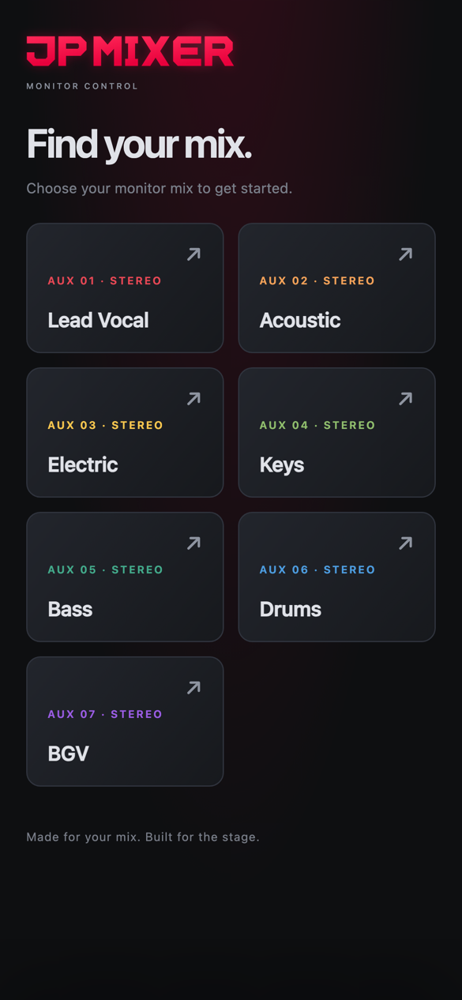&nbsp;&nbsp;
  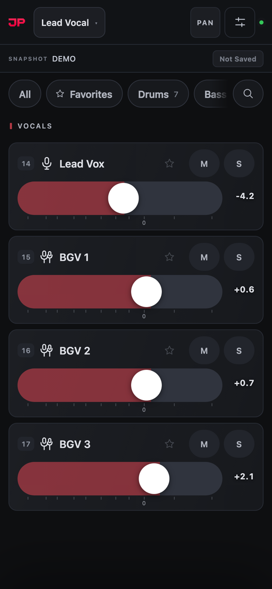&nbsp;&nbsp;
  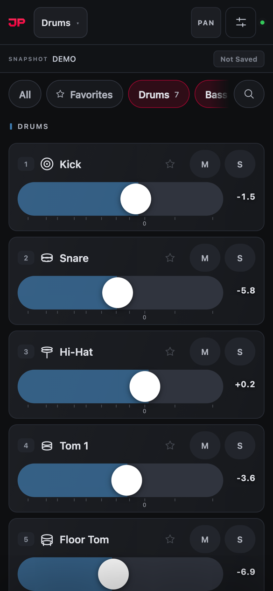
</p>

<p align="center">
  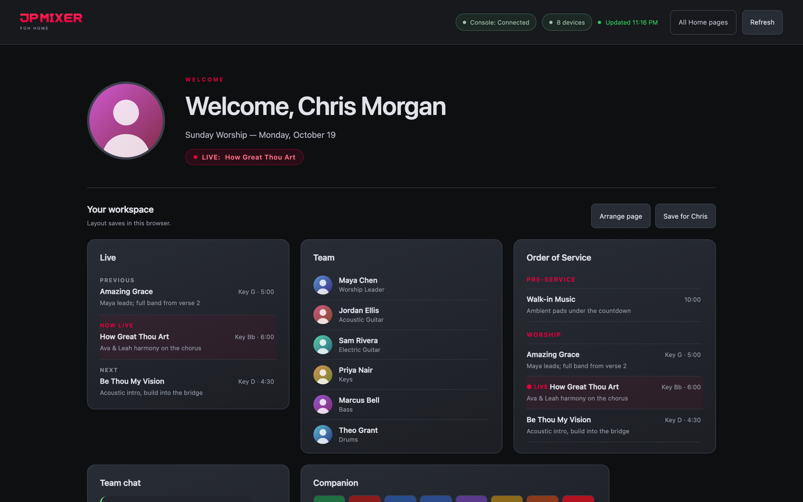
</p>

<p align="center"><sub>Screens shown with JPMixer's demo console and a sample schedule. Every name is fictional and every avatar is an illustration.</sub></p>

---

<a id="new-in-2"></a>

## ✨ New in 2.0

| | |
|---|---|
| 🏠 **Production Home pages** | FOH, ProPresenter, Lighting and Switcher stations, each welcoming whoever is scheduled, with the live item, the team and the order of service. |
| 🎛️ **Companion buttons** | Every station gets its own live Bitfocus Companion button surface. Tap to press, hold to hold. |
| 💬 **Team chat** | Live messages between all four production stations. |
| 🎚️ **Channel processing** | Gain, 48V, filters, a draggable 4-band EQ, compressor and gate, from a browser (DiGiCo). |
| 📱 **Phone-first mixer** | Group chips, tucked-away search, and mixes that open to each performer's groups. |
| 🎨 **Your branding** | Your logo and accent colour on every page JPMixer serves. |
| 🔄 **In-app updates** | Downloads from GitHub, verifies the checksum, installs and reopens. |
| 🛡️ **Stronger connections** | Detects a console dropping off, finds a console that moved, and restores phone mutes when it's back. |

See the [2.0 release notes](https://github.com/JPMixing-inc/jpmixer/releases/tag/v2.0.0) for the full list.

---

<a id="features"></a>

## 🎯 Features

### For musicians
- **Their own mix, from their own phone:** levels, mute, solo and pan for their aux only, in any browser on the network. It installs as a full-screen app on iPhone and iPad.
- **Group chips:** show just Drums, Vocals or any group in one tap. Each mix can open to the groups that performer uses.
- **My Mixes:** personal saved mixes, backed up on JPMixer's side and recoverable on a new phone with **Find My Mixes**.
- **Ear Scenes:** a mix saved per snapshot that recalls automatically when the console changes snapshot, then locks the faders against bumps. It can be hidden from performers.
- **Built-in aux EQ:** an optional 8-band EQ per mix (DiGiCo).
- **Private mixes:** hide a mix from the picker and share it by direct link.

### For engineers
- **Monitor Engineer:** every aux mix at once, grouped, with ±0.5 dB mix trims, channel search, presence indicators and snapshot controls.
- **Console Controller:** inputs, control groups and aux outputs, plus a **channel processing panel** with gain, 48V, phase, delay, pan, inserts, filters, a 4-band EQ graph and dynamics (DiGiCo).
- **Devices on stage:** every connected phone and the mix it's on, arranged to match your stage.
- **iPad relay:** run the DiGiCo iPad app through JPMixer alongside the phones. Moved iPads are followed automatically.

### For the production team
- **Home pages for FOH, ProPresenter, Lighting and Switcher:** the scheduled person with their photo, the live service item (previous, now, next), the team and the order of service.
- **Production View Select:** one link for the whole team, showing who's on at each station.
- **Arrange and save:** drag and resize cards, and **save a layout per person**. It follows them to any device and any station.
- **Team chat and Companion buttons** on every station. FOH Home can sit behind an **access code**.
- **Green Room display:** the upcoming team with photos and roles, for a TV or iPad.

### Planning Center, Companion & more
- **Planning Center:** rename aux mixes from the schedule ("Acoustic Guitar - John Smith"), drive the Green Room and Home pages, and assign phones by performer.
- **Bitfocus Companion:** a Satellite surface per station, plus a token-protected **Control API** for Companion, Stream Deck and HTTP tools.
- **Branding:** your logo and accent colour on every served page.
- **Backups:** automatic and manual, with a one-screen restore that lets you choose what to bring back and rolls back on any failure.
- **Menu bar app:** a green or red status dot, one menu for every view, keep awake, open at login, and **in-app updates**.
- **Demo mode** to explore everything without a console.

---

<a id="screenshots"></a>

## 📸 A look inside

<table>
<tr>
<td align="center" width="50%">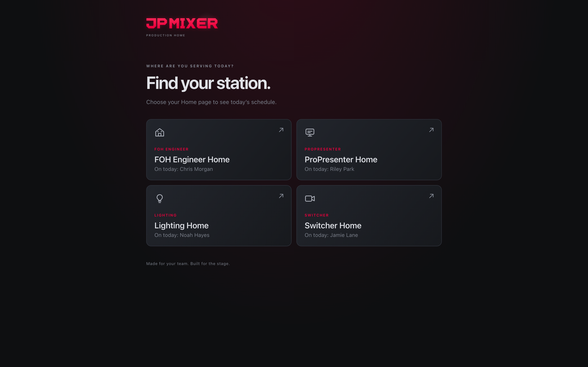<br/><sub><b>Production View Select</b>: every station, with who's on today</sub></td>
<td align="center" width="50%">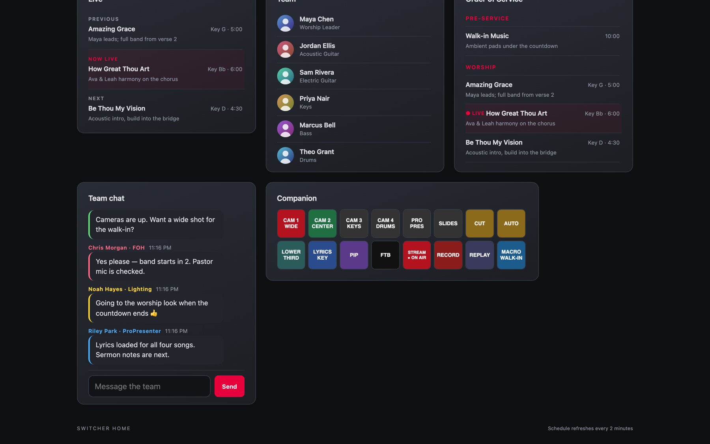<br/><sub><b>Team chat</b> and <b>live Companion buttons</b></sub></td>
</tr>
<tr>
<td align="center">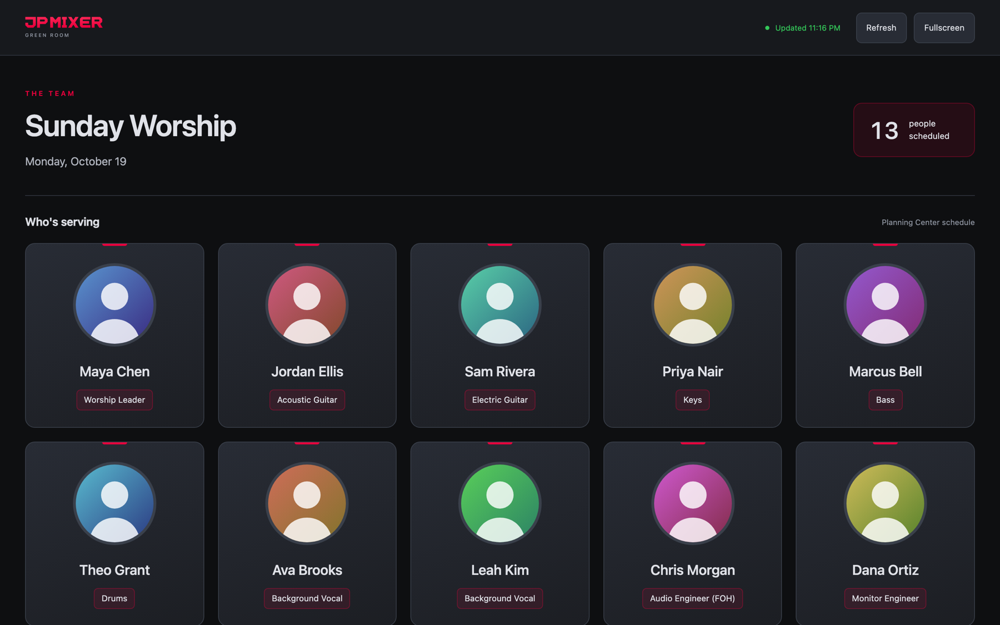<br/><sub><b>Green Room</b> display</sub></td>
<td align="center">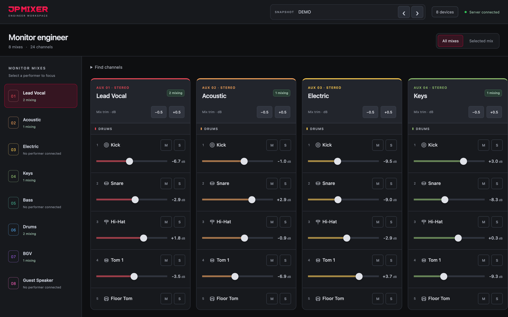<br/><sub><b>Monitor Engineer</b>: every mix, grouped</sub></td>
</tr>
<tr>
<td align="center">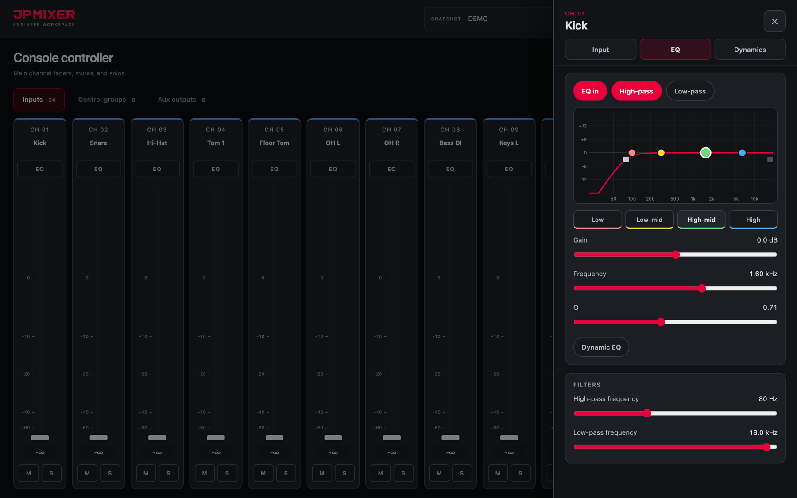<br/><sub><b>Channel processing</b>: EQ graph, filters, dynamics</sub></td>
<td align="center">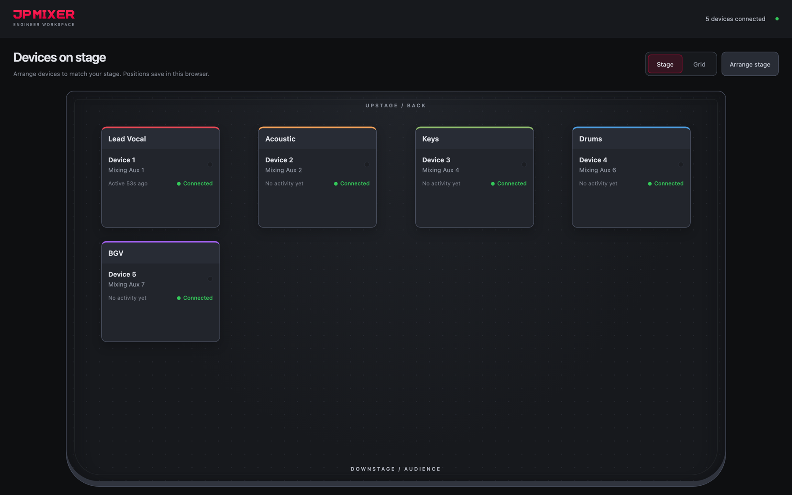<br/><sub><b>Devices on stage</b></sub></td>
</tr>
</table>

<details>
<summary><b>More: Console Controller and Settings</b></summary>
<br/>
<table>
<tr>
<td align="center" width="50%">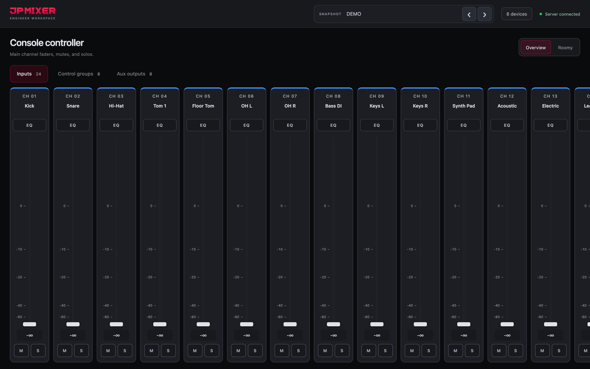<br/><sub><b>Console Controller</b></sub></td>
<td align="center" width="50%">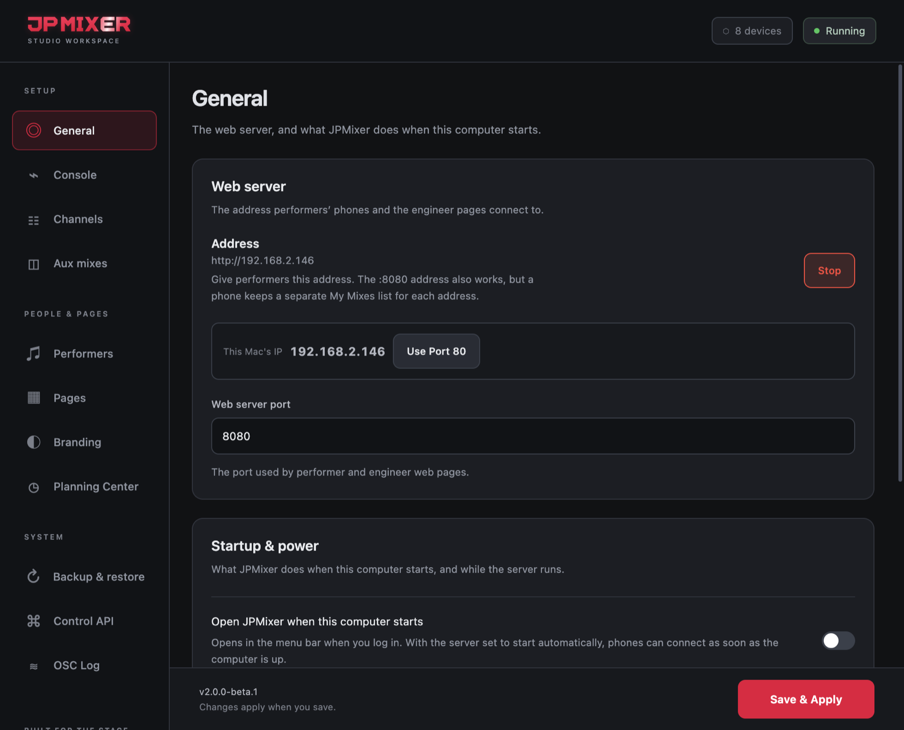<br/><sub><b>Settings</b>: General</sub></td>
</tr>
<tr>
<td align="center">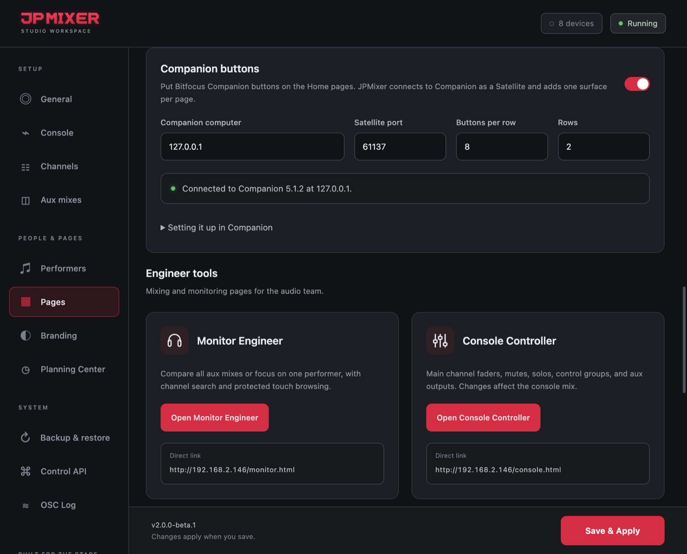<br/><sub><b>Pages</b> and Companion buttons</sub></td>
<td align="center">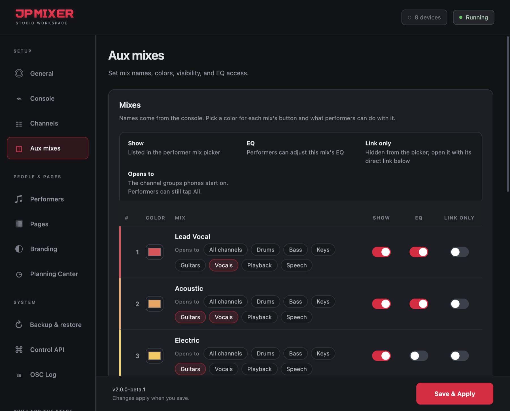<br/><sub><b>Aux mixes</b> with "Opens to" groups</sub></td>
</tr>
<tr>
<td align="center">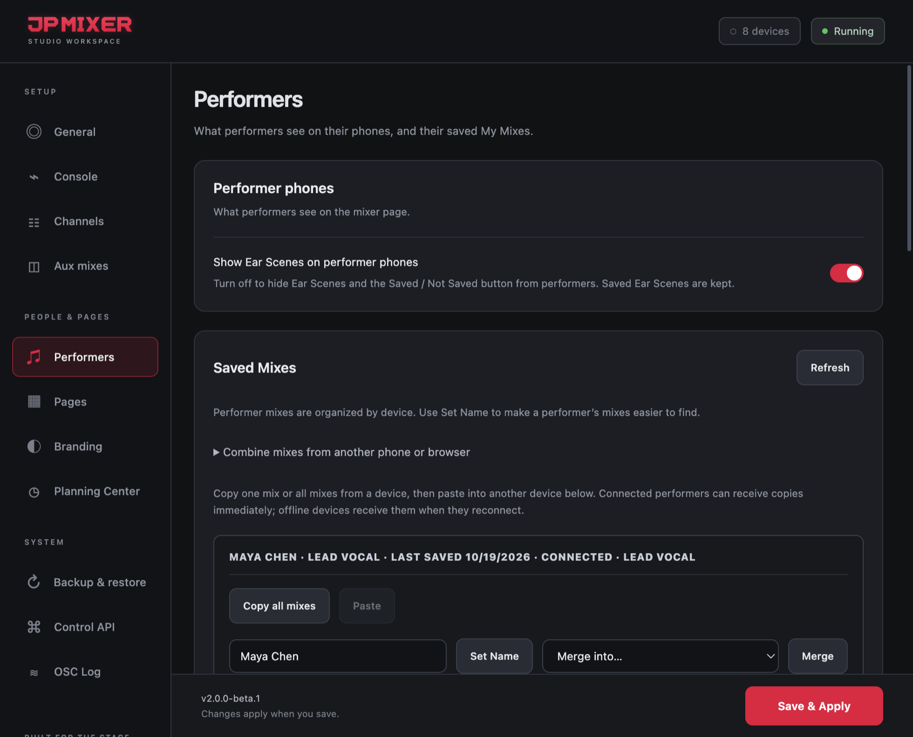<br/><sub><b>Performers</b> and saved My Mixes</sub></td>
<td align="center">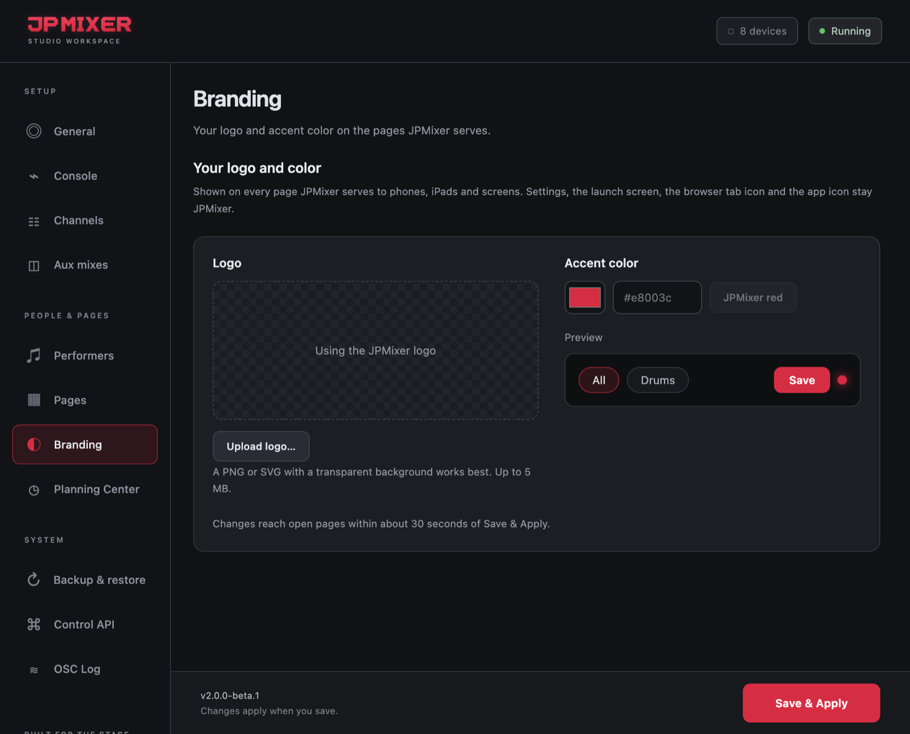<br/><sub><b>Branding</b></sub></td>
</tr>
</table>
</details>

---

<a id="download"></a>

## ⬇️ Download

Get the latest version from the [**Releases page**](https://github.com/JPMixing-inc/jpmixer/releases/latest):

| Platform | File |
|---|---|
| **macOS**, Apple Silicon and Intel | `JPMixer-<version>.dmg` (one universal app) |
| **Windows** 10 / 11 | `JPMixer.Setup.<version>.exe` |

From 2.0 on, **Check for Updates** in the menu bar installs new versions for you.

**Mac, first launch:** if macOS says the app is "damaged and can't be opened", run this once after copying it to Applications, then allow JPMixer on the local network when asked:
```
sudo xattr -rd com.apple.quarantine /Applications/JPMixer.app
```

**Windows, first launch:** choose **More info → Run anyway** on the SmartScreen prompt, and allow the firewall dialog so musicians on the network can reach the mixer page.

---

<a id="consoles"></a>

## 🎛️ Console support

| | DiGiCo<br/><sub>SD / Quantum / S</sub> | Allen & Heath<br/>dLive | KLANG<br/><sub>paired with dLive</sub> | Behringer<br/>WING |
|---|:---:|:---:|:---:|:---:|
| **Connection** | OSC (DiGiCo Pad) | MIDI over TCP/IP | OSC to the KLANG processor | OSC, UDP 2223 |
| **Levels, mute & solo** | ✅ | ✅ | ✅ KLANG's own mix | ✅ real per-send mute |
| **Per-send pan** | ✅ | — not in the protocol | ✅ stereo-mode azimuth | ✅ scale unconfirmed¹ |
| **My Mixes & Devices** | ✅ | ✅ | ✅ | ✅ |
| **Ear Scenes** | ✅ | ✅ | ✅ | — no scene recall in OSC |
| **Built-in aux EQ** | ✅ | — | — | — |
| **Console Controller & channel processing** | ✅ | — | — | — |
| **Status** | Stable | Not yet validated on hardware | Not yet validated on hardware | Not yet validated on hardware |

<sub>¹ See [WING Setup](#wing-setup).</sub>

Each console runs as its own backend; choosing one never touches another's connection. Every page works the same whichever console is active.

---

<a id="quick-start"></a>

## 🚀 Quick start

1. **Open JPMixer.** It lives in the menu bar (Mac) or system tray (Windows). The dot on the icon turns green once the console is connected.
2. **Settings → Console:** pick your console and enter its address. DiGiCo uses OSC send `8000` and listen `8001` by default. See the [setup guides](#setup-guides) for dLive, KLANG and WING.
3. **Settings → Channels:** name channels, pick icons and make groups.
4. **Settings → Aux mixes:** name and colour each mix, and choose what each opens to on performers' phones.
5. **Save & Apply.** Then share the address shown on the **General** tab (for example `http://192.168.1.10`) with your musicians.
6. **Optional:** connect Planning Center, set up the Home pages on the **Pages** tab, and add Companion buttons.

No console handy? Turn on **Demo mode** (Settings → General) to explore everything with a simulated console.

---

<a id="setup-guides"></a>

## 📚 Setup guides

<details>
<summary><b>🏠 Production Home pages — click to expand</b></summary>

### Production Home pages

Each station gets its own page to open on that station's screen:

| Page | Address |
|---|---|
| Production View Select | `http://<this computer's IP>/home.html` |
| FOH Home | `/foh.html` |
| ProPresenter Home | `/propresenter.html` |
| Lighting Home | `/lighting.html` |
| Switcher Home | `/switcher.html` |
| Green Room | `/greenroom.html` |

**Setup:**
1. Connect Planning Center first (see [Planning Center Services](#planning-center-services)).
2. Open **Settings → Pages**. Under each Home page, choose the **Team** and **Role** it welcomes, for example Production → Audio Engineer (FOH).
3. Optionally set an **Access code** for FOH Home. Other devices enter it once; the JPMixer computer never needs it, and changing it signs every device out.

**On the page:**
- **Arrange page** lets you drag, resize and hide cards.
- **Save for <name>** keeps that layout for the scheduled person, on any device. It loads automatically the next time they serve. A station they've never saved starts from their layout on another station.
- **Team chat** connects all four stations, and the **Companion** card shows that station's buttons (see below).

**Good to know:** only FOH Home can have a code. Anyone on the same network who opens another Home page can see it, chat and press its Companion buttons, so keep production Wi-Fi separate from guest Wi-Fi.

</details>

<details>
<summary><b>🎛️ Companion buttons — click to expand</b></summary>

### Companion buttons

JPMixer connects to **Bitfocus Companion** as a Satellite client and adds one button surface per Home page: **JPMixer FOH Home**, **JPMixer ProPresenter Home**, **JPMixer Lighting Home** and **JPMixer Switcher Home**.

1. In Companion, make sure Satellite connections are allowed (TCP port **16622** by default).
2. In JPMixer, open **Settings → Pages → Companion buttons**, turn it on, enter the Companion computer's address (`127.0.0.1` if it's the same computer), and choose a grid (default 8 × 4). Click **Save & Apply**. The status line should say **Connected**.
3. In Companion → **Surfaces**, give each JPMixer surface the page of buttons that station needs.

**On the Home pages,** the Companion card shows those buttons live, with Companion's own images and colours. Tap to press, hold to hold. Works with Companion 3.0 and newer; Companion 5 sends sharper images. JPMixer reconnects on its own if Companion restarts. FOH's buttons sit behind the FOH access code.

</details>

<details>
<summary><b>📖 dLive Setup — click to expand</b></summary>

### dLive Setup

Applies to both the **Allen & Heath dLive** and **KLANG (paired with dLive)** console types — they share the same console-side connection. New this cycle and unvalidated on real hardware.

**On the console, before opening JPMixer:**

1. Go to **Utility → Control → MIDI** and turn **MIDI/TCP On**. Nothing can connect until this is enabled — the same way DiGiCo needs DiGiCo Pad turned on.
2. Note the **Base MIDI Channel** shown there (**0–11**, i.e. MIDI channel 1–12). It must match exactly in JPMixer's Settings. This is a protocol addressing offset, *not* your channel/aux count.
3. If **Secure Mode** is on for MIDI/TCP, note its username/password — you'll need them if you enable TLS in JPMixer.
4. Confirm firmware is **V1.91 or later** (this integration targets **V2.0**).

**In JPMixer's Settings (Console tab):**

- **Console Type** → dLive, or KLANG if you're also running a KLANG processor.
- **Console IP Address** → the dLive **MixRack's** IP, not the Surface's. (Optional in KLANG mode — see [KLANG Setup](#klang-setup).)
- **Base MIDI Channel** → must match the console exactly.
- **Use TLS/SSL** → only if Secure Mode is on; fill in the username/password fields that appear.
- **MIDI/TCP Port Override** → leave at `0` for the default (51325, or 51327 with TLS). Try `51328` if nothing responds — an alternate port some third-party tools use; not fully settled which is correct without real hardware to confirm.
- **Listen for live send-level updates** / **Poll send levels as a backup** → both on by default. It's unconfirmed whether the console pushes live aux-send updates the way it's documented to for faders/mutes; polling is the safety net. Turn polling off once you've confirmed live updates work, to cut console traffic.

**Connection model:** unlike DiGiCo Pad (one connection at a time), dLive's MixRack supports up to **40 simultaneous connections** — Surface, IP6/IP8/IP1/IP4 remotes, Director, MixPad/OneMix/4You, and third-party tools all at once. JPMixer just takes one of those 40 slots.

**What works today:** aux send levels, mute/solo (emulated), Ear Scene recall, My Mixes, Devices View. **Not implemented:** per-send pan (not exposed by the protocol), built-in aux EQ, Console Controller.

**Troubleshooting:**
- *"Not connected"* — recheck MIDI/TCP is On, the IP is the MixRack's, and the Base MIDI Channel matches.
- *Connects but nothing responds* — try port `51328`.
- *Levels seem stale* — confirm "Poll send levels as a backup" is on.
- Aux send levels are the single most load-bearing message type here — the first thing worth confirming works.

</details>

<details>
<summary><b>🎧 KLANG Setup — click to expand</b></summary>

### KLANG Setup

This is the part that actually carries musician mix control in KLANG mode — the dLive connection ([dLive Setup](#dlive-setup)) is only for optional channel-name sync and Ear Scene snapshot-following. Skipping this section is the most likely reason KLANG mode "connects" but nobody hears anything change.

**Before anything else — audio routing.** KLANG needs its own dedicated multitrack audio feed (MADI, Dante, or analog) patched directly from the console to the KLANG processor. That's a physical decision made at the console/patchbay, entirely outside JPMixer — the app only ever sends control messages, never audio.

1. **Find the KLANG processor's IP** — check **KLANG:app → CONFIG → CONNECT**, or the unit's own network info. No DHCP on that network means it defaults to a link-local `169.254.x.y` address; assign it a fixed IP for a stable setup.
2. Enter that IP in JPMixer's **KLANG Processor IP Address** field. Leave **KLANG Port Override** at `0` (default 9110).
3. **Match channel numbers** — JPMixer's channel *N* must line up with the same input channel *N* under **KLANG:app → CONFIG → CHANNELS → INPUT**.
4. **Match mix numbers** — JPMixer's aux *N* is KLANG's **MIX *N*** (USER1–USER8 on the analog outputs).
5. **Set each mix to Stereo mode in KLANG:app** — JPMixer's pan only works in KLANG's stereo placement mode (-90°/0°/+90°); in 3D/i3D mode azimuth means a full spatial position instead. JPMixer never sets this itself.

**Troubleshooting:**
- *dLive connected but KLANG silent* — check the KLANG IP separately; the two connections are independent.
- *Levels move but nothing's audible* — almost always the audio routing step above.
- *Pan does nothing* — confirm Stereo mode in KLANG:app.
- *No way to confirm it's working from JPMixer alone* — KLANG's protocol has no read-back (see [Console Support](#console-support)), so JPMixer trusts its own last-sent value. Watching KLANG:app on another device is the most reliable way to confirm control end to end.

</details>

<details>
<summary><b>🅱️ WING Setup — click to expand</b></summary>

### WING Setup

Behringer WING is self-contained — unlike KLANG, there's no secondary console connection to configure, and unlike DiGiCo/dLive, there's no documented console-side toggle to switch on first. WING's OSC server listens on UDP port 2223 by default.

**In JPMixer's Settings (Console tab):**

- **Console Type** → Behringer WING.
- **Console IP Address** → the WING console's own IP. Same field DiGiCo/dLive use — WING needs nothing else.
- **WING Port Override** → leave at `0` for the documented default (`2223`).

Unlike dLive/KLANG, WING confirms it's actually reachable with a real round-trip request on connect, not just "did the local network socket open" — the Console status pill in Settings reflects that directly.

**What works today:** aux send levels, a real per-send mute (WING's own on/off flag, not a level trick), real per-send pan, My Mixes, Devices View. **Not implemented:** built-in aux EQ, Console Controller, and Ear Scenes — WING's OSC layer doesn't expose scene/snapshot recall at all, so there's nothing to hook Ear Scenes into.

**⚠️ Pan scale is unconfirmed.** WING's own OSC documentation shows the per-send pan parameter exists and defaults to `0`, but never documents its actual valid range or units — there's no worked example for it the way there is for fader level. JPMixer currently sends pan as degrees (-90 full left to +90 full right), the same convention KLANG documents, but WING may use a different scale internally. Test pan carefully the first time you connect to real WING hardware — if it doesn't reach full left/right, or reads as if reversed, that's the value scale, not a wiring problem.

**Troubleshooting:**
- *"Not connected"* — recheck the IP address and that the console is powered on and reachable on the network JPMixer is running on.
- *Levels work but mute doesn't* — confirm Console Type is set to "Behringer WING".
- *Pan seems clipped or reversed* — see the pan scale note above.
- *No Ear Scenes tab behavior* — expected; WING has no scene recall to hook into.

</details>

<details>
<summary><b>🔌 External Control API — click to expand</b></summary>

### External Control API

A token-gated HTTP API for external tools — Bitfocus Companion, Elgato Stream Deck, a Planning Center Services connector, or anything that can make an HTTP request. It runs as a separate, always-on server, completely independent of whichever console backend is active: enabling/disabling it, or regenerating its token, never restarts or interrupts the console connection, and vice versa.

**Setup:** Settings → **Control API** tab → **Enable Control API** → **Regenerate** to create a token. Anyone with that token can rename channels, mute mixes, and fire snapshots — treat it like a password.

**Auth:** send the token as `Authorization: Bearer <token>`, or as a `?token=` query parameter if your tool can't set custom headers (covers most Stream Deck HTTP actions and Companion's generic HTTP module).

**Endpoints** (all under `http://<this Mac's IP>:<port>/api/v1/`, port `9096` by default):

| Method & path | Body | What it does |
|---|---|---|
| `GET /status` | — | Connection state, console type, channel/aux counts |
| `GET /channels` / `GET /auxes` | — | Current label overrides |
| `POST /channels/:n/label` | `{"label": "..."}` | Rename channel *n* — live, no restart |
| `POST /auxes/:n/label` | `{"label": "..."}` | Rename aux *n* — live, no restart |
| `POST /auxes/:n/mute` | `{"channel": N, "muted": true}` | Mute/unmute one channel's send into aux *n* |
| `POST /auxes/:n/solo` | `{"channel": N, "soloed": true}` | Solo/unsolo one channel within aux *n* |
| `POST /scenes/fire` | `{"action": "next"}` or `"prev"` | Relative snapshot navigation — same as the mixer UI's own prev/next |

A relabel takes effect immediately on every connected musician's/monitor engineer's screen with no reconnect needed — this is what makes the Planning Center use case work: name aux mixes after who's actually playing them for a given service, without touching the console connection at all.

**Not implemented:** recalling a specific snapshot by name/number directly (only relative prev/next exists today, matching the mixer UI's own capability). If the console backend isn't currently running, endpoints other than `/status` return `503` rather than erroring.

</details>

<details>
<summary><b>📅 Planning Center Services — click to expand</b></summary>

### Planning Center Services

Pulls who's scheduled on the current or next service and renames the matching aux mixes for you — "Acoustic Guitar - John Smith" instead of just "AUX 3". Runs entirely inside JPMixer (Settings → **Planning Center** tab) — no separate tool.

**Auto-sync on launch:** once set up, JPMixer re-applies your saved position mapping automatically every time the console connection starts — on app launch (with Start server automatically on), and on every manual Start Server too. You never have to open Settings or click Sync Now for it to stay current; it's there if you want to force a re-check (e.g. right before a service, if PCO's schedule changed since launch) or see a summary of what got applied. Settings itself also auto-selects your saved Service Type and Team the moment you open the Planning Center tab, with no Refresh clicks needed.

**Setup:**
1. Generate a Personal Access Token at `api.planningcenteronline.com/personal_access_tokens` — the App ID and Secret it gives you go in the Application ID / Secret fields. Stored the same way JPMixer already stores your console password: locally, in plain text, in JPMixer's own config file. This is a credential to your Planning Center account specifically, so treat it accordingly.
2. **Refresh Service Types**, then pick the one you run services under.
3. **Refresh Teams**, then optionally pick one (e.g. "Worship") to narrow the Position mapping list below, and — once saved with **Save & Apply** — the Green Room display too. Leave it on "— All Teams —" to see everything. Either way, this never changes what Sync Now applies — every saved position mapping still fires regardless of which team is selected here.
4. **Refresh Positions** — lists every Team Position under the selected Team (or all of them), each with a dropdown to map it to one of your JPMixer aux mixes ("— unmapped —" by default). Switching the Team dropdown afterward just re-filters this same list instantly — no new fetch needed. This mapping is saved with **Save & Apply**, the same as everything else in Settings.
5. That's it — this mapping now auto-applies every time the console connects (see above). **Sync Now** is there for a manual re-check any time. Either way, it finds the plan closest to right now for your Service Type — currently running or next upcoming, not just "soonest future" — pulls who's scheduled, and relabels every aux with a mapped position live, with no console restart, the same mechanism the [External Control API](#external-control-api) uses.

**What it does and doesn't do:** only confirmed team members are included by default ("Include unconfirmed team members" changes that); anyone scheduled to a position you haven't mapped is skipped and listed as a warning after syncing, rather than silently doing nothing; it only ever reads from Planning Center, never writes back to it.

**Green Room display** — open `http://<this Mac's IP>:<server port>/greenroom.html` on an iPad, TV, or any browser on the network (e.g. a computer set up in front of the green room mics) for a full-screen, read-only grid of everyone scheduled for the next service — photo, name, and role. No token needed, unlike the Control API — it's informational, not a control surface. Auto-refreshes every 2 minutes, so it can just be left open. Uses the same Service Type and "Include unconfirmed" setting configured above; if a **Team** is selected and saved (e.g. "Worship"), only that team shows here — leave it on "— All Teams —" to keep showing everyone scheduled, the default. Each row in the Position → Aux Mapping table also has a **Hide from Green Room** checkbox for excluding individual positions regardless of team.

**Displays only:** turn off **Rename aux channels when syncing** (Sync aux names) to use Planning Center just for the Green Room and Home pages, without ever renaming an aux.

**Phones by performer** (optional): turn on **Assign phones by Planning Center performer**. Performers pick their name once; their phone opens their mapped mix, and their My Mixes follow their Planning Center identity to a new device.

**Who each Home page welcomes** is set per page on the **Pages** tab — see [Production Home pages](#production-home-pages).

**Multiple same-day services (e.g. Saturday 5pm/7pm, Sunday 9am/11am):** handled automatically. JPMixer always picks whichever plan is closest to right now — currently running or next up — rather than just the soonest future one, so it doesn't jump ahead to the 7pm plan the moment 5pm starts. The switch happens right at the midpoint between two services, not at either one's start time.

**Multiple teams (Worship, Production, etc.):** fully supported. Refresh Positions and Sync Now both follow Planning Center's pagination, so every team's positions and everyone scheduled show up regardless of how many teams a Service Type has — earlier versions only read the first page and could silently cut off a team. The **Team** dropdown lets you narrow the Position → Aux Mapping table to just one team (e.g. Worship only, hiding Production/Host positions) instead of scrolling through everyone at once — applied instantly against the already-fetched list, no new fetch needed when switching teams. Once saved, it also narrows the Green Room display to that same team.

**Note on API details:** Planning Center's endpoint/field names here are based on their stable, documented schema, but weren't independently re-verified against a live response line-by-line (their interactive API explorer is a JS app, not a static doc). If Refresh Service Types or Sync Now ever shows an error with a raw status code and response body instead of working normally, that's most likely a real mismatch worth reporting.

</details>


<details>
<summary><b>🎨 Branding — click to expand</b></summary>

### Branding

**Settings → Branding:**
- **Upload logo…** (PNG, JPG, WebP, GIF or SVG, up to 5 MB). It replaces the JPMixer logo on every page JPMixer serves: performer mixer, monitor, console, devices, Home pages and Green Room. A transparent background, tightly cropped, looks best.
- **Accent colour:** type a hex value, or click your logo to sample one. A preview and a readability warning help you choose.
- **Save & Apply.** Open pages pick it up within about 30 seconds.

Settings, the launch screen, the browser tab icon and the app icon always stay JPMixer.

</details>

<details>
<summary><b>💾 Backups, restore & updates — click to expand</b></summary>

### Backups, restore & updates

- **Automatic backups** (Settings → Backup & restore) save settings, saved mixes, Ear Scenes and Home page layouts on a schedule, always keeping the newest five.
- **Export Backup** saves everything to a file. Leave **Include passwords and keys** off for a copy you'll share; restoring it keeps the credentials already on that computer.
- **Load Backup** reads full backups, My Mixes backups, and extracted JSON or ZIP files. It shows what's inside, lets you pick what to restore, makes a safety backup first, and rolls everything back if anything fails.
- **Updates:** **Check for Updates** (menu bar) downloads the new version from GitHub, checks it against GitHub's published SHA-256 checksum and the app's identity, installs it and reopens JPMixer. If anything fails, nothing changes.

</details>

---

## ⚙️ How it works

JPMixer runs a web server and a WebSocket bridge inside an Electron app.

- **A musician's fader move** goes to JPMixer over WebSocket, which sends it to the console and shows it on every other screen. The console link is OSC/UDP for DiGiCo, MIDI/TCP for dLive, OSC/UDP to a KLANG processor, or OSC/UDP for WING.
- **Mute and solo** on DiGiCo and dLive work by driving the send to −∞ and restoring it afterwards. KLANG and WING have a real per-send mute.
- **Kind to the console:** background queries to a DiGiCo are paced at one every 100 ms. A performer's own moves, mutes and solos go out immediately.
- **Locked down:** a phone can only touch its own mix's sends and EQ. A server-side allowlist blocks everything else.
- **Ear Scenes** are keyed by snapshot name (DiGiCo) or scene number (dLive, KLANG). **My Mixes** are permanent and backed up per device.

---

## 🧱 Built with

[Electron](https://www.electronjs.org/) · [Express](https://expressjs.com/) · [ws](https://github.com/websockets/ws) · [osc.js](https://github.com/colinbdclark/osc.js/) · [yauzl](https://github.com/thejoshwolfe/yauzl)

---

<p align="center"><sub>JPMixer is not affiliated with DiGiCo, Allen &amp; Heath, KLANG:technologies, Behringer/MUSIC Tribe, Bitfocus or Planning Center. DiGiCo is a trademark of DiGiCo UK Ltd. dLive is a trademark of Allen &amp; Heath Limited. KLANG is a trademark of KLANG:technologies GmbH. WING is a trademark of MUSIC Tribe Global Brands Ltd. Planning Center is a trademark of Ministry Centered Technologies.</sub></p>
