<p align="center">
  <picture>
    <source media="(prefers-color-scheme: dark)" srcset="assets/brand/jpmixer-logo-dark.gif" />
    
  </picture>
</p>

<h3 align="center">Personal monitor mixes for every musician, and a home page for every production station.</h3>

<p align="center">
  <a href="https://github.com/JPMixing-inc/jpmixer/releases/latest"></a>
  <a href="https://jpmixing.com"></a>
  <a href="docs/MANUAL.md"></a>
  <a href="docs/MUSICIAN-GUIDE.md"></a>
  
  
</p>

<p align="center">
  <a href="https://jpmixing.com"><b>🌐 jpmixing.com</b></a> &nbsp;·&nbsp;
  <a href="#download"><b>⬇️ Download</b></a> &nbsp;·&nbsp;
  <a href="docs/MANUAL.md"><b>📖 User Manual</b></a> &nbsp;·&nbsp;
  <a href="docs/MUSICIAN-GUIDE.md"><b>🎧 Musician Guide</b></a> &nbsp;·&nbsp;
  <a href="#new-in-2-0-13">What’s new</a> &nbsp;·&nbsp;
  <a href="#quick-start">Quick start</a> &nbsp;·&nbsp;
  <a href="#features">Features</a> &nbsp;·&nbsp;
  <a href="#consoles">Consoles</a> &nbsp;·&nbsp;
  <a href="#documentation">All docs</a>
</p>

---

**JPMixer** is a Mac and Windows app that turns any phone, tablet or laptop on your network into a monitor mixer. Musicians open a web page and control **their own** in-ear or wedge mix, with no app to install and without touching the front-of-house console. JPMixer also gives the whole production team a home: FOH, ProPresenter, Lighting and Switcher stations, each welcoming whoever Planning Center has scheduled, with team chat and live Companion buttons.

<p align="center">
  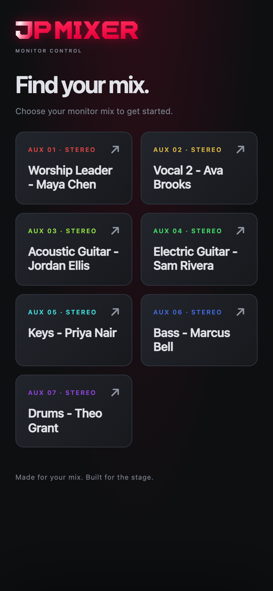&nbsp;&nbsp;
  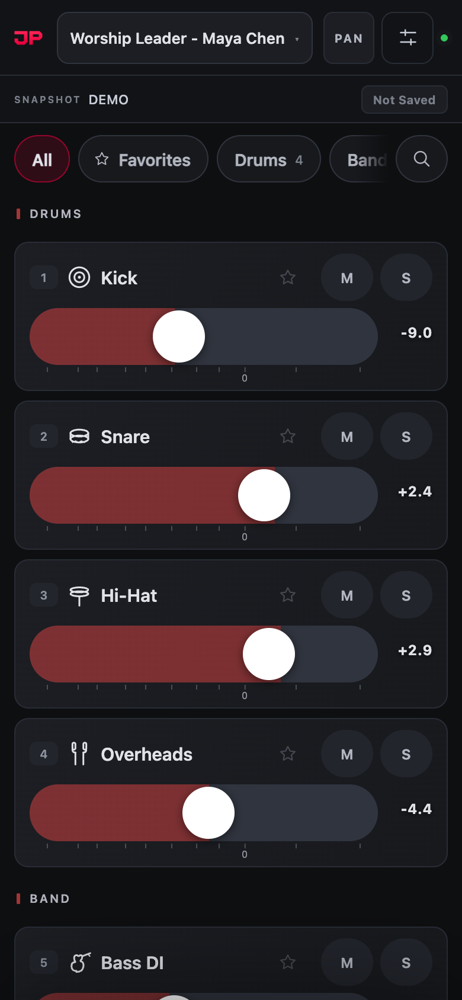&nbsp;&nbsp;
  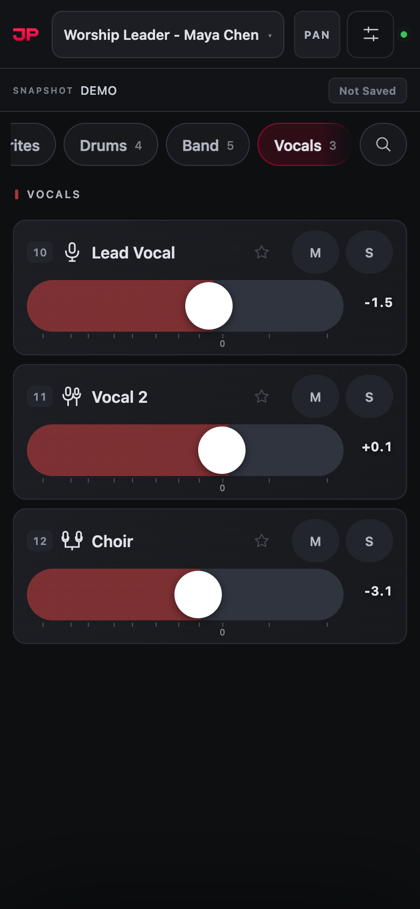
</p>

<p align="center">
  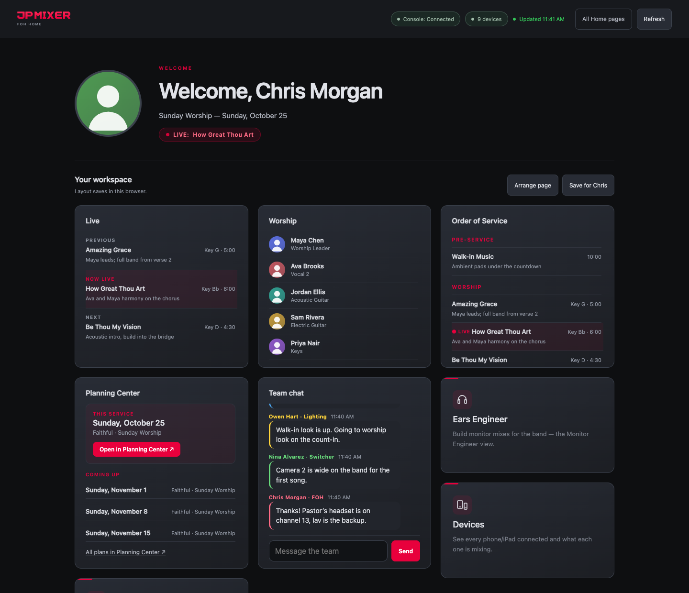
</p>

<p align="center"><sub>Screens shown with JPMixer’s demo console and a sample schedule. Every name is fictional and every avatar is an illustration.</sub></p>

> [!TIP]
> **New to JPMixer?** The **[User Manual](docs/MANUAL.md)** walks through everything with screenshots: [installing](docs/MANUAL.md#2-install-and-first-launch), [connecting your console](docs/MANUAL.md#4-connecting-your-console), [Planning Center](docs/MANUAL.md#10-planning-center), the [Home pages](docs/MANUAL.md#11-production-home-pages) and [troubleshooting](docs/MANUAL.md#18-troubleshooting).
>
> **Musicians and singers:** the **[Musician Guide](docs/MUSICIAN-GUIDE.md)** is a short, phone-friendly walkthrough of the mix screen. Send it to your band.

---

<a id="documentation"></a>

## 📖 Documentation

| Guide | What’s in it |
|---|---|
| **[User Manual](docs/MANUAL.md)** | The whole app, chapter by chapter, with screenshots. Start here. |
| **[Musician Guide](docs/MUSICIAN-GUIDE.md)** | For the band: the phone screen, part by part, and how to mix, save and recall your own mix. Short and phone-friendly. |
| [Musician Guide, designed copy](docs/musician/index.html) | The same guide as a web page made for phones. |
| [User Manual, designed copy](docs/manual/index.html) | The same manual as a web page to read offline or print. Download the repository and open `docs/manual/index.html`. |
| [Release notes](https://github.com/JPMixing-inc/jpmixer/releases) | What changed in each version. |

**Jump to a chapter**

| Getting going | Setup | People & pages | System & reference |
|---|---|---|---|
| [What JPMixer does](docs/MANUAL.md#1-what-jpmixer-does) | [Connecting your console](docs/MANUAL.md#4-connecting-your-console) | [The performer’s phone](docs/MANUAL.md#7-the-performers-phone) | [General and Port 80](docs/MANUAL.md#14-general-and-port-80) |
| [Install and first launch](docs/MANUAL.md#2-install-and-first-launch) | [Channels and groups](docs/MANUAL.md#5-channels-and-groups) | [Ear Scenes and saved mixes](docs/MANUAL.md#8-ear-scenes-and-saved-mixes) | [Backup and restore](docs/MANUAL.md#15-backup-and-restore) |
| [Get started checklist](docs/MANUAL.md#3-get-started-checklist) | [Aux mixes](docs/MANUAL.md#6-aux-mixes) | [Engineer tools](docs/MANUAL.md#9-engineer-tools) | [Control API](docs/MANUAL.md#16-control-api) |
| | | [Planning Center](docs/MANUAL.md#10-planning-center) | [OSC Log](docs/MANUAL.md#17-osc-log) |
| | | [Production Home pages](docs/MANUAL.md#11-production-home-pages) | [Troubleshooting](docs/MANUAL.md#18-troubleshooting) |
| | | [Green Room display](docs/MANUAL.md#12-green-room-display) | [Addresses and ports](docs/MANUAL.md#appendix-a-addresses-and-ports) |
| | | [Branding](docs/MANUAL.md#13-branding) | [Console feature support](docs/MANUAL.md#appendix-b-console-feature-support) |

---

<a id="new-in-2-0-13"></a>

## 🆕 New in 2.0.13

| | |
|---|---|
| 🔌 **Patch** | A new plugin on the approved list: your stage boxes and console drawn to scale, on any phone or iPad. Tap a socket to name it and patch it to a channel or mix, see 48V at a glance, and print a patch sheet. Import a DiGiCo or LV1 session and every box comes in already named and patched, with its 48V. |
| 🎚️ **LV1 preamps** | On LV1, the Console Controller's GAIN button shows each channel's preamp live: Preamp or Local gain, the gain, 48V, phase and trim. |
| 🧩 **Plugin pages** | Plugins can now have a page of their own, opened from the Home pages list. Each page talks only to its own plugin. |

<details>
<summary><b>Earlier releases: 2.0.12, 2.0.11, 2.0.10, 2.0.9, 2.0.8, 2.0.7, 2.0.5 and 2.0</b></summary>

### 2.0.12
- **Updates within seconds**: the Home pages and the Green Room follow Planning Center within seconds, and Shure batteries update every few seconds.
- **One tap on Companion buttons** on iPads and phones.
- **Settings → Performance**: how hard JPMixer and the computer are working, in plain words.
- **Plugins**: add-ons from JPMixer's approved list, or your own, under Settings → Integrations → Plugins.

### 2.0.11
- **Weekend plans with two teams**: JPMixer switches to Sunday's team once Saturday's service is over.
- **Sunday under Coming up** on the Planning Center card.
- **Console names remembered** while the console is off, and kept in backups.

### 2.0.10
- **Shure wireless**: each mic's battery and transmitter on FOH Home, the musician's phone, Monitor Engineer and the Green Room.
- **Smaart SPL** on FOH Home and the Green Room.
- **Service timing**: a countdown to the service, and time left and a progress bar on the live item.
- **Green Room**: a QR code for the mix picker, and full screen on the first press of OK.
- **Settings → Integrations**, slimmer Home pages, and double-tap a fader for 0 dB.

### 2.0.9
- **Companion buttons on phones**: a scroll that starts on a button no longer presses it, and the card reconnects after the phone wakes up.

### 2.0.8
- **Green Room made for a TV**: fits a 16:9 screen, with a large clock, **Now / Up next** from Planning Center Live, and one card per person.
- **Companion buttons always fit** their card.
- **One Devices arrangement for everyone**, saved on the JPMixer computer.
- **Team chat starts fresh each service.**

### 2.0.7
- **User Manual** and **Musician Guide**.
- **Settings that walk you through setup** (Get started checklist), and **rename any mix**.
- **Planning Center keeps itself current** (10 seconds after opening, then every 5 minutes), plus an optional **second service**.
- **dLive Console Controller** and stereo mixes.

### 2.0.5
- **Waves eMotion LV1**: a fifth console, with levels, mute, solo, pan, live names, Ear Scenes and the Console Controller through LV1’s MyMon remote.
- **Planning Center card** on every Home page, and **free-form Home page layouts**.
- **Performer names that come off cleanly** when you turn them off.
- **Steadier Monitor Engineer faders** and plain-text update notes.

### 2.0
- **Production Home pages** for FOH, ProPresenter, Lighting and Switcher, with **Companion buttons** and **team chat**.
- **Channel processing** from a browser (DiGiCo), a **phone-first mixer** with group chips, **your branding**, **in-app updates** and stronger connections.

See the [release notes](https://github.com/JPMixing-inc/jpmixer/releases) for every change.
</details>

---

<a id="quick-start"></a>

## 🚀 Quick start

1. **[Download](#download) and open JPMixer.** It lives in the menu bar (Mac) or system tray (Windows). The dot on its icon turns green once the console is connected.
2. **Open Settings → Get started.** It shows the address for performers and a checklist of every step, each with a button that opens the right place.
3. **Settings → Console:** choose your console and enter its address. Names, mixes and control groups fill themselves in once it connects. ([Console setup](docs/MANUAL.md#4-connecting-your-console))
4. **Settings → Channels and Aux mixes:** make groups, pick icons and colors, and hide anything performers don’t need.
5. **Save & Apply,** then give performers the address from Get started, for example `http://192.168.1.20`.
6. **Optional:** connect [Planning Center](docs/MANUAL.md#10-planning-center), set up the [Home pages](docs/MANUAL.md#11-production-home-pages), and add [Companion buttons](docs/MANUAL.md#companion-buttons).

No console handy? Turn on **Demo mode** on the Console tab to explore everything with a simulated console.

---

<a id="download"></a>

## ⬇️ Download

Get the latest version from the [**Releases page**](https://github.com/JPMixing-inc/jpmixer/releases/latest):

| Platform | File |
|---|---|
| **macOS**, Apple silicon and Intel | `JPMixer-<version>.dmg` (one universal app) |
| **Windows** 10 / 11 | `JPMixer.Setup.<version>.exe` |

**Check for Updates** in the menu bar installs new versions for you.

**Mac, first launch:** if macOS says the app is "damaged and can't be opened", run this once after copying it to Applications, then allow JPMixer on the local network when asked:
```
sudo xattr -rd com.apple.quarantine /Applications/JPMixer.app
```

**Windows, first launch:** choose **More info → Run anyway** on the SmartScreen prompt, and allow the firewall dialog so musicians on the network can reach the mixer page.

---

<a id="features"></a>
<a id="screenshots"></a>

## 🎯 Features

**Jump to:** [For musicians](#for-musicians) · [For engineers](#for-engineers) · [For the production team](#for-the-production-team) · [Planning Center & setup](#planning-center-and-setup) · [And more](#and-more)

<a id="for-musicians"></a>

## 🎧 For musicians

### Their own mix, from their own phone

Musicians open a web address and pick their mix. No app to install. They set the level of every channel in their own in-ears or wedge, with **mute**, **solo** and **pan** that only touch their mix. On iPhone and iPad it can be added to the Home Screen as a full-screen app.

<p align="center">
  &nbsp;&nbsp;
  &nbsp;&nbsp;
  
</p>
<p align="center"><sub>Pick a mix · mute a channel · pan in a stereo mix</sub></p>

### Find any channel in a tap

**Group chips** show just Drums, Vocals or any group, and each mix can open straight to the groups that performer uses. **Favorites** keep the channels they adjust most one tap away, and **search** finds anything by name.

<p align="center">
  &nbsp;&nbsp;
  
</p>
<p align="center"><sub>One group at a time · search by name</sub></p>

### My Mixes and Ear Scenes

**My Mixes** are named mixes a performer can load any week. JPMixer keeps a copy, so **Find My Mixes** brings them back on a new phone. **Ear Scenes** save a mix for each song (each console snapshot) and bring it back when the console goes to that song, then lock the faders so they can't be bumped.

<p align="center">
  &nbsp;&nbsp;
  
</p>
<p align="center"><sub>Saved mixes · a mix locked to its Ear Scene</sub></p>

<a id="for-engineers"></a>

## 🎚️ For engineers

### Monitor Engineer

Every monitor mix side by side, grouped the same way as the phones. Trim a whole mix in ±0.5 dB steps, mute or solo anything in anyone's mix, find channels, see who's connected to each mix, and step through snapshots.

<p align="center">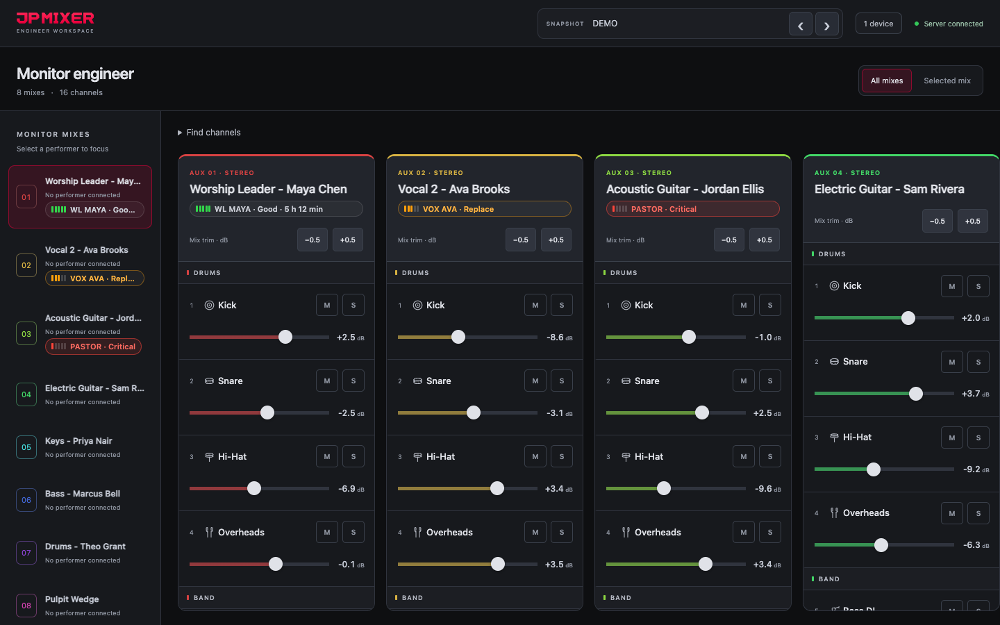</p>

### Console Controller and channel processing

The console's own faders, mutes and solos for inputs, control groups or DCAs, and aux outputs, from any browser (DiGiCo, dLive and LV1). On DiGiCo, each channel opens a **processing panel**: gain, 48V, filters, a draggable 4-band EQ and dynamics. On LV1, each channel shows its **preamp** as LV1 has it, live: Preamp or Local gain, the gain, 48V, phase and trim (read-only; change them on LV1).

<p align="center">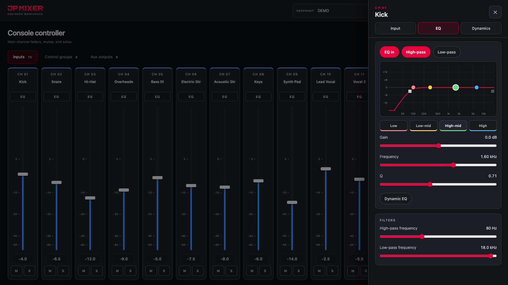</p>

### Devices on stage

Every connected phone and iPad, the mix it's on and its latest activity, placed on a map of your stage. The arrangement is saved on the JPMixer computer, so every screen shows the same stage.

<p align="center">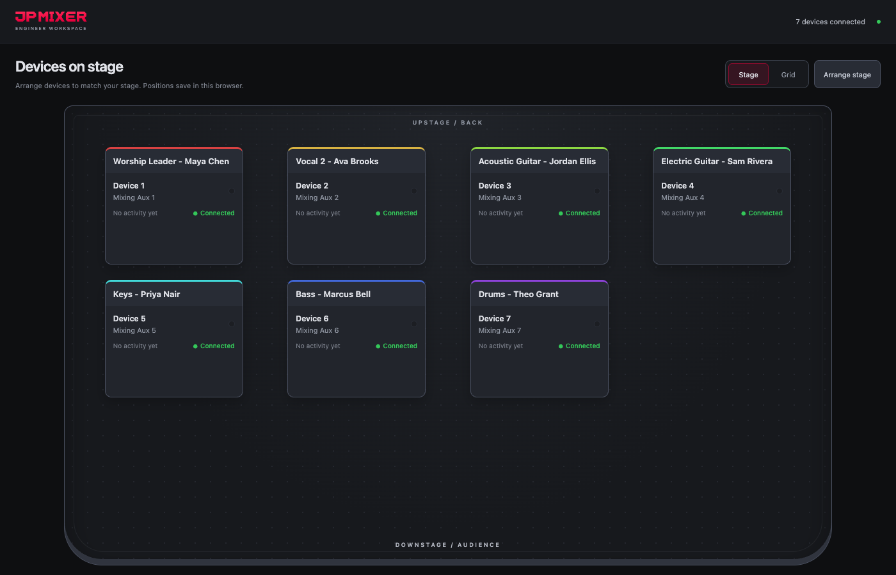</p>

<a id="for-the-production-team"></a>

## 🏠 For the production team

### A Home page for every station

FOH, ProPresenter, Lighting and Switcher each get a page that welcomes whoever Planning Center scheduled in that role, with the live service item, the team, the order of service and the next few plans. Arrange the cards and **save a layout per person**; it follows them to any device. FOH Home can sit behind an access code.

<p align="center"></p>

### One link for the whole team

**Production View Select** lists every station with who's on today. Each card opens that station's Home page.

<p align="center">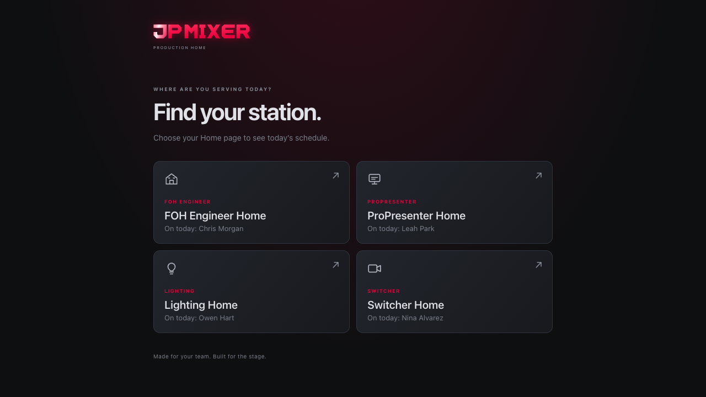</p>

### Team chat and Companion buttons

**Team chat** connects all four stations live and clears itself when the next service begins. **Bitfocus Companion** buttons appear on each station's page, live with Companion's own images. Tap to press, hold to hold.

<p align="center">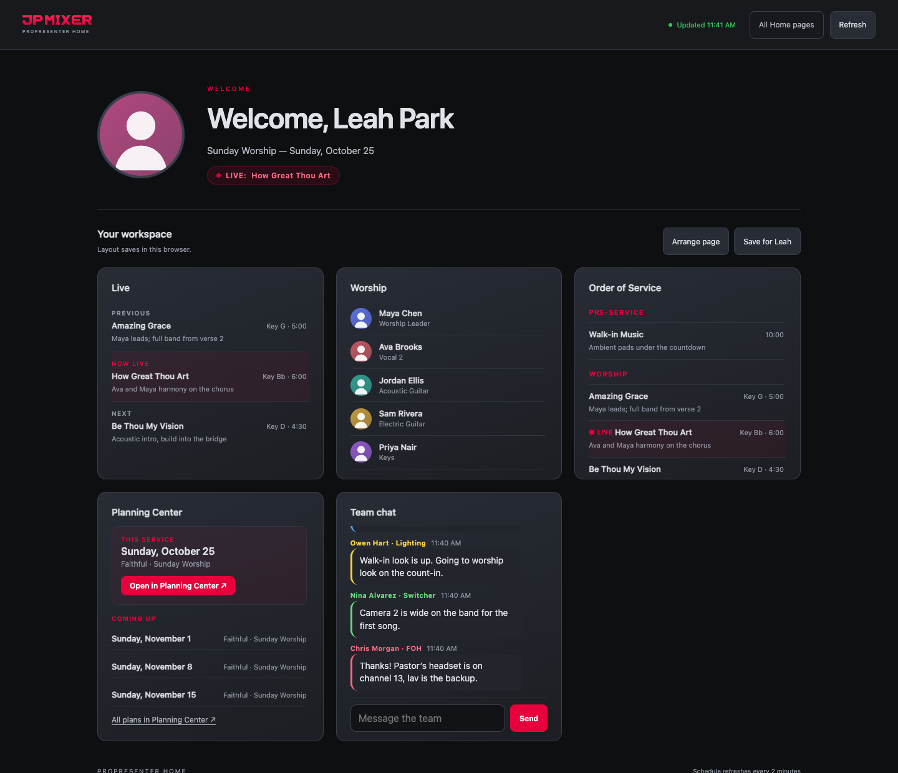</p>

### Green Room TV

A full-screen display for the green room: the team with photos and roles, a large clock, a service countdown, and **Now / Up next** from Planning Center Live with time left. A **QR code** opens the mix picker on a musician's phone, and with the integrations below it shows the room's **SPL** and each person's **mic battery**. It fits a 16:9 TV with nothing to scroll, however big the team.

<p align="center">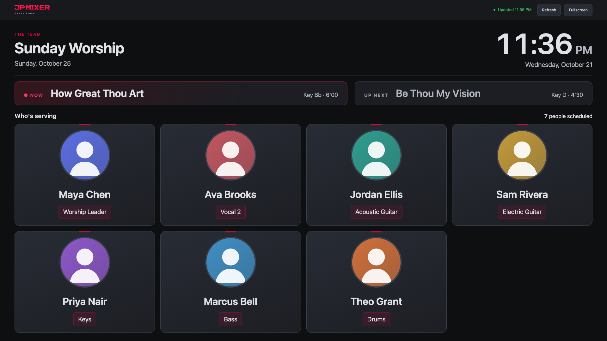</p>

### Shure wireless and Smaart SPL

Under **Settings → Integrations**, JPMixer can read your **Shure wireless** receivers (QLX-D, and the same strings on ULX-D, SLX-D and Axient Digital) and **Rational Acoustics Smaart**. Give each mic its mix, and its battery shows on that musician's phone and in Monitor Engineer. FOH Home gets an SPL card and a Wireless card. Both integrations only read: JPMixer never changes a receiver or a Smaart measurement.

<a id="planning-center-and-setup"></a>

## 📅 Planning Center & setup

### Planning Center does the names

Map each team position to a mix once, and every mix is named after who's on it, like "Keys - Priya Nair". JPMixer keeps it current by itself, gives mixes their own names back when nobody's scheduled, and can open each performer's phone straight to their mix. An optional **second service** handles a Wednesday night or another event with its own teams.

<p align="center">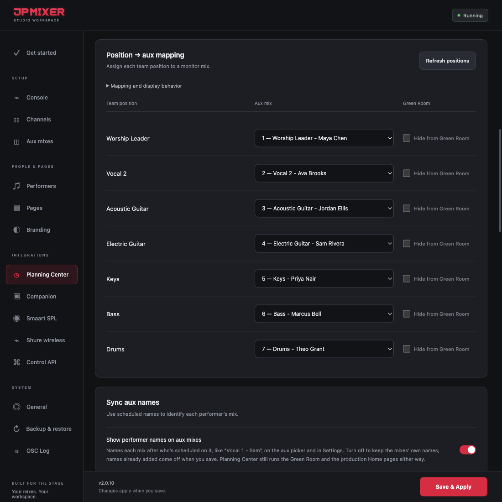</p>

### Setup that walks you through it

Settings opens on a **Get started** checklist: the address to give performers and every step in order, each with a button to the right place. Channel names, mixes and control groups fill themselves in from the console.

<p align="center">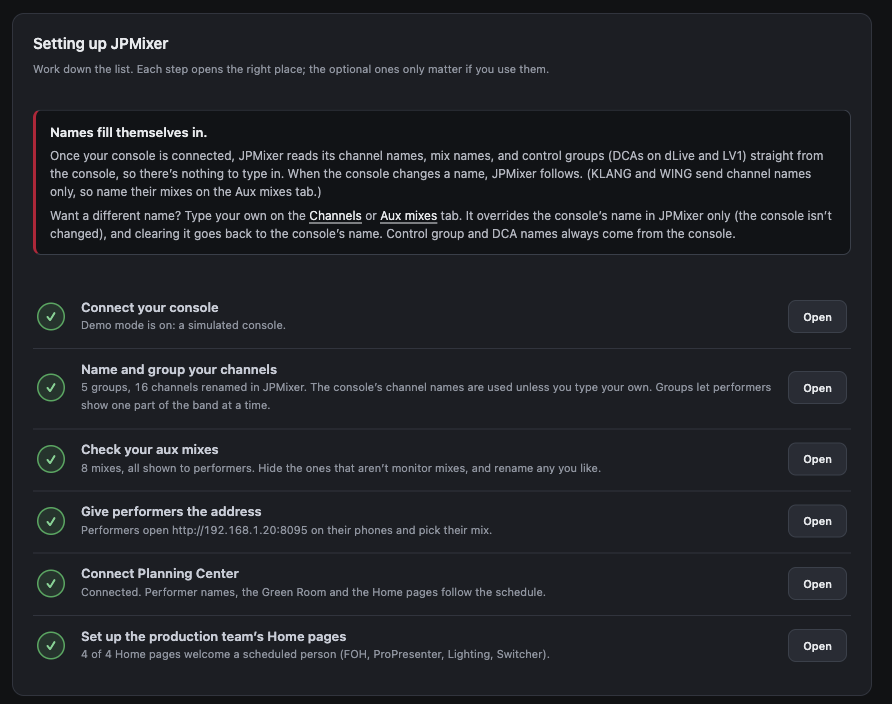</p>

<a id="and-more"></a>

### And more

- **Built-in aux EQ:** an optional 8-band EQ per mix (DiGiCo).
- **Private mixes:** hide a mix from the picker and share it by direct link.
- **iPad relay:** run the DiGiCo iPad app through JPMixer alongside the phones.
- **Control API:** a token-protected HTTP API for Companion, Stream Deck and other tools.
- **Branding:** your logo and accent color on every page JPMixer serves.
- **Backups:** automatic and manual, with a restore that lets you choose what to bring back.
- **Demo mode:** explore everything without a console.

Every feature is explained step by step in the **[User Manual](docs/MANUAL.md)**.

---

<a id="consoles"></a>

## 🎛️ Console support

| | DiGiCo<br/><sub>SD / Quantum / S</sub> | Allen & Heath<br/>dLive | KLANG<br/><sub>paired with dLive</sub> | Behringer<br/>WING | Waves<br/>eMotion LV1 |
|---|:---:|:---:|:---:|:---:|:---:|
| **Connection** | OSC (DiGiCo Pad) | MIDI over TCP/IP | OSC to the KLANG processor | OSC, UDP 2223 | MyMon remote, TCP |
| **Levels, mute & solo** | ✅ | ✅ | ✅ | ✅ | ✅ |
| **Per-send pan** | ✅ | — | ✅ stereo mode | ✅ | ✅ stereo mixes |
| **Names from the console** | ✅ channels, mixes | ✅ channels, mixes | channels* | channels | ✅ channels, mixes |
| **Counts from the console** | ✅ | mixes | — | — | ✅ |
| **Ear Scenes** | ✅ by snapshot name | ✅ by scene number | ✅ by scene number | — | ✅ by scene name |
| **Built-in aux EQ** | ✅ | — | — | — | — |
| **Console Controller** | ✅ | ✅ | — | — | ✅ |
| **Channel processing panel** | ✅ | — | — | — | — |
| **Tested on** | Live services | dLive Director | Protocol only | Protocol only | An LV1 show |

<sub>* From the paired dLive, when its address is entered. Setup for each console: [Connecting your console](docs/MANUAL.md#4-connecting-your-console).</sub>

Each console runs as its own backend; choosing one never touches another’s connection. Every page works the same whichever console is active.

---

## ⚙️ How it works

JPMixer runs a web server and a WebSocket bridge inside an Electron app.

- **A musician’s fader move** goes to JPMixer over WebSocket, which sends it to the console and shows it on every other screen. The console link is OSC/UDP for DiGiCo, MIDI/TCP for dLive, OSC/UDP to a KLANG processor, OSC/UDP for WING, or LV1’s MyMon remote (OSC over TCP).
- **Mute and solo** on DiGiCo and dLive work by driving the send to −∞ and restoring it afterwards. KLANG, WING and LV1 have a real per-send mute.
- **Kind to the console:** background queries are paced. A performer’s own moves, mutes and solos go out immediately.
- **Locked down:** a phone can only touch its own mix’s sends and EQ. A server-side allowlist blocks everything else.
- **Names stay in JPMixer:** your own names and Planning Center’s performer names are JPMixer labels. The console’s names are never changed, and Planning Center is only read.

---

## 🧱 Built with

[Electron](https://www.electronjs.org/) · [Express](https://expressjs.com/) · [ws](https://github.com/websockets/ws) · [osc.js](https://github.com/colinbdclark/osc.js/) · [yauzl](https://github.com/thejoshwolfe/yauzl)

---

<p align="center"><b>🌐 <a href="https://jpmixing.com">jpmixing.com</a></b></p>

<p align="center"><sub>JPMixer is not affiliated with DiGiCo, Allen &amp; Heath, KLANG:technologies, Behringer/MUSIC Tribe, Waves Audio, Bitfocus or Planning Center. DiGiCo is a trademark of DiGiCo UK Ltd. dLive is a trademark of Allen &amp; Heath Limited. KLANG is a trademark of KLANG:technologies GmbH. WING is a trademark of MUSIC Tribe Global Brands Ltd. Waves and eMotion LV1 are trademarks of Waves Audio Ltd. Planning Center is a trademark of Ministry Centered Technologies.</sub></p>
