<p align="center">
  <picture>
    <source media="(prefers-color-scheme: dark)" srcset="../assets/brand/jpmixer-logo-dark.gif" />
    
  </picture>
</p>

# JPMixer User Manual

**Version 2.0.12 · October 2026**

Setting up and running JPMixer: personal monitor mixes on every musician’s phone, tools for the monitor and FOH engineers, and a Home page for every production station, all driven by your console and your Planning Center schedule.

| | |
|---|---|
| **Runs on** | macOS (Apple silicon and Intel), Windows 10 and 11 |
| **Consoles** | DiGiCo, Allen & Heath dLive, KLANG, Behringer WING, Waves eMotion LV1 |
| **Opens on** | Any phone, tablet or computer browser on the same network |
| **Written for** | Tech directors, FOH and monitor engineers, production volunteers |

> A designed copy of this manual, for reading in a browser or printing, is in [manual/index.html](manual/index.html). Download it with the repository and open it from your computer.

## Contents

- [About this manual](#about-this-manual)
- [1. What JPMixer does](#1-what-jpmixer-does)
- [2. Install and first launch](#2-install-and-first-launch)
- [3. Get started checklist](#3-get-started-checklist)
- [4. Connecting your console](#4-connecting-your-console)
- [5. Channels and groups](#5-channels-and-groups)
- [6. Aux mixes](#6-aux-mixes)
- [7. The performer’s phone](#7-the-performers-phone)
- [8. Ear Scenes and saved mixes](#8-ear-scenes-and-saved-mixes)
- [9. Engineer tools](#9-engineer-tools)
- [10. Planning Center](#10-planning-center)
- [11. Production Home pages](#11-production-home-pages)
- [12. Green Room display](#12-green-room-display)
- [13. Branding](#13-branding)
- [14. General and Port 80](#14-general-and-port-80)
- [15. Backup and restore](#15-backup-and-restore)
- [16. Control API](#16-control-api)
- [17. OSC Log](#17-osc-log)
- [18. Troubleshooting](#18-troubleshooting)
- [Appendix A: Addresses and ports](#appendix-a-addresses-and-ports)
- [Appendix B: Console feature support](#appendix-b-console-feature-support)
- [Appendix C: Glossary](#appendix-c-glossary)

---

## About this manual

This manual covers the whole of JPMixer, from installing it to running a Sunday with Planning Center, the production Home pages and the Green Room. The [Musician Guide](MUSICIAN-GUIDE.md) covers what performers do on their phones in detail.

Chapters 1 to 3 get JPMixer running. Chapters 4 to 6 connect your console and set up the channels and mixes performers see. Chapters 7 to 13 cover the pages people use during a service, and Chapters 14 to 17 the system settings. Troubleshooting, a table of addresses and ports, console feature support and a glossary are at the end.

#### Conventions

- Names of buttons, tabs and settings are in bold, for example **Save & Apply**.
- A path like **Settings → Console** means: open Settings, then the Console tab in the sidebar.
- Addresses and numbers you type are shown like `http://192.168.1.20`.

Click any screenshot to see it full size.

> [!NOTE]
> The screenshots were taken with JPMixer’s demo console and a sample Planning Center schedule. Every person shown is fictional and every avatar is an illustration. Your screens will show your own console, mixes and team.

---

## 1. What JPMixer does

JPMixer runs on a Mac or Windows computer next to your console. It talks to the console over the network and serves web pages that anyone on the same network can open in a browser. Nobody installs an app on their phone.

- **Your console**: DiGiCo, dLive, KLANG, WING or LV1. Its aux sends, names and snapshots.
- **JPMixer computer**: Mac or PC in the menu bar or system tray. Runs the web server and remembers everyone’s mixes.
- **Phones, iPads, screens**: Performer mixes, engineer tools, Home pages and the Green Room, in any browser.

### Who uses what

| Who | What they open | What it gives them |
|---|---|---|
| **Musicians and singers** | The mix page on their phone | Their own in-ear or wedge mix: level, mute, solo and pan for each channel, saved mixes, and Ear Scenes that follow the console’s snapshots. |
| **Monitor engineer** | Monitor Engineer, Devices | Every mix side by side, who is connected to which mix, and a map of the devices on stage. |
| **FOH engineer** | FOH Home, Console Controller | A personal Home page with the live service item and team, and the console’s main faders, mutes and solos from a browser. |
| **Production team** | ProPresenter, Lighting and Switcher Home | A page per station welcoming whoever is scheduled, with the order of service, team chat and Companion buttons. |
| **Green room** | Green Room display | Who is serving today, with photos and roles, on a TV or iPad. |

### What JPMixer never does

- It never carries audio. It only sends control messages to the console, the way the console makers’ own remote apps do.
- A performer’s phone can only change the sends into that performer’s own mix. JPMixer blocks everything else on the server.
- Names you type in JPMixer, and performer names from Planning Center, show only in JPMixer. The console’s own channel and mix names are never changed.
- Planning Center is only read, never written to.

---

## 2. Install and first launch

Install JPMixer on the computer that will stay with the console for the service. It needs to be on the same network as the console and as the performers’ phones.

### Before you start

- **A computer:** a Mac (Apple silicon or Intel) or a Windows 10 or 11 PC.
- **One network for everything:** the console, the JPMixer computer and the phones on the same network, usually your stage Wi-Fi or production LAN. Keep it separate from guest Wi-Fi.
- **A fixed address:** give the JPMixer computer a static IP or a DHCP reservation, so the address performers use stays the same every week.

### Installing on a Mac

1. Download `JPMixer-<version>.dmg` from the JPMixer releases page.
2. Open the DMG and drag **JPMixer** into **Applications**.
3. Open JPMixer. When macOS asks whether JPMixer can find devices on your local network, choose **Allow**. Without it, JPMixer can’t reach the console.

> [!IMPORTANT]
> **If macOS refuses**
>
> If macOS says the app is damaged and can’t be opened, open Terminal and run the command below once, then open JPMixer again.
>
> `sudo xattr -rd com.apple.quarantine /Applications/JPMixer.app`

### Installing on Windows

1. Download and run `JPMixer.Setup.<version>.exe`.
2. If SmartScreen appears, choose **More info**, then **Run anyway**.
3. When the Windows Firewall asks, allow JPMixer on private networks so phones can reach it.

### The menu bar icon

JPMixer has no main window. It lives in the Mac menu bar (or the Windows system tray). The dot on the icon shows the console connection: **green** when the console is connected, **red** when it isn’t. Click the icon for the menu:

```
Running on port 80
DiGiCo connected
────────────────────
Open  ›
Settings…
────────────────────
Stop Server
Check for Updates…
Quit JPMixer
```

**Open** lists every page: Monitor Engineer, Console Controller, Devices, the Production View Select page, each Home page, and the phone mixer in your browser. Each page opens in its own window, and choosing it again brings that window forward.

**Quit JPMixer** puts back anything JPMixer is holding on the console, such as sends muted from a phone, before it closes.

### The Settings window

Choose **Settings…** to set everything up. The sidebar is in five groups: **Get started**; **Setup** (Console, Channels, Aux mixes); **People & pages** (Performers, Pages, Branding); **Integrations** (Planning Center, Companion, Smaart SPL, Shure wireless, Control API, Plugins); and **System** (General, Performance, Backup & restore, OSC Log).

Changes take effect when you click **Save & Apply** at the bottom right. Most changes apply live. A few, such as switching console type, restart the server, and the button then says **Saved — server restarted**. Phones reconnect by themselves a moment later.

### Updates

Choose **Check for Updates…** in the menu. JPMixer downloads the new version, checks it against its published checksum and the app’s signature, installs it and reopens. If any step fails, nothing changes. The update window shows what’s new in the release.

---

## 3. Get started checklist

The first tab in Settings shows the address performers use and a checklist of every part of setting JPMixer up, in order. Each step has a button that opens the right place.

<p align="center"></p>

<p align="center"><sub>Fig. 3.1 · Settings → Get started. A tick means the step is done; steps marked Optional only matter if you use that feature.</sub></p>

At the top of the tab, **Web server** shows the address to give performers and a **Stop** / **Start** button. **This Mac’s IP** is the computer’s address on the network. See [Chapter 14](#14-general-and-port-80) for **Use Port 80**, which lets performers type the address without a port number.

### Names fill themselves in

Once your console is connected, JPMixer reads its channel names, mix names and control groups (DCAs on dLive and LV1) straight from the console, so there is nothing to type in. When someone renames a channel on the console, JPMixer follows. It also remembers the names on this computer, so Settings still shows them while the console is off. A name you type in JPMixer always wins.

- To use a different name, type your own on the [Channels](#5-channels-and-groups) or [Aux mixes](#6-aux-mixes) tab. It overrides the console’s name in JPMixer only; the console isn’t changed.
- Clear the name to go back to the console’s.
- Control group and DCA names always come from the console.
- KLANG and WING send channel names only, so name their mixes on the Aux mixes tab.

---

## 4. Connecting your console

Settings → Console is three numbered steps: choose the console, tell JPMixer where to find it, and check the channel and mix counts.

<p align="center">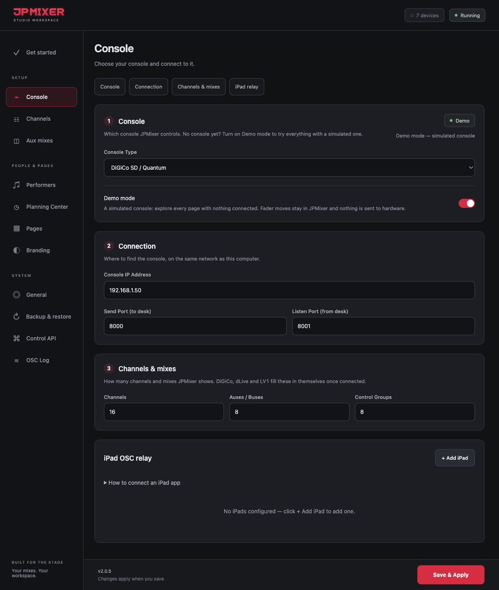</p>

<p align="center"><sub>Fig. 4.1 · Settings → Console. The status pill at the top right of step 1 turns green when the console answers.</sub></p>

1. **Console.** Choose your **Console Type**. The fields below change to match it.
2. **Connection.** Enter the console’s address and any ports, as described for your console below.
3. **Channels & mixes.** Check the counts. DiGiCo and LV1 fill in both themselves once connected, and dLive fills in the mix count; the fields lock while the console reports them.
4. Click **Save & Apply** and watch the status pill turn green.

### DiGiCo (SD, Quantum and S series)

JPMixer talks to a DiGiCo console over OSC, the same way the DiGiCo Pad iPad app does.

1. On the console, turn on external control for DiGiCo Pad, and add the JPMixer computer’s IP address as the device, with the console sending to port `8001` and receiving on `8000`.
2. In JPMixer, enter the **Console IP Address**. Leave **Send Port (to desk)** at `8000` and **Listen Port (from desk)** at `8001` unless you changed them on the console.

DiGiCo gives JPMixer the most: live names and counts, per-send pan, the built-in aux EQ, Ear Scenes by snapshot name, and the full Console Controller with the channel processing panel.

### Allen & Heath dLive

1. On the surface, open **Utility → Control → MIDI** and turn **MIDI/TCP** on. Nothing can connect until it is.
2. Note the **Main MIDI Channels** shown there. JPMixer’s **Base MIDI Channel** (0 to 11) must match: channel 1 is `0`, channel 12 is `11`.
3. In JPMixer, enter the **MixRack’s** IP address (not the surface’s) and the Base MIDI Channel.
4. Turn on **Use TLS/SSL** and enter the username and password only if MIDI/TCP is in Secure Mode on the console.
5. Leave **MIDI/TCP Port Override** at `0`. If the console doesn’t answer, try `51328`.

The dLive MixRack accepts many connections at once, so JPMixer runs alongside Director, MixPad and other remotes. JPMixer reads channel and mix names, finds which mono and stereo aux mixes the show has, and runs the Console Controller for inputs, aux masters and DCAs. Leave **Listen for live send-level updates** and **Poll send levels as a backup** on.

> [!TIP]
> No dLive to practise on? dLive Director running offline answers JPMixer like a real MixRack. In Director, turn on System → Offline → Enable Director Connections to MixRack IP Controllers, and point JPMixer at the Director computer.

### KLANG (with a dLive)

In KLANG mode, mixes are made on the KLANG processor. The dLive connection is optional and only used for channel names and Ear Scenes.

1. Patch the console’s multitrack feed (MADI, Dante or analog) to the KLANG processor. JPMixer only sends control; it can’t route audio.
2. Enter the **KLANG Processor IP Address** (from KLANG:app → CONFIG → CONNECT). Leave **KLANG Port Override** at `0`.
3. Make JPMixer’s channel numbers match KLANG’s inputs, and its aux numbers match KLANG’s MIX numbers.
4. Set each mix to **Stereo** mode in KLANG:app if performers will pan.

KLANG can’t report back what it applied, so JPMixer shows its own last-sent values. If someone changes the same mix in KLANG:app, JPMixer won’t see it.

### Behringer WING

Enter the WING’s **Console IP Address** and leave **WING Port Override** at `0` (OSC port 2223). WING confirms it is reachable when it connects, so the status pill is reliable. WING has no scene recall over OSC, so Ear Scenes don’t apply. Check per-send pan the first time you connect: if it doesn’t reach full left and right, tell your JPMixer contact.

### Waves eMotion LV1

1. In LV1, switch on the **MyMon / MyFOH** remote.
2. In JPMixer, leave **LV1 Computer IP Address** blank. JPMixer finds LV1 on the network the way the MyMon app does.
3. Leave **LV1 Remote Port** at `0`. LV1 picks a new port each time it starts and announces it.

Enter an address only when LV1 is on a different network from this computer, or when there is more than one LV1. Across networks, JPMixer checks the LV1 computer’s ports directly, which can take up to half a minute after LV1 starts. JPMixer joins as one more remote, so MyMon and MyFOH keep working alongside it.

### Demo mode

Turn on **Demo mode** in step 1 to explore every page with a simulated console. Fader moves stay in JPMixer and nothing is sent to hardware. Demo mode builds its console from the Channels and Auxes counts in step 3.

### iPad OSC relay (DiGiCo)

DiGiCo accepts one Pad connection at a time. To run the DiGiCo iPad app alongside JPMixer, point the iPad app at JPMixer instead of the console, and add it under **iPad OSC relay → + Add iPad**. JPMixer relays all console OSC to it. In the iPad app, send to JPMixer’s IP on the Listen Port; in JPMixer, set the iPad’s Send Port to the port the iPad app receives on. If an iPad’s address changes, JPMixer follows it.

---

## 5. Channels and groups

Settings → Channels controls how channels appear on performers’ phones: their names, icons, groups, order, and whether performers see them at all.

<p align="center">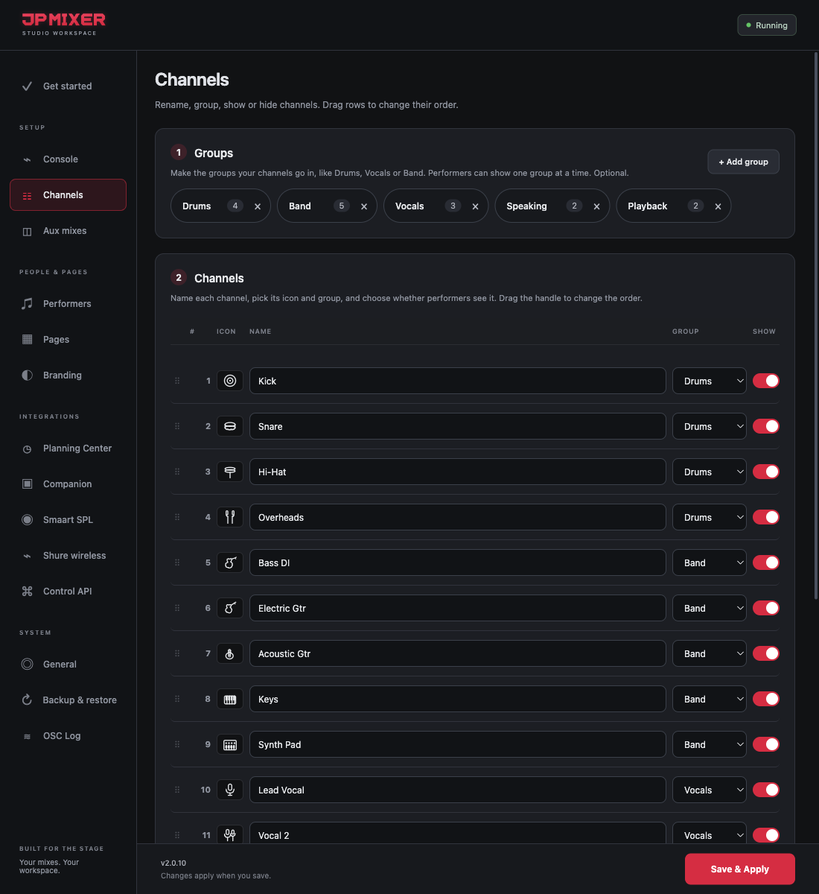</p>

<p align="center"><sub>Fig. 5.1 · Settings → Channels. Groups first, then each channel with its icon, name, group and Show switch.</sub></p>

### 1 · Groups

Groups such as Drums, Vocals or Band let performers show one part of the band at a time. Each chip shows how many channels are in it.

- Click **+ Add group**, then type its name in the new chip.
- Or, in any channel’s group menu, choose **+ New group…** to make a group and put that channel in it.
- Click a chip’s **×** to remove the group. Its channels stay, ungrouped.

### 2 · Channels

| Setting | What it does |
|---|---|
| **Icon** | Click to pick an instrument icon: drums, guitars, keys, vocals, brass, strings and more. |
| **Name** | The console’s name is used until you type your own. Clear it to go back to the console’s name. |
| **Group** | Which group the channel belongs to. Channels appear on phones group by group, in the order of the chips. |
| **Show** | Turn off to hide a channel from performers, for example talkback or an unused input. |
| **Order** | Drag a row by its handle to change where it appears. |

The button at the bottom of the tab resets the Channels tab: it clears every group, icon and name override. Console settings, mix settings and saved mixes are not affected.

---

## 6. Aux mixes

Settings → Aux mixes lists every monitor mix on the console. For each one you choose its button color, an optional name of your own, which channels it opens to, and what performers can do with it.

<p align="center">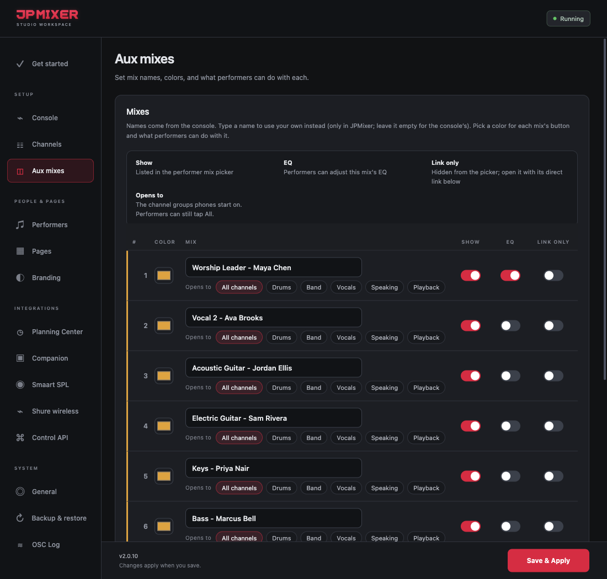</p>

<p align="center"><sub>Fig. 6.1 · Settings → Aux mixes. Here, Planning Center has put each performer’s name on their mix.</sub></p>

| Setting | What it does |
|---|---|
| **Color** | The color of the mix’s button in the performer mix picker and its stripe on the engineer pages. |
| **Name** | The console’s name shows faded in the box. Type a name to use your own instead (in JPMixer only); leave it empty for the console’s. |
| **Opens to** | The channel groups a phone starts on when it opens this mix, for example Drums and Playback for the drummer. Performers can still tap All. Pick **All channels** to show everything. |
| **Show** | Lists the mix in the performer mix picker. Turn off mixes that aren’t monitor mixes, such as a recording feed. |
| **EQ** | Lets performers adjust this mix’s built-in 8-band EQ from their phone (DiGiCo only). |
| **Link only** | Hides the mix from the picker; it opens only from its direct link. Useful for a pastor’s wedge or a mix one person should have. |

### Direct links

Below the list, **Direct links** shows the link for every Link only mix. Send it to the performer who needs it. A direct link has the form `http://192.168.1.20/?aux=8`.

---

## 7. The performer’s phone

Performers join the network, open the address from the Get started tab in their browser, and pick their mix. That is all they need. This chapter is an overview for engineers; the [Musician Guide](MUSICIAN-GUIDE.md) covers every control, and is the one to send to your band.

<table><tr><td align="center" width="25%"><br><sub>Fig. 7.1 · The mix picker</sub></td><td align="center" width="25%"><br><sub>Fig. 7.2 · Their mix</sub></td><td align="center" width="25%"><br><sub>Fig. 7.3 · One group</sub></td><td align="center" width="25%">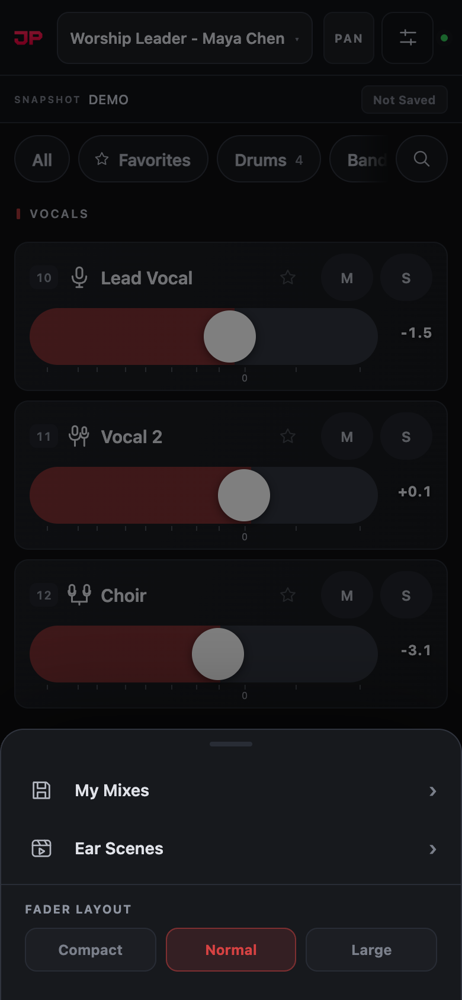<br><sub>Fig. 7.4 · Mix options</sub></td></tr></table>

### What performers can do

- **Change levels** with each channel’s fader, and **mute** (M) or **solo** (S) a channel in their own mix only. Unmuting brings back the exact level.
- **Pan** each channel in a stereo mix with the **PAN** button.
- **Show one group** with the chips (All, Favorites, Drums, Vocals…), **star favorites**, and **search** for a channel.
- **Save My Mixes**: named mixes they can load any time, on any mix. JPMixer keeps a copy, and **Find My Mixes…** recovers them on a new phone.
- **Save Ear Scenes**: a mix for the current console snapshot that comes back when that snapshot is recalled ([Chapter 8](#8-ear-scenes-and-saved-mixes)). The bar under the mix name shows the snapshot and whether its Ear Scene is saved.
- **Adjust the mix EQ**, when you allow it on the Aux mixes tab.
- **Choose a fader size**: Compact, Normal or Large.

> [!TIP]
> On an iPhone or iPad, open the address in Safari, tap Share, then Add to Home Screen. JPMixer then opens full screen like an app, and stays connected when the screen locks.

The dot at the top right shows the connection. If Wi-Fi drops, the page reconnects by itself and keeps the same mix.

---

## 8. Ear Scenes and saved mixes

Settings → Performers controls Ear Scenes and lets you look after every performer’s saved mixes.

<p align="center">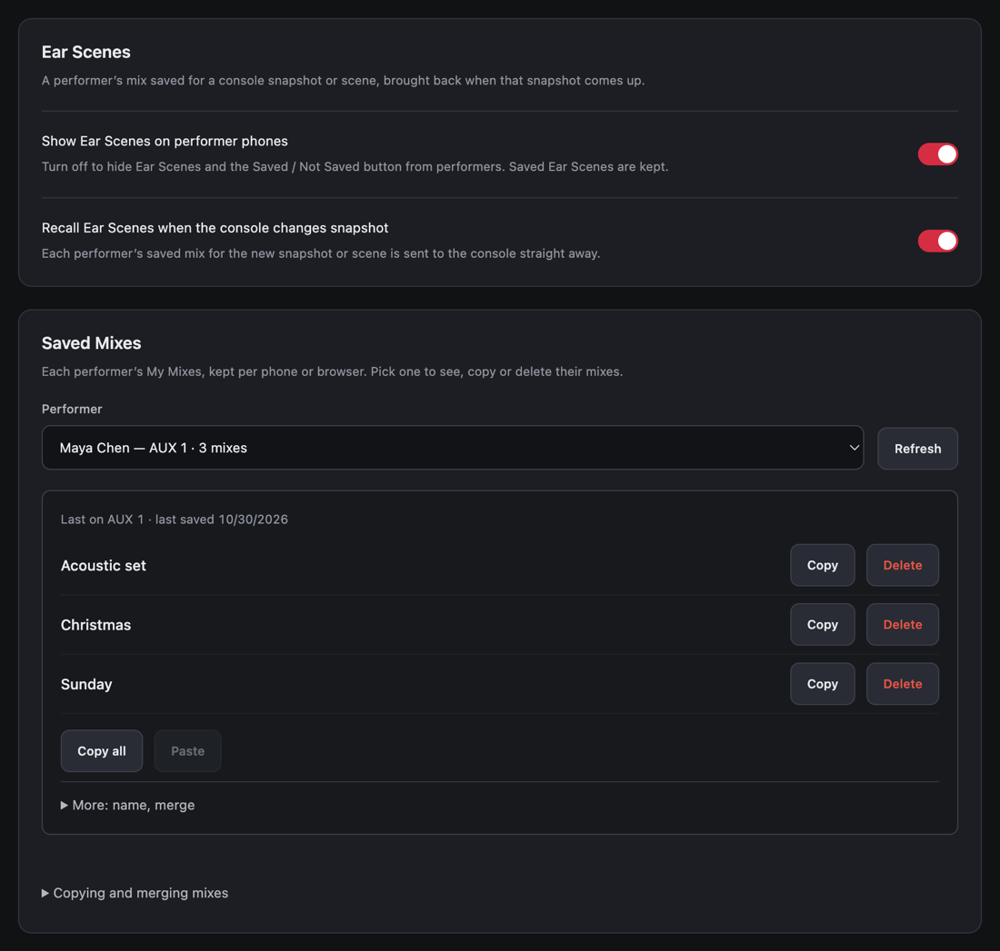</p>

<p align="center"><sub>Fig. 8.1 · Settings → Performers.</sub></p>

### Ear Scenes

An Ear Scene is a performer’s mix saved for one console snapshot or scene. When the console recalls that snapshot, each performer’s saved mix for it is sent to the console straight away, so every song can have its own monitor mix with nobody touching a phone.

| Setting | What it does |
|---|---|
| **Show Ear Scenes on performer phones** | Turn off to hide Ear Scenes and the Saved / Not Saved button from performers. Saved Ear Scenes are kept. |
| **Recall Ear Scenes when the console changes snapshot** | Sends each performer’s saved mix for the new snapshot or scene to the console. |

Ear Scenes follow snapshot names on DiGiCo, scene numbers on dLive and KLANG, and scene names on LV1. If you rename a snapshot on the console, Ear Scenes saved under the old name stop recalling. WING has no scene recall, so Ear Scenes aren’t available there.

### Saved mixes

Saved Mixes lists every device that has saved a My Mix, with the performer’s name, the mix it’s on, when it last saved and whether it is connected now.

- **Set Name** labels a device with the performer’s name, so it is easy to find later.
- **Copy** or **Copy all mixes**, then **Paste** on another device, copies mixes across. Connected performers receive them straight away; others when they next connect.
- **Merge into…** combines two devices that belong to the same person, for example an old phone and a new one.
- **Delete** removes one saved mix.

**Back up & recover My Mixes** keeps a separate copy of every performer’s saved mixes. To recover them, load the backup on the Backup & restore tab and choose only My Mixes ([Chapter 15](#15-backup-and-restore)).

---

## 9. Engineer tools

Three pages for the engineers, opened from the menu bar’s Open menu or the Pages tab: Monitor Engineer, Console Controller and Devices. They work in any browser on the network, so they can run on an iPad at the monitor position.

### Monitor Engineer

<p align="center"></p>

<p align="center"><sub>Fig. 9.1 · Monitor Engineer. The list on the left shows each mix and how many devices are mixing on it.</sub></p>

- **Every mix at once**, channel by channel, grouped the same way as performers’ phones. Switch to **Selected mix** to focus on one.
- **Mix trim**: **−0.5** and **+0.5** raise or lower a whole mix in half-dB steps, keeping its balance.
- **Mute and solo** any channel in any mix. Performers see the change on their phone, and the other way round.
- **Find channels** filters every mix to the channels you type.
- **Snapshot** at the top shows the console’s current snapshot, with ‹ › to step through them.

### Console Controller

<p align="center">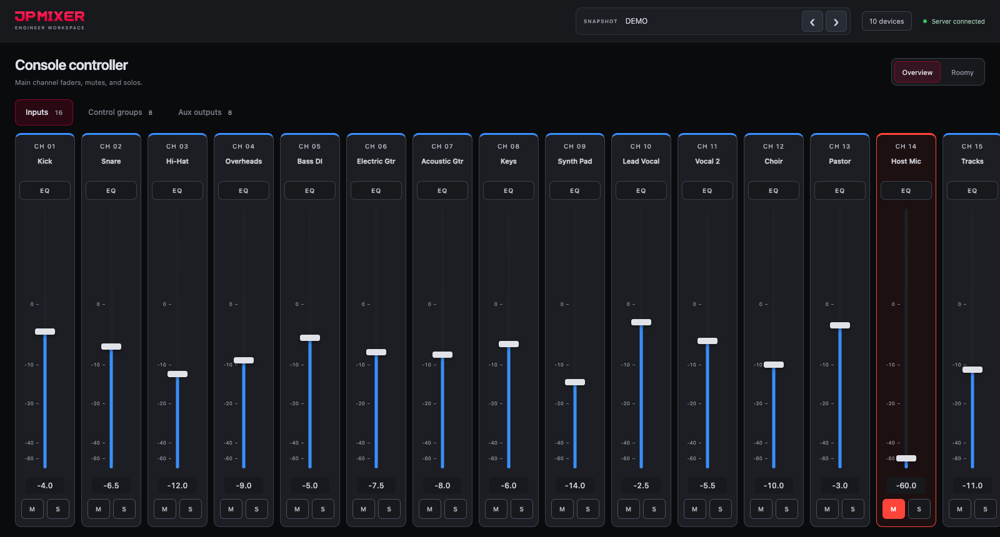</p>

<p align="center"><sub>Fig. 9.2 · Console Controller, Inputs. Channel 14 is muted.</sub></p>

The console’s main faders, mutes and solos for **Inputs**, **Control groups** (DCAs) and **Aux outputs**, from a browser. **Overview** fits more strips on screen; **Roomy** gives each strip more space. It works on DiGiCo, dLive and LV1.

On DiGiCo, each strip’s **EQ** button opens the **channel processing panel**: input gain, 48V, phase, delay and pan; a 4-band EQ graph you can drag, with high-pass and low-pass filters; and compressor and gate.

<p align="center"></p>

<p align="center"><sub>Fig. 9.3 · The channel processing panel (DiGiCo): Input, EQ and Dynamics.</sub></p>

> [!IMPORTANT]
> The Console Controller changes the main mix. Anyone on the network who opens it can move the console’s faders, so keep production Wi-Fi private.

### Devices on stage

<p align="center"></p>

<p align="center"><sub>Fig. 9.4 · Devices on stage. Each card is a connected phone or iPad and the mix it’s on.</sub></p>

Every connected phone and iPad, the mix it is on, and its latest activity. Click **Arrange stage** and drag the cards to match where people stand, from upstage to downstage. **Grid** shows the same cards in a plain grid. The arrangement is saved on the JPMixer computer, so every computer or iPad that opens the Devices page shows the same stage, and an open Devices page follows changes made on another screen.

---

## 10. Planning Center

Connect Planning Center Services and JPMixer follows your schedule: each mix is named after who is on it, performers’ phones can open their own mix, and the Green Room and Home pages welcome whoever is serving.

<p align="center">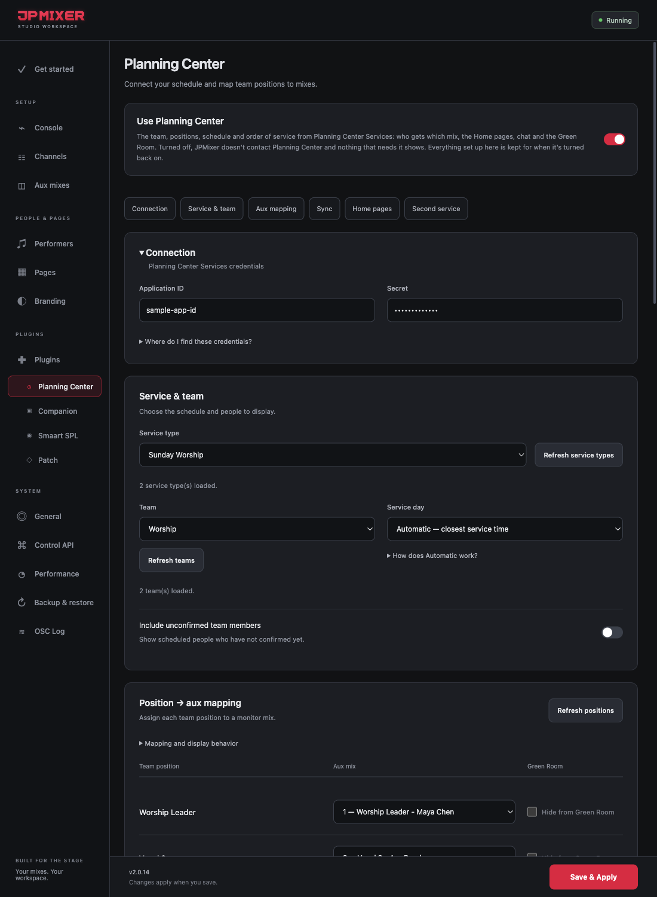</p>

<p align="center"><sub>Fig. 10.1 · Settings → Planning Center. The buttons along the top jump to each section.</sub></p>

### Connect

1. Sign in at `api.planningcenteronline.com/personal_access_tokens` and create a personal access token.
2. Enter its **Application ID** and **Secret** under **Connection**.
3. Under **Service & team**, click **Refresh service types** and choose the Service Type you plan your services under.
4. Choose a **Team**, such as Worship, to narrow the position list and the Green Room to that team, or leave it on All Teams.
5. Leave **Service day** on **Automatic — closest service time** unless you need one day.

> [!NOTE]
> **Credentials**
>
> The Application ID and Secret are saved on this computer, like the console password. Anyone with them can read your Planning Center account, so treat them like a password. Backups leave them out unless you choose otherwise.

**Include unconfirmed team members** also uses people who haven’t accepted yet. People who declined are never used.

### Position → aux mapping

<p align="center"></p>

<p align="center"><sub>Fig. 10.2 · Each team position mapped to a mix. Hide from Green Room keeps a position off the Green Room display.</sub></p>

Click **Refresh positions** and choose a mix for each position the band plays from. Positions without a mix are skipped and listed after a sync. **Hide from Green Room** keeps a position off the Green Room display only.

### Syncing names

<p align="center">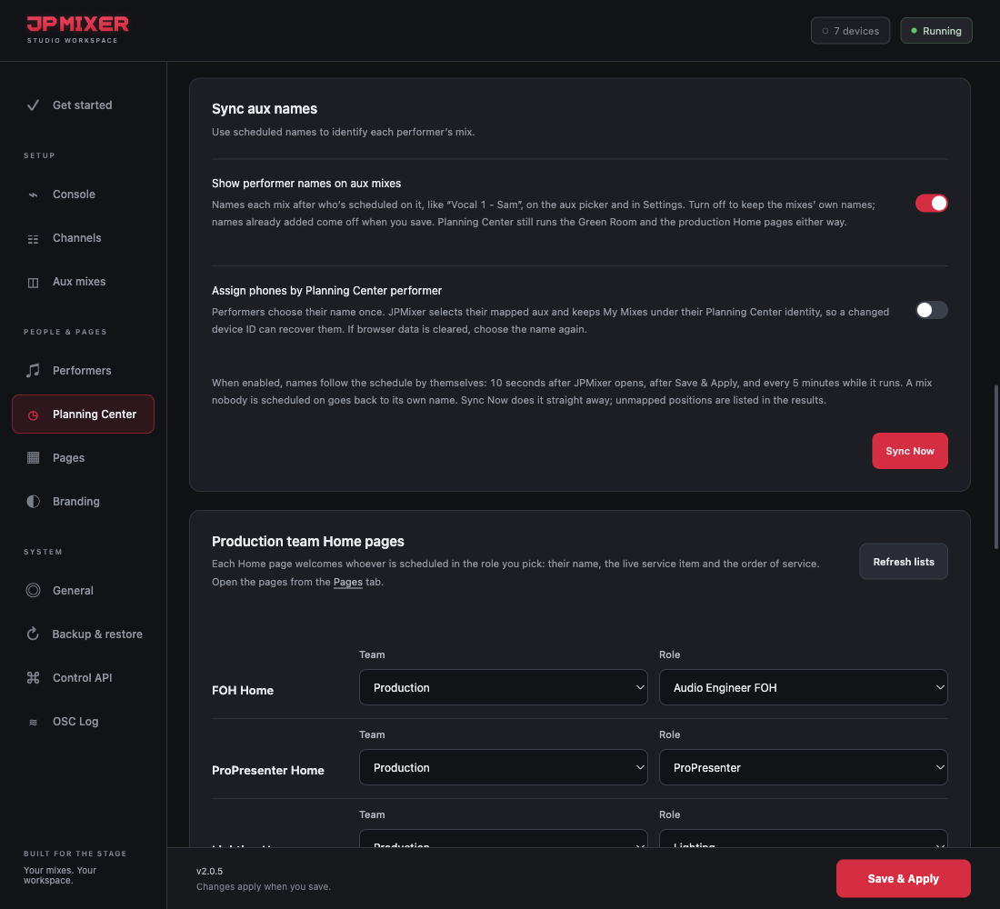</p>

<p align="center"><sub>Fig. 10.3 · Sync aux names.</sub></p>

With **Show performer names on aux mixes** on, each mix is named after who is scheduled on it, such as “Keys - Priya Nair”, on the mix picker, the engineer pages and in Settings. JPMixer syncs by itself:

- 10 seconds after JPMixer opens,
- after a Save & Apply that changes Planning Center settings,
- and every 5 minutes while it runs.

A mix nobody is scheduled on goes back to its own name. **Sync Now** syncs straight away and lists what it updated. Turn the switch off to use Planning Center only for the Green Room and Home pages; saving with it off takes every performer name back off. A name you typed yourself is always left alone.

**Assign phones by Planning Center performer**: performers choose their name once, and their phone opens their mapped mix. Their My Mixes follow their Planning Center identity, so they come back on a new phone.

> [!NOTE]
> **Several services a weekend**
>
> JPMixer uses the plan closest to now, whether it is running or next. With Saturday and Sunday services in one plan, the Automatic service day follows whichever service time is nearest.

### Second service (optional)

For a Wednesday night, a youth night or another event planned under its own Service Type with its own teams. Only the switch shows until you turn on **Use a second service**.

<p align="center">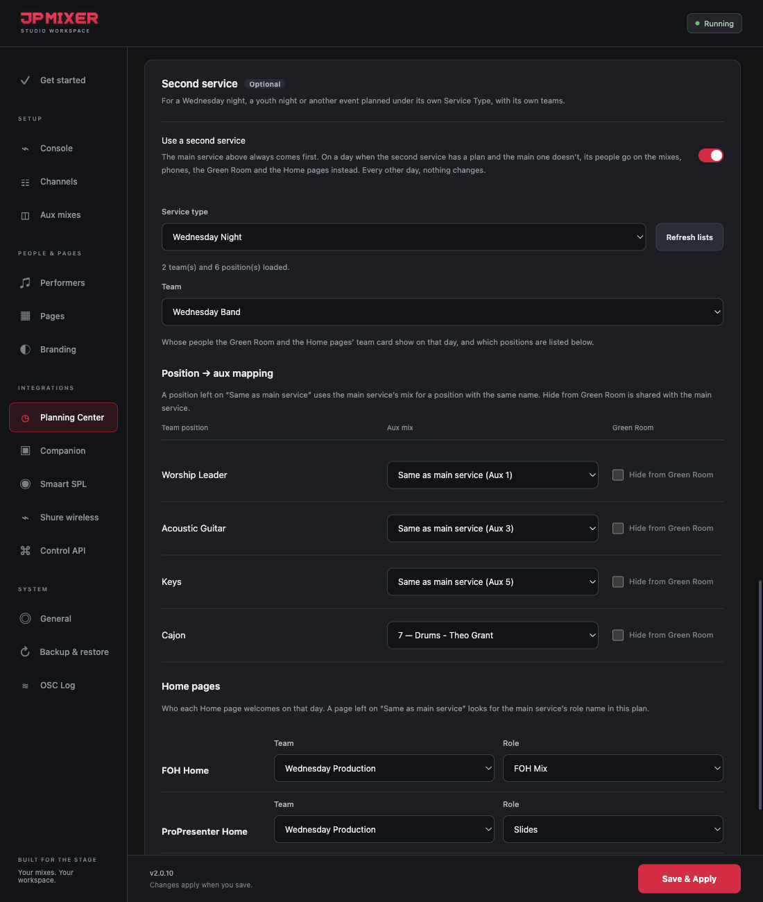</p>

<p align="center"><sub>Fig. 10.4 · A second service with its own team, one extra mapping and its own FOH and ProPresenter roles.</sub></p>

**How it decides:** the main service always comes first. On a day when the second service has a plan and the main one doesn’t, the second service runs everything: mix names, phones, the Green Room and the Home pages. The switch covers the whole day, midnight to midnight, and the first sync of the next day puts the main service back. If both have a plan the same day, the main one wins.

| Setting | What it does |
|---|---|
| **Service type** | The Service Type the event is planned under. |
| **Team** | Whose people the Green Room and the Home pages’ team card show on that day. |
| **Position → aux mapping** | Positions start on **Same as main service (Aux N)**, so a position named the same as Sunday’s uses the same mix. Pick a different mix, or **Not on a mix**. |
| **Home pages** | A team and role for each Home page that day. **Same as main service** looks for the main service’s role name in that plan. |

Include unconfirmed and Hide from Green Room are shared with the main service.

### Production team Home pages

Under **Production team Home pages**, choose the Team and Role each Home page welcomes, for example Production → Audio Engineer FOH for FOH Home. See [Chapter 11](#11-production-home-pages).

---

## 11. Production Home pages

FOH, ProPresenter, Lighting and Switcher each get a Home page for that station’s screen. It welcomes whoever Planning Center has scheduled in that role and shows the live service item, the team, the order of service, team chat and Companion buttons.

### Production View Select

<p align="center"></p>

<p align="center"><sub>Fig. 11.1 · Production View Select at `/home.html`: one link for the whole team.</sub></p>

Give the whole production team one link, `http://192.168.1.20/home.html`. It lists each station with who is on today, and each card opens that station’s Home page.

### FOH Home

<p align="center"></p>

<p align="center"><sub>Fig. 11.2 · FOH Home. The Live card shows the previous, current and next item with time left as Planning Center Live moves through the service; the SPL and Wireless cards come from Smaart and Shure receivers.</sub></p>

- **Live**: the previous, current and next item, with keys, lengths and notes, from Planning Center Live. The current item counts down its time left (for example *2:14 left*), from its length in Planning Center, and turns red with *0:32 over* when it runs long. A thin bar under it fills as the item goes. The card catches up within about 15 seconds when Live moves on.
- **Service starts in**: before the next service time in Planning Center, a countdown shows under the welcome and in the Live card. It hides while a service is on and while Live is running.
- **Team**: everyone on the roster team, with photos and positions.
- **Order of Service**: the whole plan, with the live item marked. When Live moves to a new item, the card scrolls to it by itself; scroll it yourself in between and it stays where you put it.
- **Planning Center**: this service and the next few, each opening in Planning Center.
- **Team chat** and **Companion** buttons (below), and on FOH Home, quick links to the engineer tools.
- The header shows the console connection and how many devices are connected.

### ProPresenter, Lighting and Switcher Home

<p align="center"></p>

<p align="center"><sub>Fig. 11.3 · ProPresenter Home, with team chat between the stations.</sub></p>

The same page for each station, welcoming whoever is in that station’s role, without FOH’s console status and engineer links.

### Arrange the page for each person

1. Click **Arrange page**. Drag a card to move it, drag its corner to resize it, and drop it onto another card to swap the two. **Show / hide cards** brings back hidden cards.
2. Click **Save for <name>**. The layout is saved for the scheduled person, not the device, and loads by itself next time they serve, on any device.

A station they have never saved starts from their layout on another station. Until you save, the layout stays in that browser only.

### Team chat

Messages go to all four stations live. Each shows who sent it and from which station. The chat clears itself when Planning Center moves on to the next service, for example from Saturday night’s plan to Sunday morning’s, and it starts empty whenever JPMixer opens.

### Companion buttons

JPMixer connects to Bitfocus Companion (3.0 or newer) as a Satellite and adds one button surface per Home page.

1. In Companion, allow Satellite connections (TCP port `16622` by default).
2. In JPMixer, open **Settings → Integrations → Companion**, turn it on, enter the Companion computer’s address (`127.0.0.1` if it is this computer) and choose the grid (8 × 4 by default). Click **Save & Apply**; the status should say Connected.
3. In Companion → Surfaces, give each JPMixer surface (JPMixer FOH Home, JPMixer ProPresenter Home, and so on) the page of buttons that station needs.

The Companion card shows the buttons live with Companion’s own images. Tap to press, hold to hold. One tap presses once on phones and iPads, even a tap that slides a little. On a phone, a swipe that starts on a button scrolls the page without pressing it. JPMixer reconnects by itself if Companion restarts, and the card reconnects when a phone wakes up.

### Shure wireless

JPMixer can show each Shure wireless mic’s name, battery and transmitter, the way Wireless Workbench does, in a Wireless card on FOH Home and on Settings → Integrations → Shure wireless. It works with QLX-D, and uses the same control strings as ULX-D, SLX-D and Axient Digital. JPMixer only reads: it never changes a receiver or turns on its meters, and Wireless Workbench can stay open.

1. Open **Settings → Integrations → Shure wireless** and turn on **Watch Shure wireless receivers**. Receivers on the network appear while Wireless Workbench is open; you can also add one by its address. Every receiver JPMixer sees is remembered, so after a restart they are all listed even with Wireless Workbench closed, and each is followed by its hardware ID if its address changes. **Forget this receiver** takes an unticked one off the list.
2. Tick **one spare receiver** first, outside a service, and click **Save & Apply**. Leave it a while, then tick the rest.
3. Under each ticked receiver, choose the **Mix** its mic belongs to. That mic’s battery then shows on the musician’s phone mixer, in Monitor Engineer next to the mix, and on the FOH Wireless card.

Each channel shows its name, transmitter type and frequency, and its battery as **Good** (4–5 bars), **Replace** (3, amber) or **Critical** (0–2, red), with run time on Shure rechargeables. When a transmitter is switched off the card says so and, for half an hour, what its battery was. JPMixer asks each receiver for its batteries and transmitters every 5 seconds (names every 15) and reconnects one that stops answering.

### SPL from Smaart

FOH Home can show live sound levels from Rational Acoustics Smaart in an SPL card. It works with Smaart 8.4 or later, and with Smaart 9 Suite or SPL (not RT or LE). JPMixer only reads from Smaart; it never starts a measurement or changes a setting there.

1. In Smaart, open **Options → Preferences → API** and tick **Enabled**. The port is `26000` unless you changed it. Hover over **IP Address** there to see the Smaart computer’s address.
2. In Smaart, start SPL logging on a calibrated mic input. The card shows every input that is logging.
3. In JPMixer, open **Settings → Integrations → Smaart SPL**, turn it on and enter the Smaart computer’s address. Leave the password empty unless one is set in Smaart’s API tab. Click **Save & Apply**; the status should say Connected and how many inputs it is reading.

Each input shows a big reading (LAeq 10 unless you choose another) and a small live one (SPL A Slow), green, yellow or red by Smaart’s own color levels. When one of Smaart’s alarms trips, the input turns red and says *Over Smaart’s alarm level*. Click **Options** on the card to choose the big reading, the small one (or none), and which inputs show. The choices are saved on the JPMixer computer, so every screen that opens FOH Home shows the same; they are also under **Settings → Integrations → Smaart SPL**. The lists show Smaart’s own metric names once it is connected. With an access code on FOH Home, changing them needs the code.

### Plugins

Plugins add things JPMixer doesn’t do itself, such as a card on FOH Home with a reading from another program or device. Everything to do with them is under **Settings → Integrations → Plugins**, at the bottom of Integrations. Each plugin runs on its own, so if one stops working, JPMixer and the console carry on. A plugin can’t read JPMixer’s settings or passwords, or open other programs.

1. Turn on **Allow plugins** and click **Save & Apply**. While it’s off, no plugin runs.
2. Under **Find plugins**, click **Install** on a plugin from JPMixer’s approved list. Each one says what it can do. To install one that isn’t on the list, use **Import plugin…** with its `.jpmplugin` or `.zip` file, drop the file on the page, or double-click it. These are labelled *Not reviewed*: only install them if you trust whoever made them.
3. Each plugin gets its own tab under Plugins in the sidebar. Turn it on there, fill in its settings, and click **Save & Apply**. If it shows a card, the card appears on FOH Home and can be arranged like any other.

To make a plugin, by hand or with an AI assistant, see the [plugin guide](https://github.com/JPMixing-inc/jpmixer/blob/main/docs/PLUGINS.md) (**Open the plugin guide** on the Plugins page).

### The Pages tab and FOH access code

<p align="center">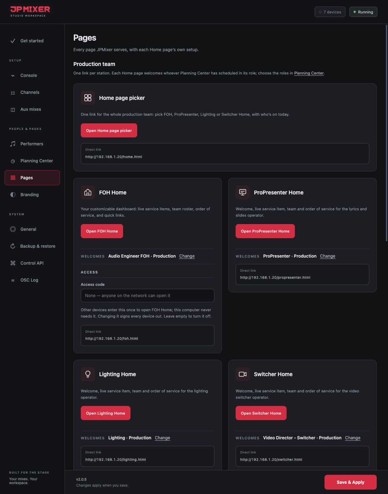</p>

<p align="center"><sub>Fig. 11.4 · Settings → Pages. Each page has an Open button and its direct link; Change jumps to its role in Planning Center.</sub></p>

Settings → Pages lists every page JPMixer serves with its direct link. FOH Home can have an **Access code**: other devices enter it once, the JPMixer computer never needs it, and changing it signs every device out. Leave it empty to turn it off.

> [!IMPORTANT]
> Only FOH Home can have a code. Anyone on the same network can open the other Home pages, chat and press their Companion buttons, so keep production Wi-Fi separate from guest Wi-Fi.

---

## 12. Green Room display

A full-screen, read-only display for a TV or iPad in the green room: who is serving, with photos and roles, a large clock, and what’s live in the service right now.

<p align="center"></p>

<p align="center"><sub>Fig. 12.1 · The Green Room on a 1080p TV: the Your mix QR code, SPL from Smaart and the clock, Planning Center Live’s current and next item, and mic batteries on the team’s cards.</sub></p>

- Open `http://192.168.1.20/greenroom.html` in the TV’s web browser, then press **OK** on the remote (or click anywhere) to go full screen. A browser won’t go full screen until something is pressed, so the page says so at the bottom until then. If the TV leaves full screen, press OK again. The mouse pointer hides itself after a few seconds. It can be left open: it follows Planning Center by itself within a few seconds, and if Planning Center doesn’t answer for a moment, it keeps showing the team.
- **Made for a 16:9 TV.** On a landscape screen everything fits on one screen with nothing to scroll. The team grid sizes itself so everyone fits, with bigger photos for a small team and smaller ones for a big team. On a phone or portrait screen it becomes a scrolling list.
- **Clock:** the time and today’s date, top right.
- **Your mix QR code:** beside the clock, a QR code that musicians scan with their phone’s camera to open the mix picker. Their phone needs to be on the same Wi-Fi as the JPMixer computer. Turn it off under Settings → Pages → Green Room. It shows on a TV or other landscape screen, not on a phone.
- **Mic batteries:** with Shure wireless set up and each mic given a mix ([Chapter 11](#11-production-home-pages)), a person’s card shows their mic’s battery while it’s on: **Good**, **Replace** or **Critical**. The card uses the mix their position is mapped to on the Planning Center tab. Turn off **Show mic batteries** under Settings → Pages → Green Room to hide them.
- **SPL:** with Smaart SPL set up ([Chapter 11](#11-production-home-pages)), turn on **Show SPL from Smaart** under Settings → Pages → Green Room to show a live sound level beside the clock, in Smaart’s colors and marked *Over the limit* when one of Smaart’s alarms trips. Choose its own **Reading** and **Input** there; Automatic uses LAeq 10 and the first input FOH Home’s SPL card shows.
- **Now and Up next:** while someone runs the service in Planning Center Live, a strip shows the live item and the next one, with their key and length, and the time left on the live item (red when it runs over), with a bar along the bottom that fills as it goes. It follows Live within about 15 seconds and disappears when Live isn’t running.
- **Service starts in:** under the clock, a countdown to the next service time in Planning Center, from 12 hours before. It hides while a service is on.
- It shows the team chosen under Planning Center → Service & team (or everyone), minus any position marked Hide from Green Room. Someone serving more than one role shows once, with each role under their name.
- No code is needed. It is information only, not a control surface.

---

## 13. Branding

Put your church’s logo and color on every page JPMixer serves to phones, iPads and screens.

<p align="center">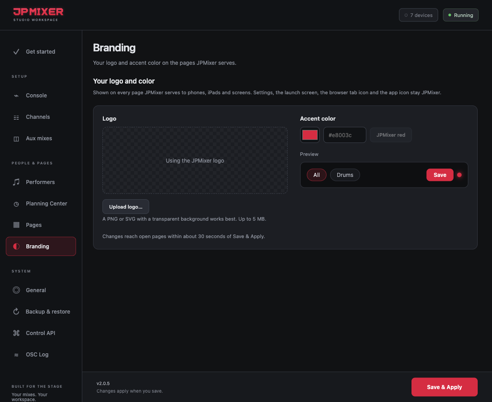</p>

<p align="center"><sub>Fig. 13.1 · Settings → Branding.</sub></p>

1. Click **Upload logo…**. A PNG or SVG with a transparent background, tightly cropped, works best (up to 5 MB).
2. Choose an **Accent color**: type a hex value, or click anywhere on your logo to use that color. The preview shows how buttons will look.
3. Click **Save & Apply**. Open pages pick up the change within about 30 seconds.

Settings, the launch screen, the browser tab icon and the app icon always stay JPMixer.

---

## 14. General and Port 80

Settings → General holds the web server port and what JPMixer does when the computer starts.

<p align="center">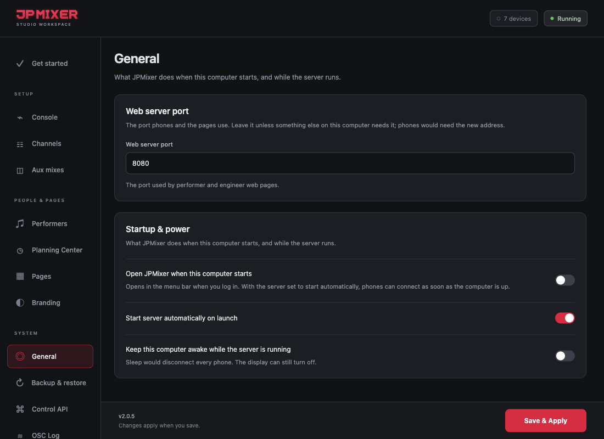</p>

<p align="center"><sub>Fig. 14.1 · Settings → General.</sub></p>

| Setting | What it does |
|---|---|
| **Web server port** | The port phones and pages use, `8080` by default. Leave it unless something else on the computer needs it; phones would need the new address. |
| **Open JPMixer when this computer starts** | Opens JPMixer in the menu bar when you log in. |
| **Start server automatically on launch** | Starts serving pages and connects to the console as soon as JPMixer opens. With both of these on, phones can connect as soon as the computer is up. |
| **Keep this computer awake while the server is running** | Sleep would disconnect every phone. The display can still turn off. |

### Use Port 80

On the Get started tab, **Use Port 80** lets performers type just the computer’s address, `http://192.168.1.20`, without `:8080`. It installs a small helper that forwards port 80 to JPMixer, and asks for your administrator password once.

> [!NOTE]
> Pick one address for performers and stick to it. The `:8080` address still works, but a phone keeps a separate My Mixes list for each address. If Get started says the Port 80 helper is outdated, click Use Port 80 again to update it.

### Performance

**Settings → Performance**, below General, shows how hard JPMixer and this computer are working. **Right now**, at the top, says in plain words if anything needs attention: JPMixer being held up long enough for faders to lag, the console not connected, the computer running hot, low on memory or disk, or on battery, or Planning Center being asked too often. Below it are JPMixer’s processor and memory use (with each window and plugin), the phones and pages connected, the console’s messages a second, each integration’s status, and this computer’s load, memory, disk and temperature. **Copy report** copies it all as text to send to whoever is helping; it never includes passwords or names.

---

## 15. Backup and restore

Protect your setup and everyone’s saved mixes on a schedule, keep copies, and bring back exactly what you need.

<p align="center">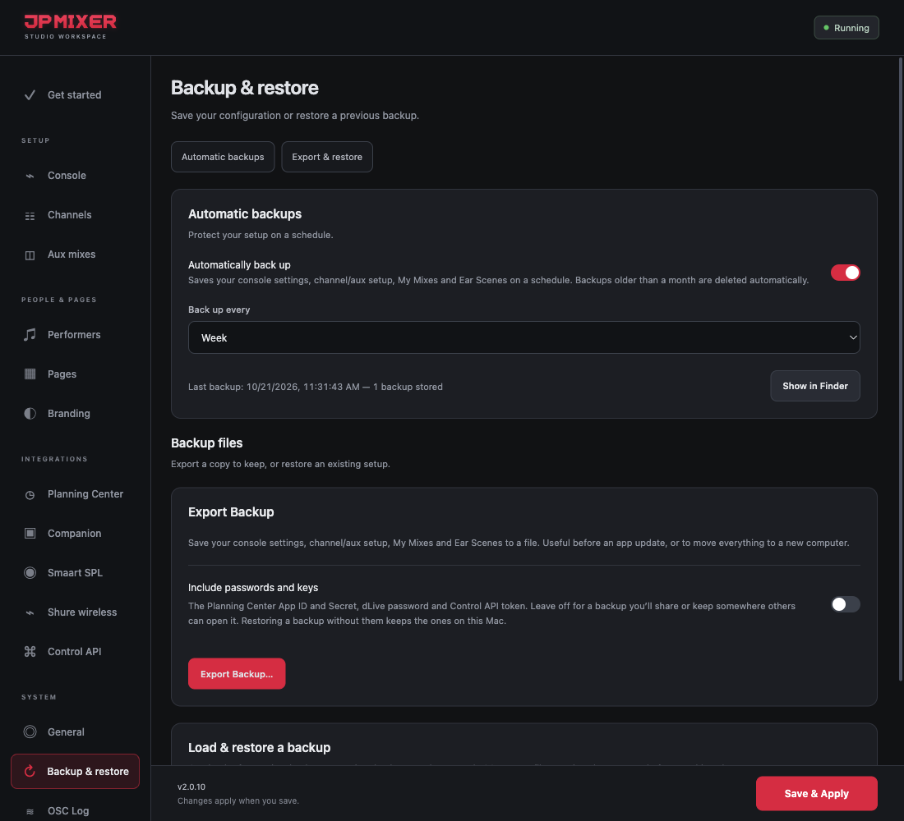</p>

<p align="center"><sub>Fig. 15.1 · Settings → Backup &amp; restore.</sub></p>

### Automatic backups

Turn on **Automatically back up** and choose how often: every day, 3 days, week, 2 weeks or month. Backups include console settings, channel and mix setup, My Mixes, Ear Scenes, Home page layouts, the Devices stage arrangement, and the console names JPMixer remembers. Backups older than a month are deleted by themselves. **Show in Finder** opens the folder.

### Export a backup

**Export Backup…** saves everything to a file, for example before an update or to move JPMixer to a new computer. Leave **Include passwords and keys** off for a copy you will share. Restoring a backup without them keeps the ones already on that computer.

### Load and restore

1. Click **Load Backup…** and choose a JPMixer backup, a My Mixes backup, or an extracted JSON or ZIP file.
2. Review what the file contains and tick the sections to restore. Unticked sections stay as they are. Credentials are never ticked for you.
3. For My Mixes, choose **Merge** (keep existing mixes and add the backup’s) or **Replace**.
4. Click **Restore Selected**.

JPMixer makes a safety backup first and puts everything back if any part fails. Restoring saved mixes never sends their levels to the console.

---

## 16. Control API

A token-protected HTTP API for Bitfocus Companion, Stream Deck and other tools that can send a web request. It runs separately from the console connection, so turning it on or off never interrupts the console.

<p align="center">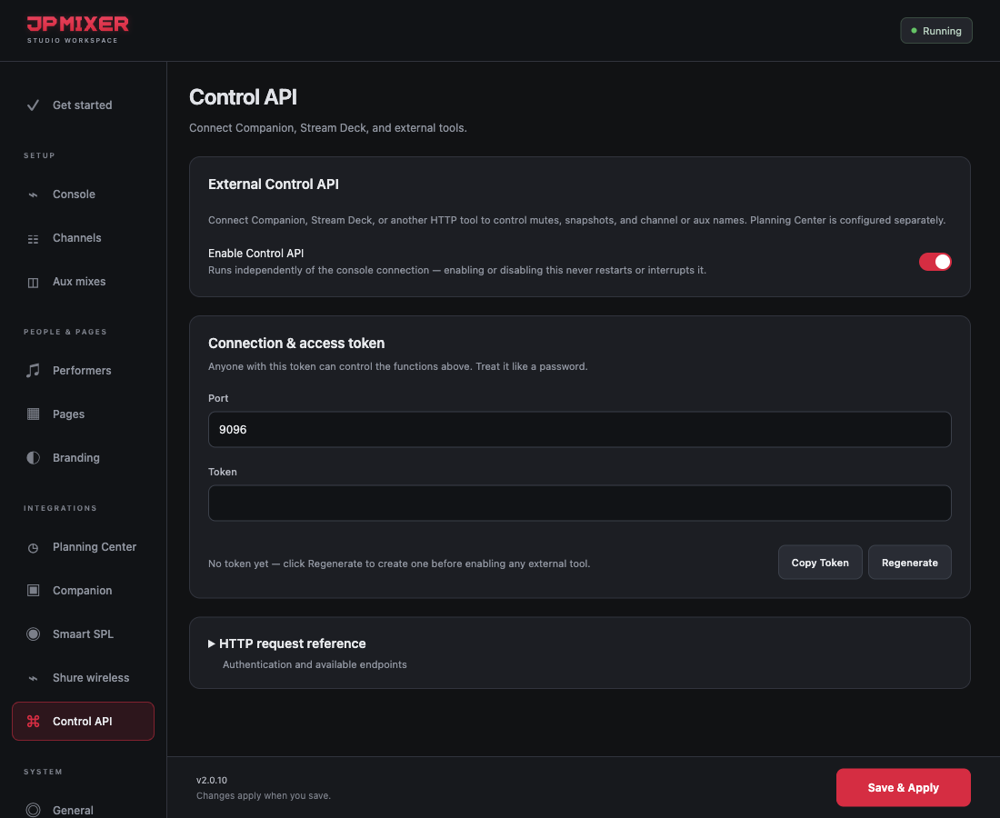</p>

<p align="center"><sub>Fig. 16.1 · Settings → Control API, turned on.</sub></p>

1. Turn on **Enable Control API**.
2. Click **Regenerate** to create a token, then **Copy Token**. Anyone with the token can use the API, so treat it like a password.
3. Send the token with each request as `Authorization: Bearer <token>`, or add `?token=<token>` if your tool can’t set headers.

Every address starts with `http://192.168.1.20:9096/api/v1/` (port `9096` by default).

| Request | Body | What it does |
|---|---|---|
| `GET /status` | — | Console connection, console type, channel and mix counts |
| `GET /channels`, `GET /auxes` | — | Current name overrides |
| `POST /channels/:n/label` | `{"label": "…"}` | Rename channel *n* in JPMixer, live |
| `POST /auxes/:n/label` | `{"label": "…"}` | Rename mix *n* in JPMixer, live |
| `POST /auxes/:n/mute` | `{"channel": 3, "muted": true}` | Mute or unmute one channel in mix *n* |
| `POST /auxes/:n/solo` | `{"channel": 3, "soloed": true}` | Solo or release one channel in mix *n* |
| `POST /scenes/fire` | `{"action": "next"}` or `"prev"` | Step to the next or previous snapshot |

When the console connection isn’t running, every request except `/status` answers `503`. The tab’s **HTTP request reference** repeats this list.

---

## 17. OSC Log

Settings → OSC Log shows the messages passing between JPMixer and the console, live. It is for diagnosing a connection, not for everyday use.

<p align="center">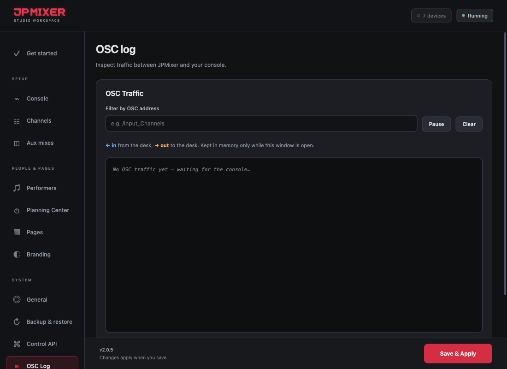</p>

<p align="center"><sub>Fig. 17.1 · Settings → OSC Log.</sub></p>

- **←** marks a message in from the console, **→** one out to the console.
- Type part of an address in **Filter by OSC address** to see only those messages, such as `Aux_Send`.
- **Pause** freezes the list and **Clear** empties it.
- The live list is kept in memory only while the window is open. Further down the tab, record the traffic to a file to keep a copy to send to support.

---

## 18. Troubleshooting

The most common problems and what to check first.

| What you see | What to check |
|---|---|
| The menu bar dot is red; Console says Not connected | Check the console’s IP address, that it is on the same network as this computer, and its remote setting: DiGiCo Pad external control, dLive MIDI/TCP on, or LV1’s MyMon / MyFOH remote. On a Mac, check JPMixer is allowed Local Network access in System Settings → Privacy & Security. |
| Phones can’t open the address | Confirm the phone is on the production network, not guest Wi-Fi or mobile data. Check the address on the Get started tab, and that the server is running (the menu says Running on port …). On Windows, allow JPMixer through the firewall. |
| dLive connects but nothing responds | Check the Base MIDI Channel matches the console’s Main MIDI Channels. Then try `51328` as the MIDI/TCP Port Override. |
| LV1 stays Offline | Switch on LV1’s MyMon / MyFOH remote. If LV1 is on a different network, enter its computer’s IP address and allow up to half a minute. |
| KLANG levels move but nothing is heard | Check the audio patch from the console to the KLANG processor. For pan, set the mix to Stereo mode in KLANG:app. |
| A channel or mix is missing | Check its Show switch on the Channels or Aux mixes tab, and the counts under Console → Channels & mixes. A Link only mix opens only from its direct link. |
| Performer names don’t appear on mixes | Check Show performer names on aux mixes is on, positions are mapped, and the people are confirmed (or Include unconfirmed is on). Click Sync Now to see what was applied and which positions are unmapped. |
| A Home page says nobody is scheduled | Check the page’s Team and Role under Planning Center → Production team Home pages, and that the person has accepted. With a second service, check its Home page roles too. |
| Ear Scenes don’t recall | Check Recall Ear Scenes when the console changes snapshot is on (Performers tab). On DiGiCo, the snapshot name must match exactly; a renamed snapshot needs its Ear Scenes saved again. |
| A performer’s saved mixes are gone | Make sure they use the same address as before (with or without `:8080`). On the phone, use Find My Mixes…, or on the Performers tab, copy or merge from their old device. |
| Faders feel slow through Port 80 | If Get started says the Port 80 helper is outdated, click Use Port 80 to update it. |

---

## Appendix A: Addresses and ports

Replace `192.168.1.20` with your JPMixer computer’s address from the Get started tab. Without Use Port 80, add `:8080` after it.

| Page | Address | For |
|---|---|---|
| Performer mix picker | `/` | Musicians and singers |
| One mix, direct | `/?aux=8` | A Link only mix |
| Production View Select | `/home.html` | The whole production team |
| FOH Home | `/foh.html` | FOH engineer |
| ProPresenter Home | `/propresenter.html` | Lyrics and slides |
| Lighting Home | `/lighting.html` | Lighting operator |
| Switcher Home | `/switcher.html` | Video director |
| Green Room | `/greenroom.html` | Green room screen |
| Monitor Engineer | `/monitor.html` | Monitor engineer |
| Console Controller | `/console.html` | FOH engineer |
| Devices on stage | `/devices.html` | Monitor engineer |

| Port | Used for |
|---|---|
| `8080` TCP | JPMixer’s web pages (or `80` with Use Port 80) |
| `8000` / `8001` UDP | DiGiCo OSC: JPMixer sends on 8000, listens on 8001 |
| `51325` TCP | dLive MIDI/TCP (try `51328` if it doesn’t answer) |
| `9110` UDP | KLANG processor |
| `2223` UDP | Behringer WING OSC |
| Announced by LV1 | Waves LV1 MyMon remote (found by itself) |
| `16622` TCP | Bitfocus Companion Satellite |
| `2202` TCP | Shure receivers’ control port (JPMixer reads) |
| `8427` UDP | Shure receivers’ announcements (JPMixer listens only) |
| `26000` TCP | Smaart API (on the Smaart computer) |
| `9096` TCP | Control API |

---

## Appendix B: Console feature support

Every page works the same whichever console you use. What changes is what each console lets JPMixer do.

| Feature | DiGiCo | dLive | KLANG | WING | LV1 |
|---|---|---|---|---|---|
| Levels, mute and solo | Yes | Yes | Yes | Yes | Yes |
| Per-send pan | Yes | No | Stereo mode | Yes | Stereo mixes |
| Names from the console | Channels, mixes | Channels, mixes | Channels* | Channels | Channels, mixes |
| Counts from the console | Yes | Mixes | No | No | Yes |
| My Mixes and Devices | Yes | Yes | Yes | Yes | Yes |
| Ear Scenes | By snapshot name | By scene number | By scene number | No | By scene name |
| Built-in aux EQ | Yes | No | No | No | No |
| Console Controller | Yes | Yes | No | No | Yes |
| Channel processing panel | Yes | No | No | No | No |

* KLANG mode reads channel names from the paired dLive, when its address is entered. DiGiCo is in regular use. dLive has been tested against dLive Director, LV1 against an LV1 show, and KLANG and WING against their published protocols; try each on your own console before a service.

---

## Appendix C: Glossary

| Setting | What it does |
|---|---|
| **Aux mix** | A console output built from sends, used for one performer’s in-ears or wedge. JPMixer calls them mixes; consoles call them auxes, buses or mixes. |
| **Send** | How much of one channel goes into one mix. Each fader on a performer’s phone is a send. |
| **Snapshot / scene** | A stored console state the engineer recalls, often one per song. DiGiCo calls them snapshots; dLive and LV1 call them scenes. |
| **Ear Scene** | A performer’s mix saved for one snapshot, sent to the console when that snapshot is recalled. |
| **My Mixes** | A performer’s own named saved mixes, loaded by hand, kept by JPMixer and recoverable on a new phone. |
| **Control group / DCA** | A fader that controls the level of a set of channels. DiGiCo calls them control groups; dLive and LV1 call them DCAs. |
| **Service Type** | In Planning Center, the kind of service a plan belongs to, such as Sunday Worship or Wednesday Night. |
| **Position** | In Planning Center, a role on a team, such as Keys or Audio Engineer FOH. JPMixer maps positions to mixes and Home pages. |
| **Smaart** | Rational Acoustics’ sound measurement software. JPMixer can read its SPL levels for FOH Home. |
| **Satellite** | Bitfocus Companion’s way of adding remote button surfaces. JPMixer adds one per Home page. |
| **OSC** | Open Sound Control, the network protocol DiGiCo, KLANG, WING and LV1 use for remote control. |

---

<sub>JPMixer is not affiliated with DiGiCo, Allen &amp; Heath, KLANG:technologies, Behringer / MUSIC Tribe, Waves Audio, Bitfocus or Planning Center. All trademarks belong to their owners.</sub>
