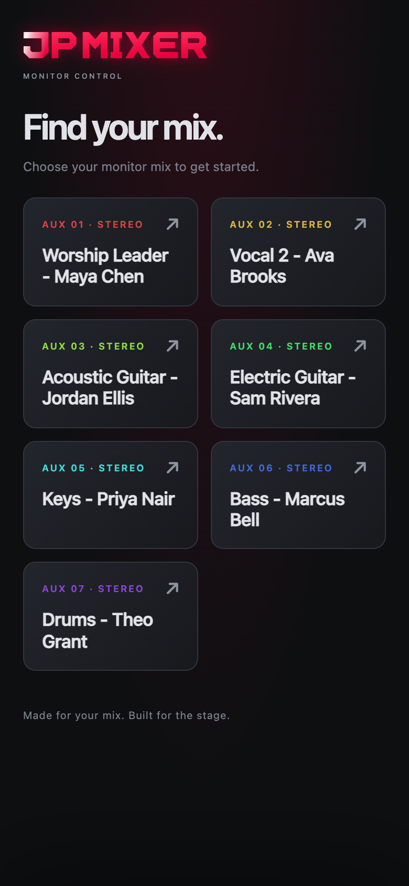
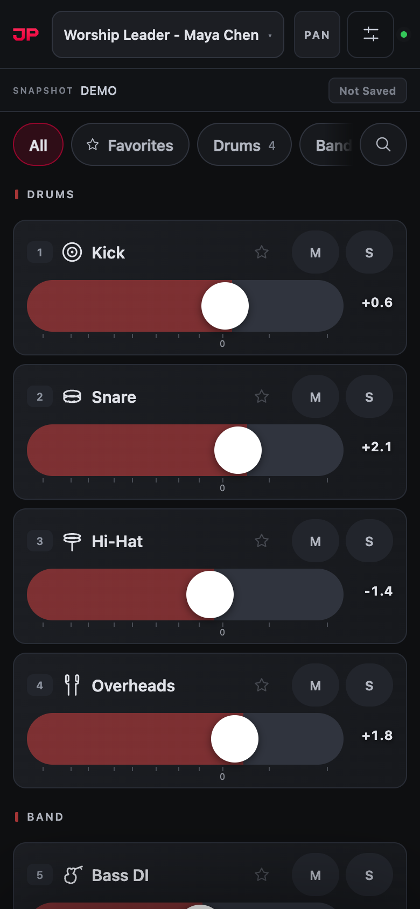
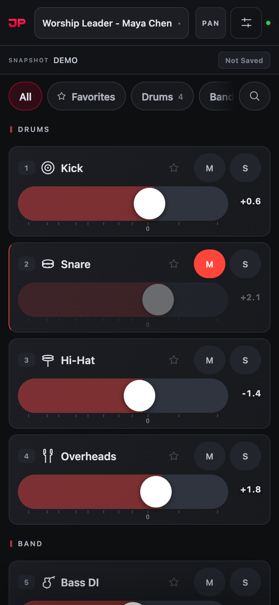
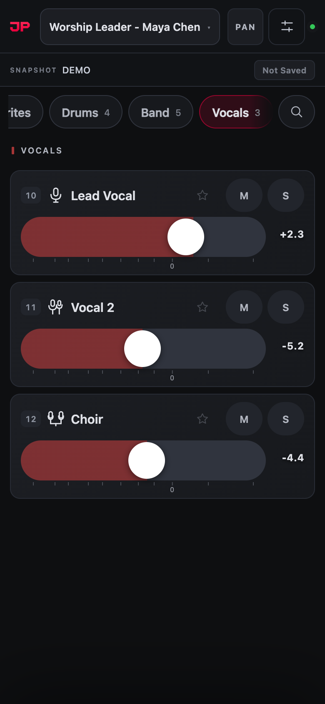
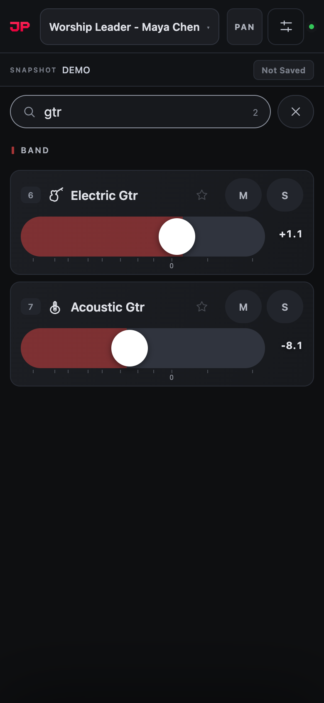
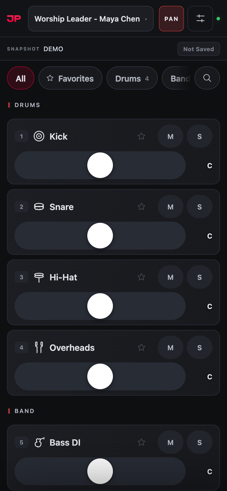
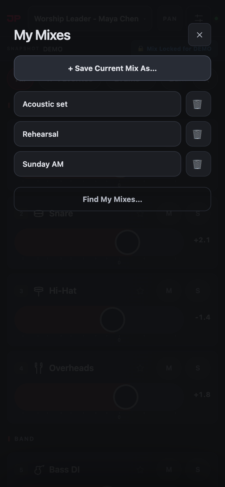
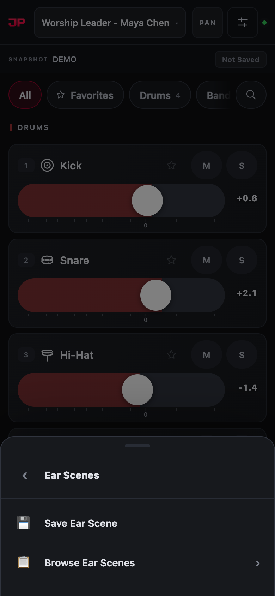
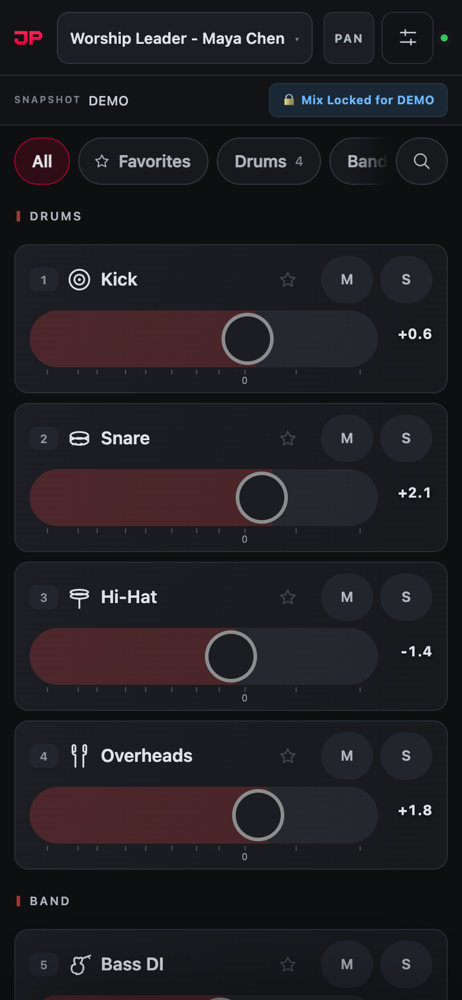
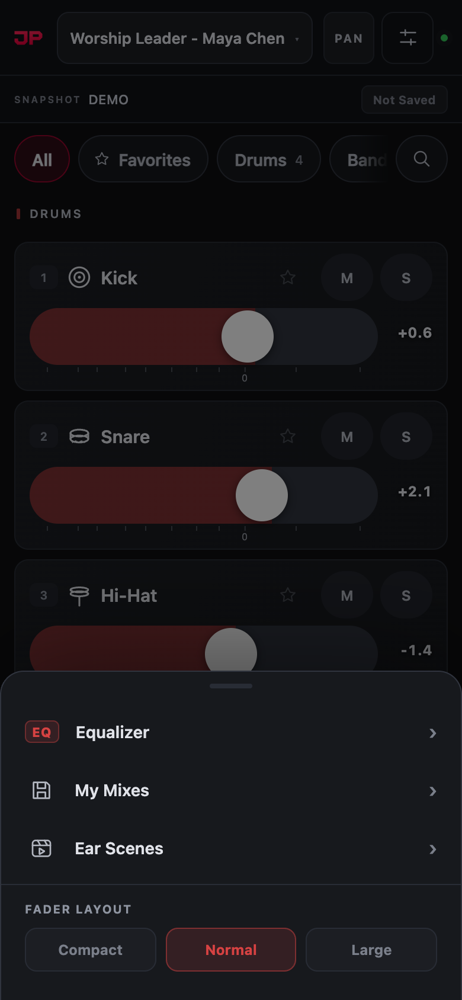

  <picture>
    <source media="(prefers-color-scheme: dark)" srcset="../assets/brand/jpmixer-logo-dark.gif" />
    
  </picture>

# Your mix, on your phone

**JPMixer Musician Guide · Version 2.0.13**

A quick guide for musicians and singers. JPMixer lets you set the level of every channel in your own in-ears or wedge, without touching the main mix and without installing an app.

> A designed copy of this guide, made for reading on a phone, is in [musician/index.html](musician/index.html). Sound teams: setup is in the [User Manual](MANUAL.md).

**Jump to:** [Get connected](#1-get-connected) · [The screen](#2-the-screen-at-a-glance) · [Mixing](#3-mixing-a-channel) · [Finding channels](#4-finding-channels) · [Pan](#5-pan-stereo-in-ears) · [Saving mixes](#6-saving-your-mix-my-mixes) · [Ear Scenes](#7-ear-scenes-a-mix-for-each-song) · [Menu](#8-more-in-the-menu) · [Help](#9-quick-help)

---

## 1. Get connected

1. Join the stage **Wi-Fi**. Your sound team will tell you which one. Mobile data won’t work.
2. Open your browser (Safari on iPhone) and type the address your sound team gives you, for example `192.168.1.20`.
3. Tap your name in the list of mixes. That’s it: you’re mixing.

<table><tr>
<td width="42%"> Pick the mix with your name on it</td>
<td>

Each button is one monitor mix. If your sound team uses Planning Center, your name is already on yours, like **Keys - Priya Nair**.

Next time you open the address, your phone goes straight back to the same mix.

**Make it an app:** on iPhone or iPad, tap **Share**, then **Add to Home Screen**. JPMixer then opens full screen from its own icon and stays connected when your screen locks.

</td>
</tr></table>

---

## 2. The screen at a glance

Everything on the screen, top to bottom. Each channel in your mix has its own card.

<table><tr>
<td width="42%"></td>
<td>

| | Part | What it does |
|---|---|---|
| **Top** | **Your mix** (the name) | Whose mix you’re on. Tap it to switch mixes. |
| | **PAN** | Shows pan sliders instead of levels, for stereo in-ears. |
| | **Menu** (the sliders icon) | My Mixes, Ear Scenes, fader size, and EQ if allowed. |
| | **Connection light** | Green means you’re connected. |
| | **Snapshot** | The song or scene the sound desk is on now. |
| | **Ear Scene button** | Whether your mix is saved for this song. |
| | **Groups** | Show only Drums, Vocals, Favorites… Swipe for more. |
| | **Search** (magnifying glass) | Find a channel by name. |
| **Each channel** | **Number, icon, name** | Which channel it is. |
| | **Star** | Adds it to your Favorites. |
| | **M** and **S** | Mute it, or solo it, in your mix only. |
| | **Fader** | Slide right for more, left for less. |
| | **Level** | In dB; **0** is the middle mark. Tap it to type a level. |

</td>
</tr></table>

---

## 3. Mixing a channel

<table><tr>
<td width="42%"> Snare muted: M lights red and the fader dims</td>
<td>

**Move a fader**
- **Drag sideways** on a fader to change the level: right is louder, left is quieter.
- **Swipe up and down** to scroll through your channels. That never moves a fader.
- **Tap the level number** to type an exact level, like `-6`, or `-inf` for off.

**Mute and solo**
- **M** mutes that channel in your mix. Tap again and it comes back at exactly the same level.
- **S** solos it: you hear only that channel. Solo a few to hear just those. Tap again to hear everything.

</td>
</tr></table>

> [!WARNING]
> **Double-tapping a fader sets that channel to 0 dB.** If it was down low, it gets louder in your ears straight away. To turn a channel off, drag it all the way left, or tap the level number and type `-inf`.

> [!TIP]
> Everything you do here changes **your** mix only. You can’t affect the main speakers or anyone else’s ears.

> [!TIP]
> If your sound team has linked your wireless mic or pack to your mix, its battery shows at the top of your mix: **Good**, **Replace** (amber) or **Critical** (red). Tell the sound team if it says Replace or Critical.

---

## 4. Finding channels

<table><tr>
<td width="50%" align="center"> Tap a group to see just those channels</td>
<td width="50%" align="center"> Search finds any channel by name</td>
</tr></table>

- **Groups:** tap **Drums** or **Vocals** to see only those channels. Tap more than one to see them together, and **All** to see everything again.
- **Favorites:** tap the **star** on the channels you adjust most, then tap **★ Favorites** to see just those.
- **Search:** tap the magnifying glass and type part of a name. Search always looks through every channel.

Your mix may open on the groups your sound team chose for you, such as Drums and Click for the drummer. Your own choice is remembered on your phone.

---

## 5. Pan (stereo in-ears)

<table><tr>
<td width="42%"> PAN on: each slider places a channel left or right</td>
<td>

If your mix is stereo, tap **PAN** at the top. Each channel’s slider now moves it left or right in your ears. **C** means centre.

Tap **PAN** again to go back to levels. Mixes marked **MONO** in the mix list have no pan.

</td>
</tr></table>

---

## 6. Saving your mix: My Mixes

<table><tr>
<td width="42%"> Menu → My Mixes</td>
<td>

Save a mix you like and bring it back any week, on any mix.

1. Tap the **menu** button, then **My Mixes**.
2. Tap **+ Save Current Mix As…**, give it a name like “Sunday AM”, and add your name.
3. Next time, open My Mixes and **tap the name** to load it.

**New phone, or your mixes are gone?** Tap **Find My Mixes…** and search for your name. JPMixer keeps a copy of every saved mix.

</td>
</tr></table>

---

## 7. Ear Scenes: a mix for each song

An Ear Scene is your mix saved for one song (one **snapshot** on the sound desk). When the desk goes to that song again, your mix for it comes back by itself.

<table><tr>
<td width="50%" align="center"> Menu → Ear Scenes → Save Ear Scene</td>
<td width="50%" align="center"> Saved: the mix locks so it can’t be bumped</td>
</tr></table>

1. While the snapshot shows the song you want, set your mix.
2. Tap the **menu** button, then **Ear Scenes**, then **Save Ear Scene**.

The button next to the snapshot name tells you where you stand:

| Button | What it means |
|---|---|
| **Not Saved** | No Ear Scene for this song yet. |
| **🔒 Mix Locked for …** | Saved and locked: faders won’t move if you bump them. **Tap the button** to unlock. |
| **🔓 Unlocked — Editing** | You can change the mix. Tap again to lock it. |
| **↺ Changed Since Save** | You’ve changed it since you saved. Tap to go back to the saved mix, or choose **Update Ear Scene** in the menu to keep the new one. |

**Browse Ear Scenes** lists every song you’ve saved, so you can fix next week’s opener without the desk being on it. If you don’t see Ear Scenes at all, your sound team has turned them off.

---

## 8. More in the menu

<table><tr>
<td width="42%"> The menu</td>
<td>

- **Fader Layout:** Compact, Normal or Large. Large is easier on a small phone.
- **Equalizer:** shape the tone of your whole mix, if your sound team has turned EQ on for it. Tap a band on the curve, then adjust its frequency, gain and width.
- **My performer:** if your church uses it, choose your name once and your phone opens your mix by itself every week.

</td>
</tr></table>

---

## 9. Quick help

**The screen says Reconnecting…**
Your phone lost the Wi-Fi for a moment. Wait a few seconds; it reconnects by itself and keeps your mix. If it doesn’t, check you’re on the stage Wi-Fi.

**A fader won’t move**
Your mix is locked to its Ear Scene. Tap the 🔒 button at the top to unlock it. And remember to drag sideways, not up and down.

**A channel is missing**
Tap **All** to clear any group, and clear the search box. If it’s still missing, ask your sound team; they may have hidden it.

**I can’t hear a channel**
Check its **M** isn’t red, no other channel is on **S** solo, and its fader isn’t all the way left.

**My mix isn’t in the list**
Some mixes only open from their own link. Ask your sound team for yours.

**My saved mixes are gone**
Use the same address as before, then Menu → My Mixes → **Find My Mixes…** and search for your name.

---

Screens show a demo setup; every name is fictional.
