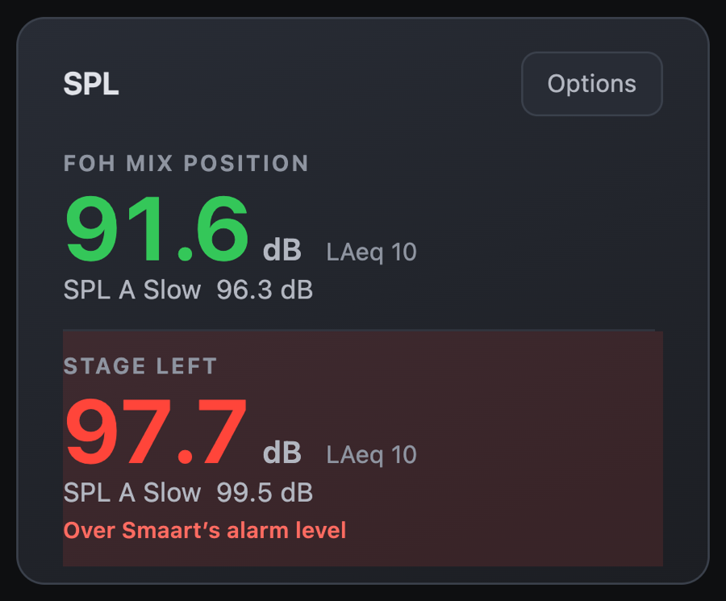

# JPMixer plugins

Plugins add things JPMixer doesn't do itself. Install only the ones you use: each runs in its own process, so if one stops working, JPMixer and the console carry on. Find them in JPMixer under **Settings → Plugins → Find plugins**.

Plugins marked **JPMixer Original** are JPMixer's own, as long as their files are the approved ones. Each plugin has its own switch in Settings → Plugins, and starts off.

| | Plugin | What it does |
|---|---|---|
|  | **[Patch](patch.md)** · JPMixer Original | Patch screens for your stage boxes, drawn to scale. Import an LV1 or DiGiCo session or a dLive show, and see 48V at a glance. |
|  | **[Shure wireless](shure.md)** · JPMixer Original | Each wireless mic's battery and transmitter on FOH Home, the musician's phone, Monitor Engineer and the Green Room. |
|  | **[Smaart SPL](smaart.md)** · JPMixer Original | Live sound levels from Smaart on FOH Home and the Green Room. |
|  | **[Companion buttons](companion.md)** · JPMixer Original | Bitfocus Companion buttons on each Home page, live. Tap to press. |
|  | **[Console check](console-check.md)** · Example | Whether the console is connected, on FOH Home. The example for making your own. |

Planning Center isn't a plugin: it's built into JPMixer. It's listed with the plugins in Settings, and it can be turned off in its tab.

## Updates

When a plugin has a new version, a red dot appears next to **Plugins** in Settings' sidebar, and the plugin's row has an **Update** button. Updating keeps its settings.

## Making a plugin

See the [plugin guide](../PLUGINS.md): how a plugin is made, by hand or with an AI assistant, what it can and can't do, and how to submit one for the approved list.

---

[User Manual](../MANUAL.md) · [JPMixer on GitHub](../../README.md)
