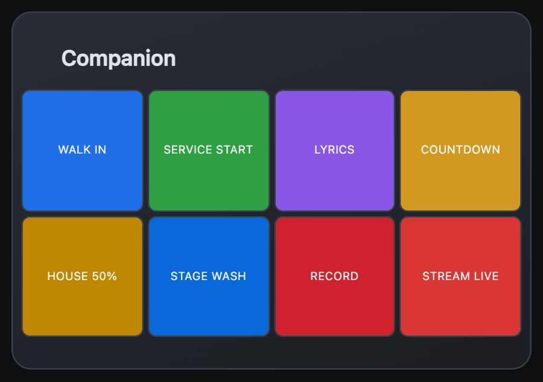
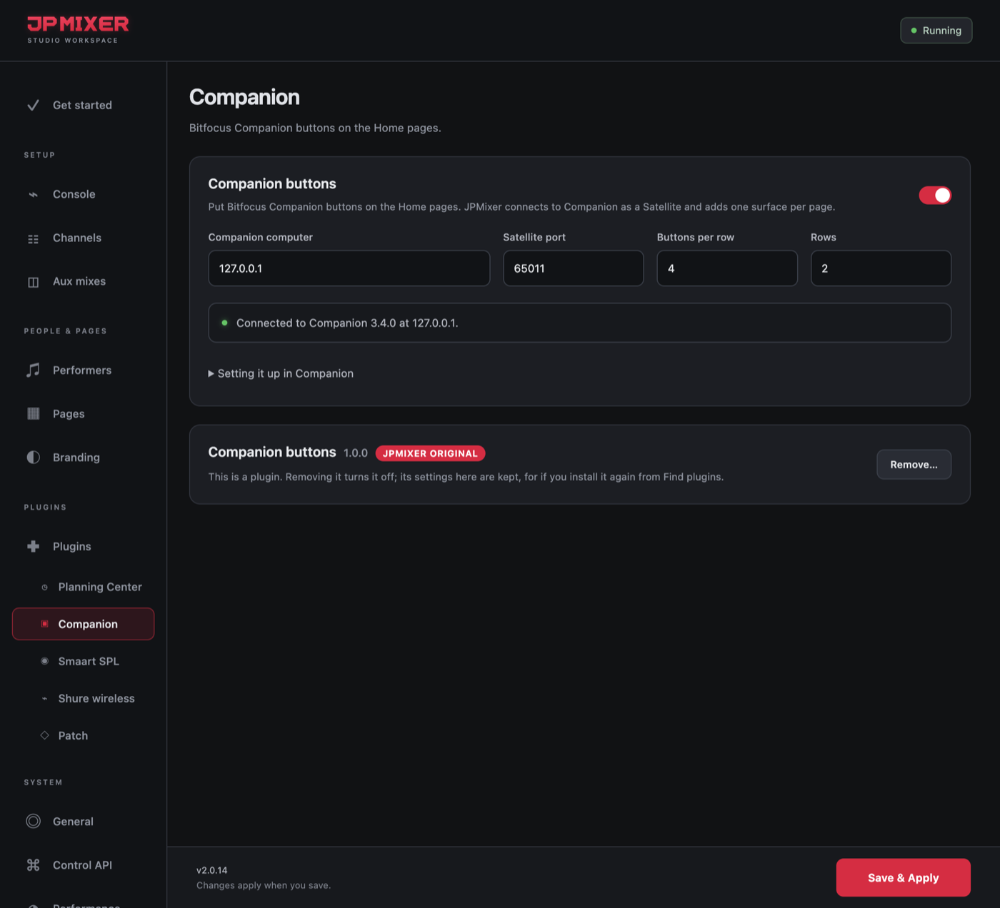

# Companion buttons

**A JPMixer Original plugin** · version 1.0.0 · needs JPMixer 2.0.14 or later

Bitfocus Companion buttons on JPMixer's Home pages, live. Each Home page (FOH, ProPresenter, Lighting and Switcher) is a button surface in Companion, and a tap on the page presses the button, the same as a Stream Deck.

## What it does

- **One surface per Home page.** In Companion, each shows up under **Surfaces** as "JPMixer FOH Home", "JPMixer Lighting Home" and so on, and can be given its own page of buttons.
- **Live buttons:** each button's look reaches the page as Companion shows it.
- **Tap to press, hold to hold.** One tap presses once on phones and iPads, even a tap that slides a little. On a phone, a swipe that starts on a button scrolls the page without pressing it.
- **Keeps going:** JPMixer reconnects by itself if Companion restarts, and the page catches up when a phone wakes up.
- **FOH's buttons stay FOH's:** with an FOH code set, only someone with the code can see or press them.

## Install it

1. In JPMixer, open **Settings → Plugins**.
2. Under **Find plugins**, click **Install** next to **Companion buttons**. It comes with JPMixer, so it installs even with no internet.
3. Select **Companion** under Plugins in the sidebar.

If you used Companion buttons before JPMixer 2.0.14, it moved over by itself when you updated, with its settings.

## Set it up

1. In Companion (3.0 or newer), allow Satellite connections. The port is TCP `16622` unless you changed it.
2. In JPMixer's **Companion** tab, turn it on, enter the Companion computer's address (`127.0.0.1` if it's this computer), and choose the grid (8 × 4 by default). Click **Save & Apply**. The status should say Connected.
3. In Companion, open **Surfaces** and give each JPMixer surface the page of buttons that station needs.

## What it can do

It only feeds JPMixer's own pages and Settings, which only official JPMixer plugins can do. It can't read JPMixer's other settings or passwords.

## Updating and removing

When a new version is out, a red dot appears next to **Plugins** in the sidebar, and its row has an **Update** button. To remove it, click **Remove…** in its tab, on its row, or in Find plugins. Removing it turns it off and keeps its settings, for if you install it again.

---

[All plugins](README.md) · [User Manual](../MANUAL.md) · [JPMixer on GitHub](../../README.md)
