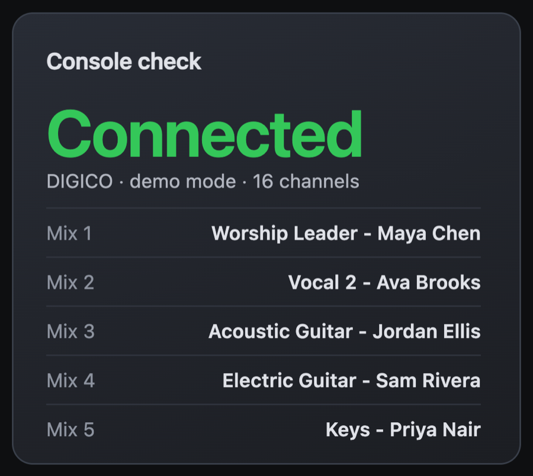

# Console check

**An example plugin** · version 1.0.0

A card on FOH Home that says whether the console is connected, which console it is, and the names of its mixes. It's small on purpose: it's the example to read if you're making a plugin of your own.

## Install it

1. In JPMixer, open **Settings → Plugins**. Under **Find plugins**, click **Install** next to **Console check**.
2. Select **Console check** under Plugins in the sidebar, turn it on, and click **Save & Apply**. The card appears on FOH Home, and can be arranged like any other.

## What it can do

- Show a card on FOH Home.
- See channel, control group and mix names, each channel's 48V, and whether the console is connected.

## Making your own

Its code is in [`plugins/console-check`](../../plugins/console-check). The [plugin guide](../PLUGINS.md) shows how to make a plugin, by hand or with an AI assistant, and how to submit one for the approved list.

---

[All plugins](README.md) · [User Manual](../MANUAL.md) · [JPMixer on GitHub](../../README.md)
