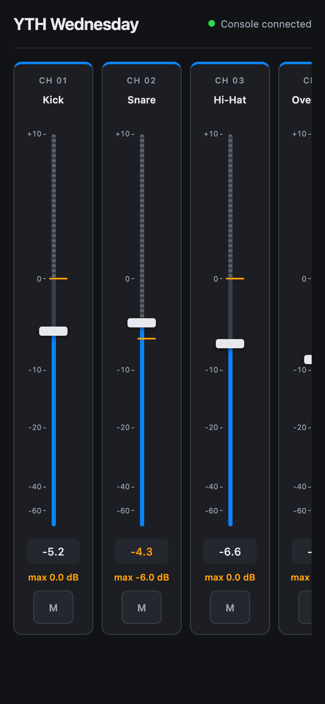
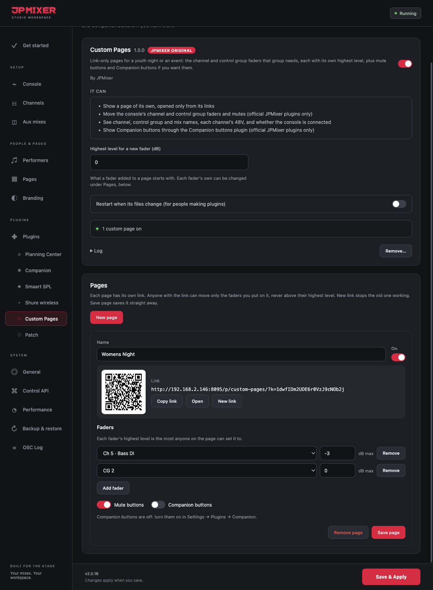

# Custom Pages

**A JPMixer Original plugin** · version 1.0.1 · needs JPMixer 2.0.16 or later

Link-only pages for a youth night, a women's event or anything else that runs its own sound. Each page has just the faders that group needs, and every fader has its own highest level, so nobody on the page can push it past that. Mute buttons and a Companion card can be added to each page.

- **Faders:** console channels and control groups (DCAs), on DiGiCo, dLive and LV1. They look like the Console Controller's strips, side by side in a row that scrolls sideways; drag a fader up or down, swipe sideways for more.
- **The highest level** is checked by JPMixer, not by the page. If the engineer has a fader above it on the desk, the page can bring it down but not back up.
- **Links:** each page has a secret link and a QR code. **New link** stops the old one working straight away. A page that's off shows that it isn't available.
- **Not listed:** custom pages aren't on the Home pages list. They open only from their links.

## Setting up

1. In JPMixer, open **Settings → Plugins → Find plugins** and click **Install** on Custom Pages. Turn it on.
2. Open its tab under **Plugins** (Settings → Plugins → Custom Pages). The pages are set up there, under **Pages**, on the JPMixer computer only.
3. Click **New page** and give it a name.
4. Click **Add fader** for each channel or control group, and give each one its highest level in dB.
5. Tick **Mute buttons** for a mute on each fader, and **Companion buttons** for a card of buttons (see below).
6. Click **Save page**, then share the link or the QR code (**Copy link**, or **Open** to try it).

## Companion buttons

Custom Pages' Companion buttons go through the [Companion buttons](companion.md) plugin, which has the connection to Bitfocus Companion. Set that up first; there's nothing to enter in Custom Pages.

1. Install **Companion buttons**, turn it on, and enter the Companion computer's address in its tab (Settings → Plugins → Companion). If only the custom pages need Companion, turn off **Home page surfaces** there: the four Home page surfaces are then left out.
2. On a custom page, tick **Companion buttons**, and choose how many columns and rows.
3. In **Companion → Surfaces**, give the new surface, "JPMixer" and the page's name, a page of buttons.

If Companion buttons isn't installed, is off, or is too old (custom pages need 1.1.0 or later), the plugin's tab and the page say so. Turning Companion buttons on updates an older copy by itself.

## Settings

| Setting | What it's for |
|---|---|
| Highest level for a new fader (dB) | What a fader added to a page starts with. Each fader's own can be changed under Pages, in the same tab. |

## Good to know

- With a **Console Controller code** set (Settings → Pages), the Console Controller still needs it. Custom Pages don't: their faders are only the ones you put on them, capped.
- Taking a fader off a page, or turning a page off, takes effect at once on every phone that has it open.

---

[All plugins](README.md) · [User Manual](../MANUAL.md)
