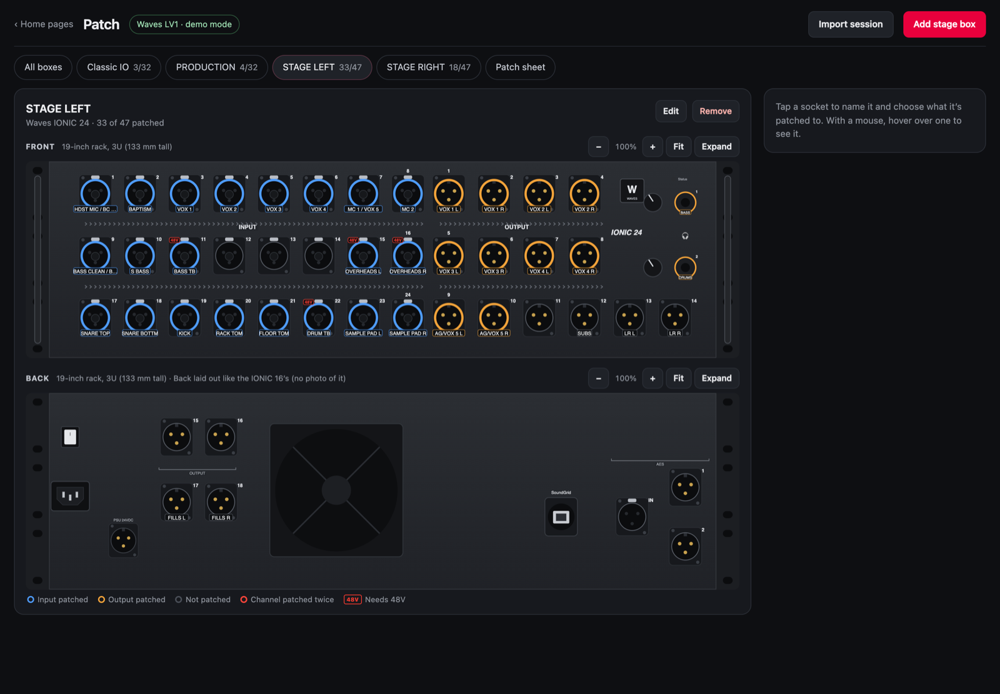
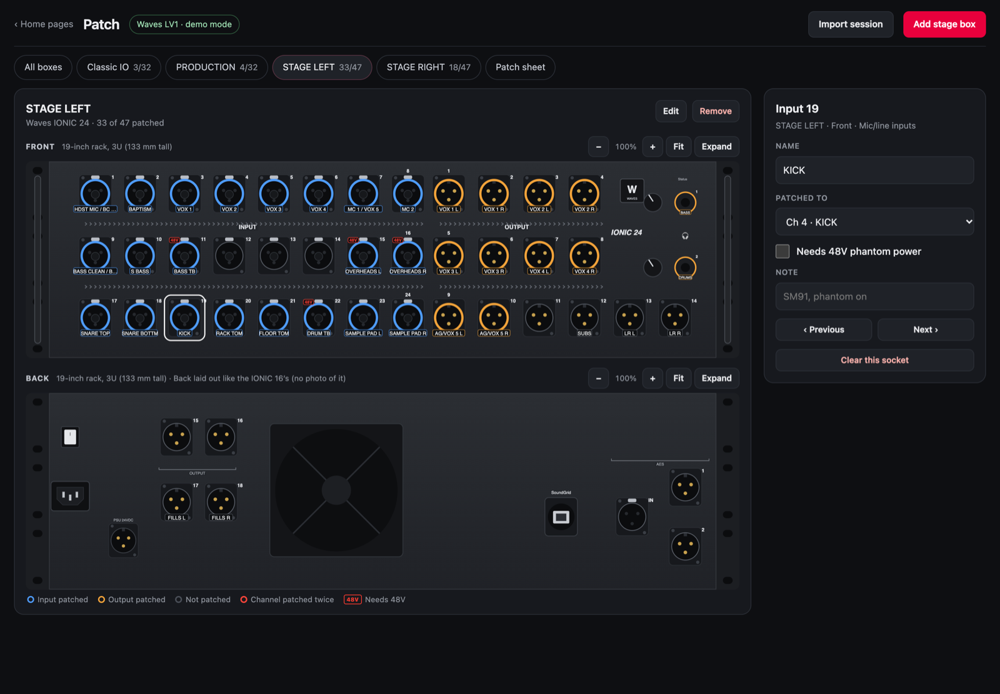
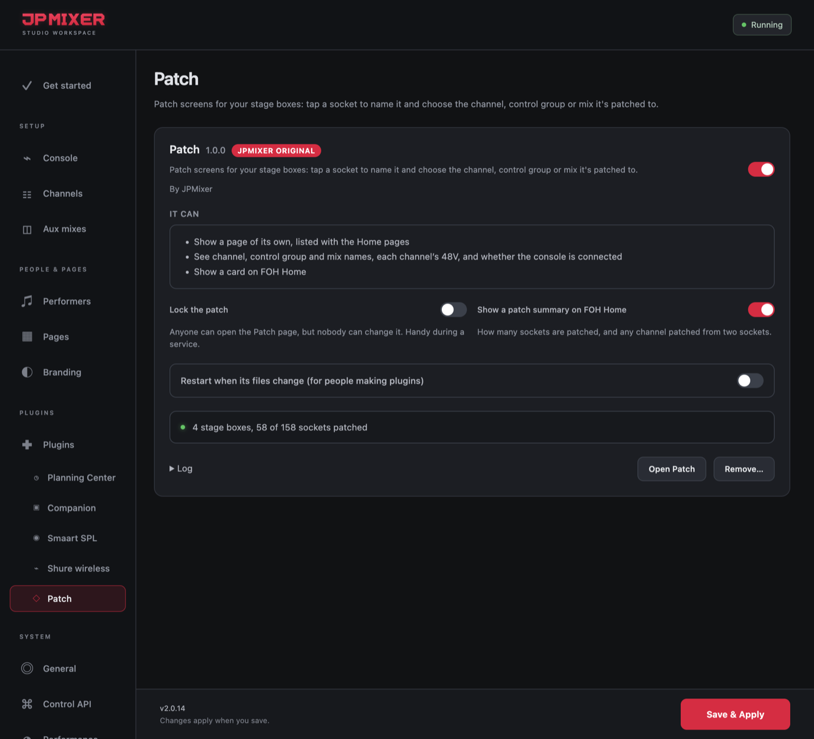
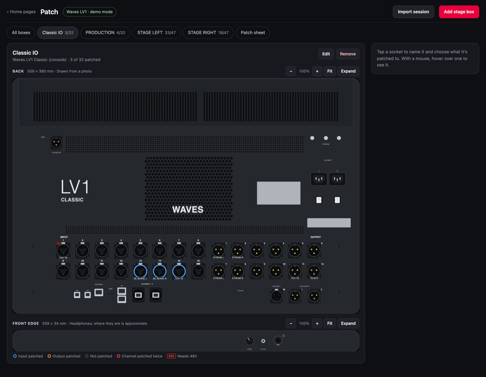
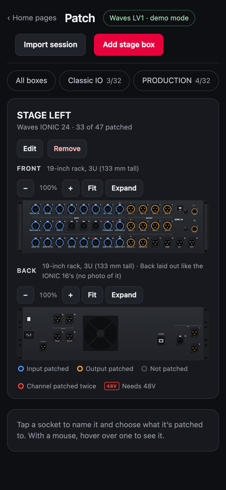
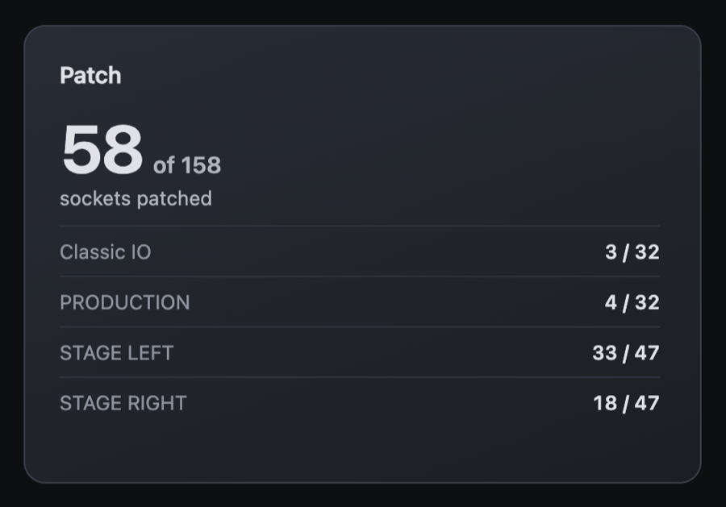

# Patch

**A JPMixer Original plugin** · version 1.0.0 · needs JPMixer 2.0.13 or later

Patch screens for your stage boxes. Every box on your stage is drawn to scale. Tap a socket to name it and choose the channel, control group or mix it's patched to. Anyone on the team can open it on a phone, iPad or computer, and every screen shows and edits the same patch.

Pictures on this page: an LV1 session imported into Patch.

## What it does

- **Your boxes, drawn as they are.** DiGiCo racks (D-Rack, D2-Rack, DQ-Rack, MQ-Rack, SD-Rack, SD-MiNi, SD-Nano and the 4REA4 boxes), Waves SoundGrid boxes for eMotion LV1 (IONIC 16 and 24, DiGiGrid IOX and IOS), and the back of the console itself: every current DiGiCo, and the LV1 Classic. A generic box can have any number of inputs and outputs.
- **Tap a socket to patch it.** Give it a name and choose what it's patched to. The lists use your console's own channel and mix names. With a mouse, hover over a socket to see what's on it.
- **Import a session.** Choose an LV1 session (`.emo`) or a DiGiCo session (`.ses`), and its stage boxes come in with every socket named and patched. The file is read in your browser; nothing is sent anywhere.
- **48V at a glance.** Mark a mic input as needing 48V. On a DiGiCo or LV1, JPMixer also hears each channel's 48V from the desk, and warns when a socket needs 48V that's off at the desk.
- **Checks.** A channel patched from two sockets is marked in red.
- **A patch sheet** to print, or download as a spreadsheet (CSV).
- **Lock the patch** to make it view-only during a service.
- **A summary on FOH Home**, if you want one.

## Install it

1. In JPMixer, open **Settings → Plugins**.
2. Under **Find plugins**, click **Install** next to **Patch**.
3. Select **Patch** under Plugins in the sidebar, turn it on, and click **Save & Apply**.
4. Open **Patch** from the Home pages list on any phone, iPad or computer, or click **Open Patch** in its Settings tab.

It runs without **Allow plugins**, as long as it's the approved copy.

## Add your stage boxes

- **From a session:** click **Import session** and choose the session file.
  - **LV1:** every stage box in the session is added, drawn as itself, with stereo channels across two sockets. Importing again updates those boxes and keeps your own notes and 48V marks.
  - **DiGiCo:** the console's own I/O comes in as the back of that console. A session doesn't say which rack is on each port, so the preview asks (a DQ-Rack by default). Channels from playback computers and other Dante devices go on a box of their own, or can be left off.
- **By hand:** click **Add stage box**, choose the model, and patch each socket.

## On a phone

Each box fits the screen; zoom in to tap a socket.

  &nbsp;&nbsp;
  

## What it can do

- Show a page of its own, listed with the Home pages.
- See channel, control group and mix names, each channel's 48V, and whether the console is connected.
- Show a card on FOH Home.

It can't read JPMixer's settings or passwords, and it never changes anything on the console.

## Updating and removing

When a new version is out, a red dot appears next to **Plugins** in the sidebar, and its row has an **Update** button. Your patch is kept. To remove it, click **Remove…** on its row, in its tab, or in Find plugins.

---

[All plugins](README.md) · [User Manual](../MANUAL.md) · [JPMixer on GitHub](../../README.md)
