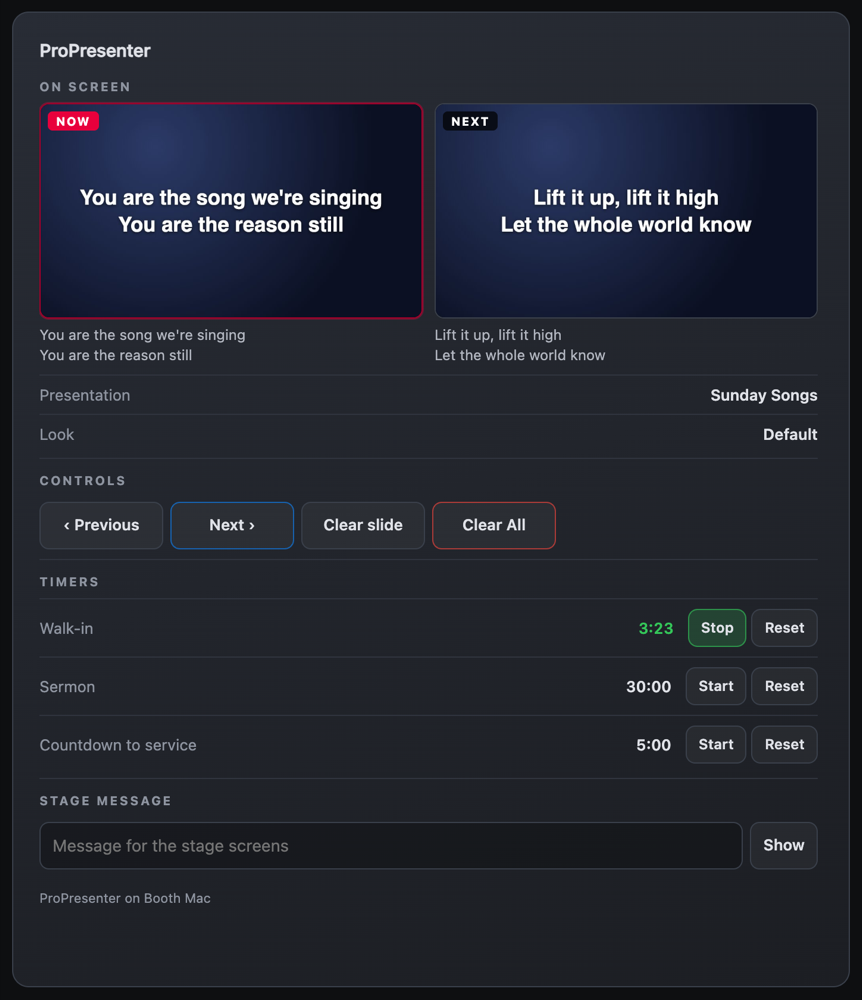

# ProPresenter

**A JPMixer Original plugin** · version 1.1.2 · needs JPMixer 2.0.19 or later, and ProPresenter 7.9 or later

A ProPresenter controller on every Home page, with pictures of the current and next slide, plus cards for every timer, audience messages, and macros and Looks, for the whole team. It talks to ProPresenter through ProPresenter's own network API, the one Renewed Vision's ProPresenter Control uses.

## What it does

- **ProPresenter card, a controller in four parts** (version 1.1.0):
  - **On screen:** pictures of the current slide (**Now**) and the next one (**Next**), as they look on screen, with their words under them; or the image or video from the Media bin that's on screen. The presentation and the live Look.
  - **Controls:** **‹ Previous** and **Next ›** through the active playlist, **Clear slide**, **Clear media** (while media is up), and ProPresenter's **Clear All**.
  - **Timers:** up to four, running ones first, each with **Start** (or **Stop**) and **Reset**.
  - **Stage message:** type a message for the stage screens and select **Show**; **Clear stage message** takes it off.
- **Timers card:** every one of ProPresenter's timers, counting live, with its own **Start** (or **Stop**) and **Reset**.
- **Audience messages card:** each of ProPresenter's messages with **Show** / **Hide**. They show with the text they have in ProPresenter. The card appears once ProPresenter has a message.
- **Macros & Looks card:** a button for each macro, and under **Looks** one for each Look, with the live Look marked.
- **Running timers at the top.** While a ProPresenter timer runs, it shows under the header of every Home page and next to the clock on the Green Room screen, in red once it's past zero. Turn it off with **Running timers at the top of the pages** on the plugin's tab. Version 1.0.2.
- **On every Home page.** FOH, ProPresenter, Lighting, Switcher, Producer and any Home page added for another role. Hide a card on a page with **Arrange page**, like any other card.
- **Keeps going:** if ProPresenter closes or the network drops, the cards say so, and JPMixer reconnects by itself.

## Install it

1. In JPMixer, open **Settings → Plugins**.
2. Under **Find plugins**, click **Install** next to **ProPresenter**.
3. Select **ProPresenter** under Plugins in the sidebar.

## Set it up

1. In ProPresenter, open **Settings → Network** and turn on **Enable Network**. Note the **IP Address** and **Port** it shows. (ProPresenter Remote and the Stage App don't need to be on, and their passwords aren't used.)
2. In JPMixer's **ProPresenter** tab, turn it on, enter that address (leave it blank if ProPresenter runs on the JPMixer computer) and the port, then click **Save & Apply**. The status line should say Connected.
3. Open any Home page. The cards are there; use **Arrange page** to place or hide them.

## Good to know

- Anyone who can open a Home page can use the buttons, as with ProPresenter Control. On FOH Home, an FOH code (Settings → Pages) covers them too.
- The ProPresenter computer and the JPMixer computer need to be on the same network.
- Up to 8 timers, 20 audience messages, and 24 macros and Looks are shown.

## What it can do

It shows cards on the Home pages, its running timers at the top of the Home pages and the Green Room, and talks to ProPresenter on the network. It can't see the console, Planning Center, or JPMixer's other settings.
