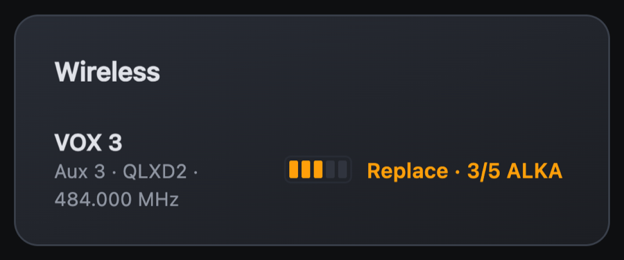
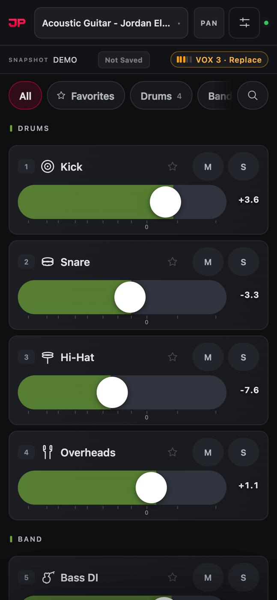
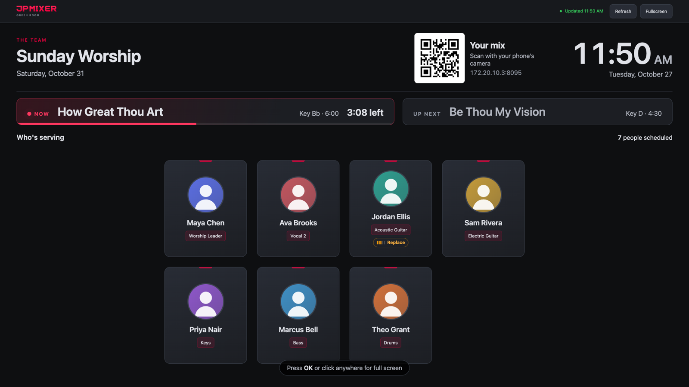
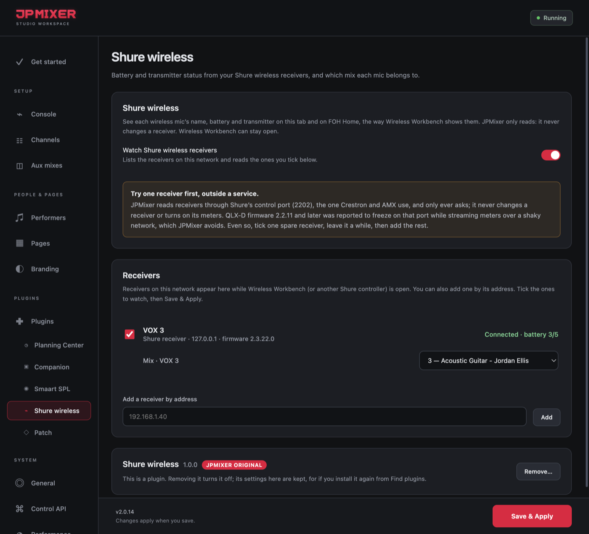

# Shure wireless

**A JPMixer Original plugin** · version 1.0.0 · needs JPMixer 2.0.14 or later

Each Shure wireless mic's name, battery and transmitter, the way Wireless Workbench shows them. It's on FOH Home's Wireless card, on each musician's phone, in Monitor Engineer next to the mix, and on the Green Room TV.

  &nbsp;&nbsp;
  

## What it does

- **Works with** QLX-D, ULX-D, SLX-D and Axient Digital receivers.
- **Batteries at a glance:** **Good** (4–5 bars), **Replace** (3, amber) or **Critical** (0–2, red), with run time on Shure rechargeables.
- **Transmitter off?** The card says so, and for half an hour shows what its battery was.
- **Each mic on its own mix:** give a mic the mix it belongs to, and its battery shows on that musician's phone and in Monitor Engineer.
- **Only reads.** JPMixer only sends Shure's GET strings on the receiver's control port (TCP 2202). It never changes a receiver or turns on its meters, and Wireless Workbench can stay open.

## Install it

1. In JPMixer, open **Settings → Plugins**.
2. Under **Find plugins**, click **Install** next to **Shure wireless**. It comes with JPMixer, so it installs even with no internet.
3. Select **Shure wireless** under Plugins in the sidebar.

If you used Shure wireless before JPMixer 2.0.14, it moved over by itself when you updated, with your receivers and mixes.

## Set it up

1. Turn on **Watch Shure wireless receivers**. Receivers on the network appear while Wireless Workbench is open. You can also add one by its address.
2. **Tick one spare receiver first,** outside a service, and click **Save & Apply**. Leave it a while, then tick the rest.
3. Under each ticked receiver, choose the **Mix** its mic belongs to.

Every receiver JPMixer sees is remembered by its hardware id, so it's still listed after a restart, and still found if its address changes.

## What it can do

It only feeds JPMixer's own pages and Settings, which only official JPMixer plugins can do. It can't read JPMixer's other settings or passwords.

## Updating and removing

When a new version is out, a red dot appears next to **Plugins** in the sidebar, and its row has an **Update** button. To remove it, click **Remove…** in its tab, on its row, or in Find plugins. Removing it turns it off and keeps your receivers and mixes, for if you install it again.

---

[All plugins](README.md) · [User Manual](../MANUAL.md) · [JPMixer on GitHub](../../README.md)
