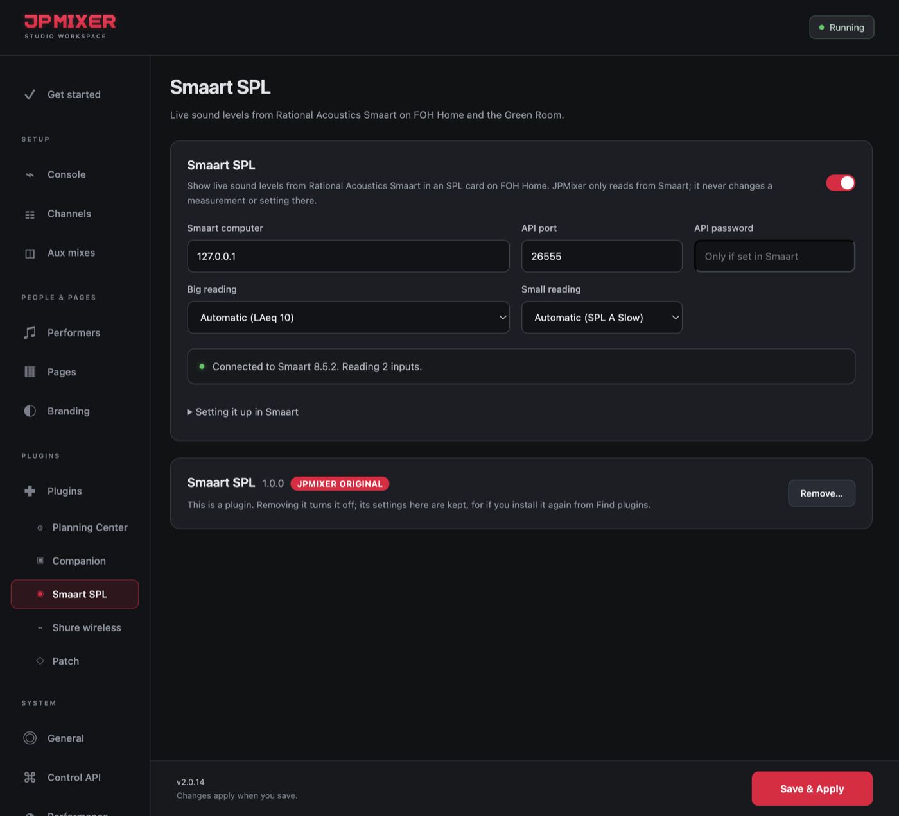

# Smaart SPL

**A JPMixer Original plugin** · version 1.0.0 · needs JPMixer 2.0.14 or later

Live sound levels from Rational Acoustics Smaart, in an SPL card on FOH Home and on the Green Room TV.

## What it does

- **Every input that's logging** in Smaart gets a big reading (LAeq 10 unless you choose another) and a small live one (SPL A Slow).
- **Smaart's own colors:** green, yellow or red by the levels set in Smaart. When one of Smaart's alarms trips, the input turns red and says *Over Smaart's alarm level*.
- **Your choice of readings:** click **Options** on the card to choose the big reading, the small one (or none), and which inputs show.
- **Works with** Smaart 8.4 or later, and Smaart 9 Suite or SPL. Smaart RT and LE don't share levels.
- **Only reads.** It never starts a measurement or changes a setting in Smaart.

## Install it

1. In JPMixer, open **Settings → Plugins**.
2. Under **Find plugins**, click **Install** next to **Smaart SPL**. It comes with JPMixer, so it installs even with no internet.
3. Select **Smaart SPL** under Plugins in the sidebar.

If you used Smaart SPL before JPMixer 2.0.14, it moved over by itself when you updated, with its settings.

## Set it up

1. In Smaart, open **Options → Preferences → API** and tick **Enabled**. The port is `26000` unless you changed it. Hover over **IP Address** there to see the Smaart computer's address.
2. In Smaart, start SPL logging on a calibrated mic input.
3. In JPMixer's **Smaart SPL** tab, turn it on and enter the Smaart computer's address. Leave the password empty unless one is set in Smaart's API tab. Click **Save & Apply**. The status should say Connected, and how many inputs it's reading.

## What it can do

It only feeds JPMixer's own pages and Settings, which only official JPMixer plugins can do. It can't read JPMixer's other settings or passwords.

## Updating and removing

When a new version is out, a red dot appears next to **Plugins** in the sidebar, and its row has an **Update** button. To remove it, click **Remove…** in its tab, on its row, or in Find plugins. Removing it turns it off and keeps its settings, for if you install it again.

---

[All plugins](README.md) · [User Manual](../MANUAL.md) · [JPMixer on GitHub](../../README.md)
